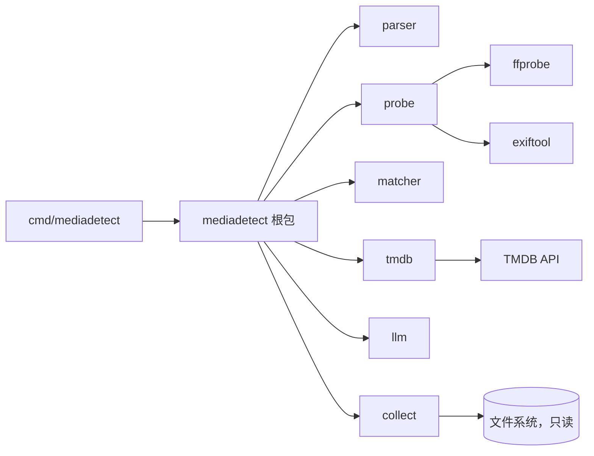
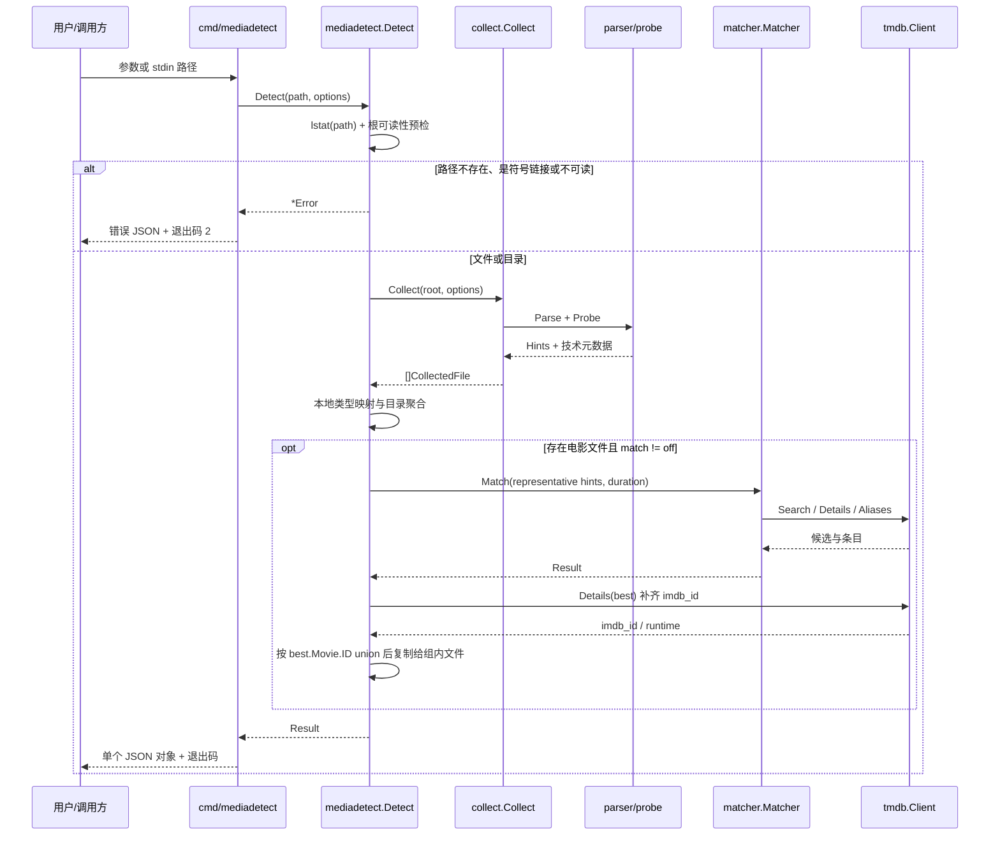

# MediaDetect 媒体检测库与 CLI 技术方案

| 字段 | 内容 |
| --- | --- |
| 标题 | MediaDetect 媒体检测库与 CLI 技术方案 |
| 主笔 | alang |
| 评审人 | alang |
| 创建日期 | 2026-11-11 |
| 目标版本 | v0.1.0 |
| 关联资源 | Go module `github.com/dream-365/MediaDetect`；TMDB API；合成/匿名测试语料；`docs/quality/SPEC-001/` 质量报告 |

## 1. 背景与目标

### 1.1 问题

媒体库工具、脚本和其他服务经常需要回答一个很窄的问题：给定一个文件或目录，它是什么媒体类型、对应哪个条目、IMDb ID 是什么。常见实现把检测逻辑嵌在索引器或扫描器里，导致：

* 单路径检测必须先建索引或扫描整个根，成本远高于问题本身。
* 标题归一化、类型映射、TMDB 匹配和探测封装散落在多个内部包，外部无法复用。
* 检测结果被写入数据库或缓存，调用方拿不到稳定的结构化输出。
* 不同工具各自复制规则，类型判断和匹配结果逐渐分叉。

MediaDetect 把这些能力收敛为一个独立 Go module 和一个无状态 CLI。

### 1.2 设计目标

* 输入一个文件或目录，输出单个 JSON 对象。
* 只读访问输入树，不创建索引、数据库、缓存或临时文件。
* 本地类型识别覆盖电影、剧集、季、系列、合集、混合、非正片、附属和其他。
* 电影匹配复用 TMDB，返回候选、置信度和 `imdb_id`；剧集只做本地识别。
* 无 key、无网络、无探测工具时都能降级，不阻塞本地结果。
* 解析器、匹配器和探测层作为库 API 暴露，CLI 只是薄封装。

### 1.3 非目标

* 不建索引、不写 SQLite、不做查询服务。
* 不移动、重命名、删除、转码或写入任何媒体文件。
* 不做 TMDB 剧集匹配，不导入全量 IMDb 数据集。
* 不提供 HTTP 服务、常驻进程或批处理协议。
* 不新增媒体类型规则或匹配算法；本版本的 parser 修正范围见 4.5.1.1。

## 2. 目标与非目标

### 2.1 目标

* **G1 - 无状态 CLI 契约（架构/接口）**：`mediadetect <path>` 和 `mediadetect -` 每次只输出一个 JSON 对象；不创建索引目录、不写 SQLite、不写缓存或临时文件；成功、降级、未匹配和错误都有稳定字段与退出码。验收方式：CLI golden 测试覆盖文件、目录、stdin、缺少参数、路径不存在、无 TMDB key、`--match=off` 七种场景；运行前后对输入树做内容/mtime/inode 快照，断言零写入。
* **G2 - 独立 detect 模块（架构/代码）**：公开仓库与 Go module `github.com/dream-365/MediaDetect`（仓库名 `MediaDetect`，MIT License）拥有自己的 `go.mod`，包含 `parser`、`probe`、`tmdb`、`matcher`、`internal/llm`、`internal/collect`、根包 `mediadetect` 和 `cmd/mediadetect`；模块不依赖任何私有项目；module path 大小写必须与仓库路径一致。包位置以 SPEC-002 §4.1 为准；G2 的其他验收不变。验收方式：`go test ./...` 通过；`go list -deps ./cmd/mediadetect` 不包含私有依赖；`go mod tidy -diff` 无差异；干净缓存下 `GOWORK=off go mod download github.com/dream-365/MediaDetect@vX.Y.Z` 成功（代理路径转义为 `github.com/dream-365/!media!detect`）；`go install github.com/dream-365/MediaDetect/cmd/mediadetect@vX.Y.Z` 可用。
* **G3 - 本地媒体类型识别（质量/指标）**：在运行前冻结的人工标注样本（≥100 个真实文件/目录）上，`movie`、`tv_episode`、`tv_season`、`tv_series`、`non_feature`、`auxiliary`、`other` 的总体准确率 ≥95%（不含附录 B 的已知限制桶），并分别报告每类 precision/recall；含已知限制桶的准确率也必须写入报告，但不作为门槛。映射契约测试：4.5.1 每条映射规则有单元测试；parser 已识别的显式剧集标记（`SxxExx`、中文“第 N 集”）在 type 映射上召回率 100%——这是契约测试，不作为真实世界准确率指标。4.5.1.1 的 parser 修正必须覆盖辅助类型优先、`sample`/`oad` 词边界、`ova` 误报、`1x01`/`S01.E01` 和全角斜杠/分数标题；连续多集 `S01E01E02`/`S01E01E02E03` 按 SPEC-003 G6 修复；未修正的裸数字集号、非连续 `S01E01E03` 等列入附录 B。验收方式：`docs/quality/SPEC-001/calibration-report.md` 给出冻结样本清单、混淆矩阵、逐类样本数、已知限制清单和错误清单；同时用 ≥60 条基于 parser 测试语料和目录 fixture 的回归测试。
* **G4 - 匹配与 IMDb ID（质量/指标）**：在冻结的 225 个 feature 文件基线上（文件级分母），high 置信匹配率 ≥86.2%（基线 194/225），high+medium 合计 ≥90%（基线 207/225 = 92.0%）；组级口径（221 部）单独报告 high ≥86.9%、high+medium ≥94.6%，不得与文件级数字混用。对 high 置信匹配，`imdb_id` 非空率 ≥95%；剧集文件不得被发送到 TMDB 电影搜索。验收方式：固定样本 + mock TMDB 服务（`--tmdb-base-url` 或库级 `TMDBOptions.BaseURL`）；统计 high/medium 占比、`imdb_id` 缺失清单和搜索请求的媒体类型断言；与历史基线结果做对照并给出允许差异；真实样本报告归档。不得通过人工映射或新增匹配规则达到阈值；95% 及以上属于后续匹配校准 spec 的目标。
* **G5 - 降级与隐私（可靠性/安全）**：对电影文件，`--match=auto` 且无 `TMDB_API_KEY` 时，本地检测仍返回 `ok=true`、`match.status=disabled`，退出 0；`--match=off` 时零 HTTP 请求（库级测试注入计数 `http.RoundTripper`，CLI 测试用 `--tmdb-base-url` 指向 mock 服务器）；`--match=on` 且缺少 key 或 TMDB 不可达时，本地结果仍输出，电影文件的 `match.status=error`，退出 4；纯剧集/附属输入不因缺少 TMDB key 失败，类型为 `not_applicable`。JSON、stderr 和错误信息中不出现 API key、Authorization、原始 URL query 或响应 body。验收方式：无 key 测试、mock 网络失败测试、key/query 脱敏测试、零请求 transport 计数测试。

### 2.2 非目标

* **NG1 - IMDb 数据集导入**：不下载、解压、导入官方 IMDb TSV，不建立本地 IMDb 数据库（本次不做）。理由：这是新工程，涉及数 GB 数据和每日更新；现有检测链路已经通过 TMDB 返回 `imdb_id`，满足“拿到 IMDb 标识”的基础需求。全量 IMDb 字段（站内评分、演职员、剧集表）Deferred to Phase 2。
* **NG2 - TMDB 剧集匹配**：不新增 `/search/tv`、`/tv/{id}` 或剧集 external IDs 适配；剧集只输出 parser 能识别的本地类型和季集，`match.status=not_applicable`（Deferred to Phase 2）。理由：现有 `tmdb`/`matcher` 是电影实现，扩展剧集需要新的评分与数据结构，不属于本版本范围。
* **NG3 - 下游项目行为改造**：不修改任何下游项目的扫描、匹配、索引或查询行为；本仓库只提供库与 CLI（本次不做）。理由：下游集成属于各自项目的变更和验收。
* **NG4 - 持久化**：不建索引、不写 SQLite、不写缓存文件、不写临时文件、不读全局配置（本次不做）。理由：mediadetect 定位为完全无状态的基础工具；进程内 `tmdb.Client` 的 map 缓存随进程结束消失，不跨调用持久化。
* **NG5 - 文件操作**：不移动、重命名、删除、硬链接、转码或写入任何媒体文件（本次不做）。理由：与只读边界一致。
* **NG6 - 批量与流式多结果**：不支持一次传入多个路径，也不输出 NDJSON（Deferred to Phase 2）。理由：本次契约是单对象；批量由调用方循环。
* **NG7 - 服务化**：不提供 HTTP 服务、Web UI、常驻进程或监控端点（本次不做）。理由：基础工具只需一次调用一个路径。
* **NG8 - 新算法与新数据源**：不新增 TVDB、OMDb、IMDb 抓取或机器学习分类（本次不做）。理由：现有 TMDB + IMDb ID 链路已经能支撑 v1；新增数据源需要单独的合规和评分设计。
* **NG9 - LLM 默认开启**：LLM 查询扩展只在显式 `--llm-fallback` 时启用，默认关闭（本次不做默认开启）。理由：模型只做召回，不参与判定；默认开启会增加凭据与网络依赖。
* **NG10 - Windows 平台保证**：不承诺 Windows 下的路径、控制台或外部工具行为（本次不做）。理由：当前支持目标是 macOS 和 Linux；Windows 没有真实样本。
* **NG11 - 模块范围扩张**：不把索引、查询、审计、介质或上层编排纳入本模块（本次不做）。理由：模块的职责是“路径 → 检测结果”，把状态带进模块会破坏无状态边界。
* **NG12 - 发布渠道与多版本**：本次只提供 Go module、CLI 和 `v0.1.0` tag；不发布 Homebrew/Docker/包管理器分发，不维护多版本并行分支（Deferred to Phase 2）。理由：分发渠道和长期版本支持需要单独的发布流程与维护承诺。
* **NG13 - 新分类规则/匹配算法**：除 4.5.1.1 的五个 parser 缺陷修复和其中的标题 NFKC 归一化外，不新增媒体类型规则、匹配评分或数据源（本次不做）。理由：本 spec 是既有能力的模块化，不是算法升级；提高匹配率或类型准确率应另立校准 spec。

## 3. 架构设计与核心方案

### 3.1 总体架构



> 核心原则：检测栈只有一份，位于独立 module；CLI 与库调用共用同一实现；模块不依赖任何私有项目，也不持有持久状态。

下游项目通过版本化 `require` 使用本模块，不需要复制检测代码；本仓库不包含下游包装代码。

### 3.2 核心模块职责

* **`MediaDetect` module**：位于仓库根目录，module path `github.com/dream-365/MediaDetect`，拥有自己的 `go.mod`。包含 `parser`、`probe`、`tmdb`、`matcher`、`internal/llm`、`internal/collect`、根包 `mediadetect` 和 `cmd/mediadetect`。模块布局由 SPEC-002 §4.1 定义。
* **`mediadetect` 根包**：提供 `Options`、`Detect(ctx, path, Options)`、`Result` 和错误类型；负责本地类型映射、目录聚合、`GroupKey` 去重、匹配后按 `best.Movie.ID` union、匹配状态优先级、`imdb_id` 补齐和 JSON 契约。对外不暴露内部实现细节。
* **`internal/collect`**（SPEC-002 起为内部包，位置见 SPEC-002 §4.1）：只读遍历、`parser.Parse`、`probe.Probe`、`GroupKey` 计算，返回 `CollectedFile` 列表、`Seen` 集合和 `Counts`；不依赖索引或数据库。契约见 4.4.1.1：`CollectedFile` 必须包含 `RelPath`、`SizeBytes`、`Mtime`、`Hints`、`ProbeStatus`、`DurationSec`、`GroupKey`；`Seen` 是本次遍历成功返回的相对路径集合；`Counts` 区分 `FilesSeen`、`ProbeFailed`、`Unreadable`、`SkippedHidden`、`SkippedSymlinks`、`Truncated`。root 不可读必须返回 error，不能返回空列表。
* **`parser`**：从相对路径拆出标题候选、年份候选、角色、edition、分辨率、来源、编码、发布组和季集标记；按 4.5.1.1 修正五项既有缺陷，并提供 `Hints.NonFeatureReason` 字段。
* **`probe`**：ffprobe 优先、exiftool 兜底读取时长、分辨率与编码；只依赖标准库和外部二进制。
* **`tmdb`**：TMDB 搜索、详情、别名、进程内缓存、限流退避和错误脱敏；`Details` 返回 runtime 与 `imdb_id`。
* **`matcher`**：用标题候选、年份、时长和别名评分，输出候选、置信度和领先分差；查询扩展包括确定性的繁简/紧凑变体和可选的 LLM 召回。
* **`internal/llm`**（SPEC-002 起为内部包，位置见 SPEC-002 §4.1）：读取 `DEEPSEEK_API_KEY`，只生成额外检索词，不直接判定条目。
* **`cmd/mediadetect`**：解析参数与 stdin，读取 `TMDB_API_KEY`/`DEEPSEEK_API_KEY`，调用根包，输出单个 JSON 对象，映射退出码；不包含分类或评分规则。
* **下游集成**：下游项目通过 `require github.com/dream-365/MediaDetect vX.Y.Z` 使用本模块；本仓库不包含下游的类型别名、包装或索引代码。

### 3.3 核心数据流转

1. CLI 确定唯一输入路径：位置参数优先；`-` 或非 TTY stdin 时读取一行；flags 可在路径前后混排。
2. 根包对路径做 `lstat`，区分文件、目录和符号链接；路径不存在、输入是符号链接或不可读时返回结构化错误。目录先用 `os.Open + Readdirnames(1)` 做根可读性预检，文件用 `os.Open` 检查。
3. 目录输入调用 `collect.Collect`：排序遍历、跳过系统索引目录（如 `.mstruct`）/隐藏项/符号链接、按现有条件探测、计算 `GroupKey`；受 `MaxDepth`/`MaxFiles` 指针语义约束；每个目录项和每次探测前检查 `ctx.Err()`。文件输入也走 collect 的单文件路径，不另写一套探测逻辑。
4. 对每个文件，用 `parser.Hints` 映射本地媒体类型；电影文件按 `GroupKey` 分组，每组选一个代表文件调用 `matcher.Match`；`GroupKey` 为空时用文件路径生成唯一组键。
5. 对最佳候选调用 `tmdb.Client.Details` 补齐 `imdb_id` 和 runtime（如果 matcher 尚未填充）；把同一组的匹配结果复制给组内所有文件。
6. 匹配后按 `best.Movie.ID` 对电影组做 union，合并同一 TMDB 条目的中英文/多版本分组，再计算 `distinct_movies` 和目录聚合。
7. 目录级聚合：按 4.5.2 的有序判定表统计本地类型、季号、标题/年份，选择顶层 `media_type` 和 `match`。
8. 根包返回 `Result`；CLI 先把完整 JSON 序列化到内存，再一次性写 stdout 并设置退出码。诊断只写 stderr。

### 3.4 关键选型与约束

* **独立 Go module，而不是同仓库公共包**：检测栈整体位于 `github.com/dream-365/MediaDetect`，拥有自己的 `go.mod` 和版本；外部项目通过 `require` 使用，CLI 与库共享同一实现。详细对比见第 7 章。
* **复用而不是重写**：parser/probe/tmdb/matcher/llm 复用已经验证的实现、测试和 token 表；collect 从遍历逻辑中抽出，不复制规则。只按 4.5.1.1 修五项既有缺陷，不重写分类器。
* **无状态**：模块不建索引、不写盘、不读全局配置；`collect` 只读文件系统；`tmdb.Client` 的进程内缓存随进程结束消失。
* **电影匹配、剧集本地识别**：现有 `tmdb`/`matcher` 只实现电影；mediadetect 对 `tv_episode` 只输出本地类型，不发起 TMDB 电影搜索。剧集元数据匹配需要新的适配与评分，Deferred to Phase 2。
* **IMDb 数据边界**：返回现有链路可获得的 `imdb_id` 和 TMDB 条目字段；不导入 IMDb 数据集。全量 IMDb 字段另立 Spec。
* **单个 JSON 对象**：文件明细、目录聚合和匹配结果放在一个对象里；批量由调用方循环。

## 4. 详细设计

### 4.1 设计概览

一次 `Detect` 调用分为五段：

1. **输入解析**：路径归一化、`stat`、文件/目录分流、stdin 合法性检查。
2. **只读收集**：`collect.Collect` 复用现有遍历与探测逻辑，返回 `CollectedFile` 列表。
3. **本地类型映射**：`parser.Hints.RoleHint` + `SeasonEpisode` → `media_type`；目录级聚合。
4. **电影匹配**：按 `GroupKey` 去重，调用 `matcher.Match`；最佳候选调用 `tmdb.Details` 补齐 `imdb_id`；把结果复制给组内文件。
5. **结果组装**：顶层标题/年份、summary、match、warnings、退出码。

### 4.2 边界与约束

* **文档简写**：本文中的 `MediaDetect/<pkg>` 均为 `github.com/dream-365/MediaDetect/<pkg>` 的简写；`mediadetect` 仅指 CLI 命令与根包名，不作为 module path 使用。
* **模块边界**：本模块的所有包不得依赖任何私有项目；CLI 位于 `cmd/mediadetect`。下游只能单向依赖本模块。
* **输入数量**：每次调用恰好一个路径。位置参数多于一个返回 `ERR_INPUT_MULTIPLE`；没有位置参数且 stdin 是 TTY 返回 `ERR_INPUT_REQUIRED`。flags 可以出现在路径之前或之后；`--` 结束 flag 解析。
* **路径形态**：支持绝对/相对路径；输入用 `lstat`，不跟随符号链接。输入本身是符号链接时返回 `ERR_INPUT_SYMLINK`（退出 2），不读取目标；目录内部条目的符号链接跳过并计入 `summary.skipped_symlinks`。`input.path` 输出清理后的绝对路径；目录内文件用相对输入目录的 POSIX 路径，文件输入用 basename。
* **可读性**：目录输入先 `os.Open + Readdirnames(1)` 预检，文件输入先 `os.Open` 预检；根不可读返回 `ERR_PATH_UNREADABLE`（退出 2），子条目不可读计入 `summary.unreadable` 并继续。不能把断连的 SMB 根当成空目录。
* **无状态**：不创建索引目录、SQLite、缓存或临时文件；不读取全局配置文件。`TMDB_API_KEY` 只从环境变量读取；`DEEPSEEK_API_KEY` 只在 `--llm-fallback` 时读取。
* **只读**：不修改输入树；目录遍历和探测都只读；运行前后内容、mtime、inode 不变。atime 是否变化取决于文件系统挂载选项，不在保证范围。
* **隐藏项**：`collect` 默认跳过 `.mstruct`（兼容常见索引目录）；CLI 额外跳过 basename 以 `.` 开头的条目和 `@eaDir`、`#recycle`、`$RECYCLE.BIN`、`System Volume Information`、`.Trashes`、`.Spotlight-V100`、`.fseventsd`，除非 `--include-hidden`；系统目录始终跳过（大小写不敏感）。
* **深度与数量**：`Options.MaxDepth`/`Options.MaxFiles` 是 `*int`；`nil` 表示默认 8/5000，`*0` 表示不限制，正整数表示上限。CLI `--max-depth=0` 映射为 `*0`；`--max-files` 不允许 0（1–100000），未设置时为 `nil`。达到 `MaxFiles` 后停止并设置 `detection.truncated=true`，追加 `scan.truncated`。
* **匹配范围**：只对 `media_type=movie` 的文件调用 `matcher.Match`；`tv_episode`、`non_feature`、`auxiliary`、`other` 不发送到 TMDB 电影搜索。匹配状态优先级见 4.5.2：先看本地类型（非电影一律 `not_applicable`），再看 match 模式和 key，最后看匹配结果。
* **凭据**：`TMDB_API_KEY` 和 `DEEPSEEK_API_KEY` 只从环境变量读取；不写入 JSON、stderr、文件或错误信息。`--tmdb-base-url` 只用于测试/本地 mock，不是凭据；默认空值表示公网 API。
* **网络**：只有 `--match=on` 或 `--match=auto` 且存在电影文件并提供了 key 时才访问 TMDB；`--match=off` 零 HTTP。LLM 只在 `--llm-fallback`、存在电影文件且提供了 key 时访问；缺少 LLM key 不终止检测，追加 warning 并降级。
* **外部工具**：ffprobe/exiftool 只从 `PATH` 查找，使用参数数组调用，不经过 shell；`PATH` 完整性由运行环境负责。`probe.Probe` 改为 ffprobe 和 exiftool 共享一个 10 秒总 context，而不是各 10 秒。

### 4.3 数据模型与契约

#### 4.3.1 枚举

`media_type`：

| 值 | 适用输入 | 含义 | 来源 |
| --- | --- | --- | --- |
| `movie` | 文件、目录 | 单部电影；目录内同一 `GroupKey` 的多个版本仍算 `movie` | `parser.RoleFeature` |
| `movie_collection` | 目录 | 包含 ≥2 个不同 `GroupKey` 的电影目录 | `parser.GroupKey` 去重 |
| `tv_episode` | 文件 | 单集 | `parser.RoleNonFeature` + 非空 `SeasonEpisode` |
| `tv_season` | 目录 | 只有剧集文件，目录名含季标记且所有集共享同一季 | `SeasonEpisode` + 目录名 |
| `tv_series` | 目录 | 只有剧集文件，其余情况 | `SeasonEpisode` 聚合 |
| `mixed` | 目录 | 同时包含电影与剧集 | 文件级类型聚合 |
| `non_feature` | 文件、目录 | 预告、花絮、样本、发布会、游戏实况、OVA/OAD 等 | `parser.RoleNonFeature` 且无季集 |
| `auxiliary` | 文件、目录 | 字幕、封面、NFO | `parser.RoleSubtitle/Artwork/NFO` |
| `other` | 文件、目录 | 非媒体文件或空目录 | `parser.RoleOther` |

`confidence`：`high`、`medium`、`low`。

`match_mode`：`auto`、`on`、`off`。

`match_status`：`high`、`medium`、`low`、`unmatched`、`not_applicable`、`disabled`、`unavailable`、`error`、`multiple`。判定优先级：非电影 → `not_applicable`；电影 + `--match=off` → `disabled`；电影 + `auto` 无 key → `disabled`；电影 + `on` 无 key → `error`；匹配成功 → 置信度；`auto` 网络失败 → `unavailable`；`on` 网络失败 → `error`。多电影组目录顶层用 `multiple`；`mixed` 用 `multiple` + `reason=mixed_types`。

`match_reason`：`local_type_not_movie`、`match_disabled`、`no_tmdb_key`、`tmdb_key_missing`、`tmdb_unavailable`、`multiple_movies`、`mixed_types`、`partial_match`；成功匹配时 `null`。

`probe_mode`：`auto`、`off`。

`auxiliary_kind`：`subtitle`、`artwork`、`nfo`、`null`。

`input.kind`：`file`、`directory`、`null`。

#### 4.3.2 结果对象

| 字段 | 类型 | 必填 | 校验与说明 |
| --- | --- | --- | --- |
| `schema_version` | string | 是 | 固定 `"1"`；破坏性变更才升主版本 |
| `ok` | bool | 是 | 本地检测完成时为 `true`；路径/输入错误时为 `false` |
| `input` | object | 成功时是 | `{path, kind}`；`path` 为清理后的绝对路径 |
| `media_type` | enum | 成功时是 | 顶层媒体类型，见 4.3.1 |
| `confidence` | enum | 成功时是 | 顶层本地类型置信度 |
| `title` | string/null | 是 | 代表文件的标题候选首选；无法确定时为 `null` |
| `year` | int/null | 是 | 代表文件的年份候选首选；无法确定时为 `null` |
| `summary` | object | 是 | 见 4.3.4 |
| `files` | array | 是 | 文件级结果，按相对路径排序；文件输入为单元素数组 |
| `match` | object | 是 | 顶层匹配摘要，见 4.3.5 |
| `detection` | object | 是 | `{probe_mode, match_mode, warnings, truncated}` |
| `attribution` | string/null | 是 | 调用过 TMDB 时为 TMDB 署名文本；否则 `null` |
| `error` | object | `ok=false` 时是 | `{code, message}`；成功时不出现 |

`ok=false` 时只允许以下最小对象，其他字段不出现（`input` 可省略；如出现则为 `null`）：

```json
{"schema_version":"1","ok":false,"input":null,"error":{"code":"ERR_PATH_NOT_FOUND","message":"path not found"}}
```

序列化规则：所有数组字段空值为 `[]`，不使用 `null`；`title`、`year`、`margin`、`imdb_id` 等可空标量用 `null`；`files` 永远存在（错误对象除外）；顶层 `error` 只在 `ok=false` 时出现，成功时不出现；`match.error` 只在 `match.status=error` 时非空，成功时显式为 `null`。

#### 4.3.3 FileResult 对象

| 字段 | 类型 | 必填 | 说明 |
| --- | --- | --- | --- |
| `path` | string | 是 | 相对输入目录的 POSIX 路径；文件输入为 basename |
| `name` | string | 是 | basename |
| `ext` | string | 是 | 小写扩展名，含点；无扩展名为空字符串 |
| `role` | string | 是 | parser 原始角色：`feature`、`subtitle`、`artwork`、`nfo`、`non_feature`、`other` |
| `media_type` | enum | 是 | 文件级映射后的类型 |
| `confidence` | enum | 是 | 文件级置信度 |
| `title_candidates` | array[string] | 是 | parser 输出的标题候选；剧集已剥离季集 token |
| `year_candidates` | array[int] | 是 | parser 输出的年份候选，升序 |
| `edition` | string/null | 是 | parser 输出的 edition |
| `resolution` | string/null | 是 | parser 输出的分辨率 |
| `source` | string/null | 是 | parser 输出的来源 |
| `codec` | string/null | 是 | parser 输出的编码 |
| `release_group` | string/null | 是 | parser 输出的发布组 |
| `season_episode` | string/null | 是 | parser 输出的季集标记原文 |
| `season` | int/null | 是 | 从 `season_episode` 展示层解析出的季号；无季号时为 `null` |
| `episode` | int/null | 是 | 从 `season_episode` 展示层解析出的集号；无法解析时为 `null` |
| `auxiliary_kind` | enum/null | 是 | 附属文件细分 |
| `group_key` | string/null | 是 | `parser.GroupKey`；仅电影文件非空 |
| `probe_status` | string | 是 | `ok`、`failed`、`skipped`；沿用 scanner 的规则 |
| `duration_sec` | int/null | 是 | 探测成功时的时长 |
| `match` | object | 是 | 该文件的匹配结果；优先级见 4.3.1：非电影一律 `not_applicable`，电影按 match 模式/key/结果判定 |

#### 4.3.4 Summary 对象

| 字段 | 类型 | 必填 | 说明 |
| --- | --- | --- | --- |
| `total_files` | int | 是 | 放入 `files` 的文件总数 |
| `movie_files` | int | 是 | 文件级 `media_type=movie` 的数量 |
| `episode_files` | int | 是 | 文件级 `media_type=tv_episode` 的数量 |
| `non_feature_files` | int | 是 | 文件级 `media_type=non_feature` 的数量 |
| `auxiliary_files` | int | 是 | 文件级 `media_type=auxiliary` 的数量 |
| `other_files` | int | 是 | 文件级 `media_type=other` 的数量 |
| `distinct_movies` | int | 是 | 匹配后按 `best.Movie.ID` union 的电影组数 + 未匹配组数 + 空 `GroupKey` 的文件数 |
| `seasons` | array[int] | 是 | 去重升序的季号 |
| `skipped_hidden` | int | 是 | 因隐藏项跳过的条目数 |
| `skipped_symlinks` | int | 是 | 因符号链接跳过的条目数 |
| `unreadable` | int | 是 | 读取失败的条目数 |
| `unmatched_movie_groups` | int | 是 | 匹配状态为 `unmatched` 或 `error` 的电影组数 |
| 恒等式 | — | 是 | `total_files = movie_files + episode_files + non_feature_files + auxiliary_files + other_files` |

#### 4.3.5 Match 对象

```json
{
  "status": "high",
  "reason": null,
  "file": "Inception.2010.1080p.mkv",
  "margin": 0.42,
  "best": {
    "source": "tmdb",
    "tmdb_id": 27205,
    "imdb_id": "tt1375666",
    "title": "Inception",
    "original_title": "Inception",
    "release_date": "2010-07-15",
    "year": 2010,
    "runtime_sec": 8880,
    "popularity": 80.5,
    "score": 0.97,
    "title_score": 1.0,
    "year_delta": 0,
    "runtime_delta_sec": 0,
    "matched_by": "title",
    "title_hit": true,
    "expanded": false,
    "query": "Inception",
    "evidence": {
      "query": "Inception",
      "tmdb_id": 27205,
      "tmdb_title": "Inception",
      "tmdb_year": 2010,
      "title_score": 1.0,
      "score": 0.97,
      "matched_by": "title",
      "year_delta": 0,
      "runtime_delta_sec": 0
    }
  },
  "candidates": [],
  "error": null
}
```

| 字段 | 类型 | 必填 | 说明 |
| --- | --- | --- | --- |
| `status` | enum | 是 | 见 4.3.1 |
| `reason` | string/null | 是 | 状态原因 code，如 `local_type_not_movie`、`match_disabled`、`no_tmdb_key`、`tmdb_unavailable`、`multiple_movies` |
| `file` | string/null | 是 | 顶层摘要对应的代表文件；单文件匹配时为该文件；`multiple` 时为得分最高的文件 |
| `margin` | float/null | 是 | `matcher.Result.Margin`；无候选时为 `null` |
| `best` | object/null | 是 | 最佳候选；无候选时为 `null` |
| `candidates` | array[object] | 是 | 最多 `--candidates` 个备选候选（不含 `best`），按得分降序；字段与 `best` 相同，但只有 `best` 保证补齐 `imdb_id`；无备选时为空数组 |
| `error` | object/null | 是 | 仅 `status=error` 时出现，`{code, message}` |

`best`/`candidates[]` 字段来源：

| 字段 | 来源 |
| --- | --- |
| `source` | 固定 `"tmdb"` |
| `tmdb_id` | `tmdb.Movie.ID` |
| `imdb_id` | `tmdb.Client.Details` 返回的 `IMDbID`；仅 `best` 主动补齐 |
| `title` / `original_title` / `release_date` | `tmdb.Movie` |
| `year` | `tmdb.Movie.Year()` |
| `runtime_sec` / `popularity` | `tmdb.Movie` |
| `score` / `title_score` / `year_delta` / `runtime_delta_sec` / `matched_by` / `title_hit` / `expanded` / `query` | `matcher.Scored` |
| `evidence` | `matcher.Scored.Evidence()` 解码后的对象 |

* `multiple`：顶层只用于多电影组或 `mixed`；`best=null`，`file` 为得分最高的代表文件（无匹配时为第一个按路径排序的电影文件），每个文件的 `match` 仍是权威结果。
* `candidates[].imdb_id` 只在 `best` 上保证补齐；备选候选的 `imdb_id` 为 `null`（不是空字符串）。
* `margin` 无候选时为 `null`；`matcher.Result.Margin` 的零值不能直接序列化为 0。

#### 4.3.6 JSON 示例

文件 `/media/Inception.2010.1080p.mkv`，匹配到 TMDB 条目：

```json
{
  "schema_version": "1",
  "ok": true,
  "input": {"path": "/media/Inception.2010.1080p.mkv", "kind": "file"},
  "media_type": "movie",
  "confidence": "high",
  "title": "Inception",
  "year": 2010,
  "summary": {
    "total_files": 1,
    "movie_files": 1,
    "episode_files": 0,
    "non_feature_files": 0,
    "auxiliary_files": 0,
    "other_files": 0,
    "distinct_movies": 1,
    "seasons": [],
    "skipped_hidden": 0,
    "skipped_symlinks": 0,
    "unreadable": 0,
    "unmatched_movie_groups": 0
  },
  "files": [
    {
      "path": "Inception.2010.1080p.mkv",
      "name": "Inception.2010.1080p.mkv",
      "ext": ".mkv",
      "role": "feature",
      "media_type": "movie",
      "confidence": "high",
      "title_candidates": ["Inception"],
      "year_candidates": [2010],
      "edition": null,
      "resolution": "1080p",
      "source": null,
      "codec": null,
      "release_group": null,
      "season_episode": null,
      "season": null,
      "episode": null,
      "auxiliary_kind": null,
      "group_key": "inception|2010",
      "probe_status": "ok",
      "duration_sec": 8880,
      "match": {
        "status": "high",
        "reason": null,
        "file": "Inception.2010.1080p.mkv",
        "margin": 0.42,
        "best": {
          "source": "tmdb",
          "tmdb_id": 27205,
          "imdb_id": "tt1375666",
          "title": "Inception",
          "original_title": "Inception",
          "release_date": "2010-07-15",
          "year": 2010,
          "runtime_sec": 8880,
          "popularity": 80.5,
          "score": 0.97,
          "title_score": 1.0,
          "year_delta": 0,
          "runtime_delta_sec": 0,
          "matched_by": "title",
          "title_hit": true,
          "expanded": false,
          "query": "Inception",
          "evidence": {
            "query": "Inception",
            "tmdb_id": 27205,
            "tmdb_title": "Inception",
            "tmdb_year": 2010,
            "title_score": 1.0,
            "score": 0.97,
            "matched_by": "title",
            "year_delta": 0,
            "runtime_delta_sec": 0
          }
        },
        "candidates": [],
        "error": null
      }
    }
  ],
  "match": {
    "status": "high",
    "reason": null,
    "file": "Inception.2010.1080p.mkv",
    "margin": 0.42,
    "best": {
      "source": "tmdb",
      "tmdb_id": 27205,
      "imdb_id": "tt1375666",
      "title": "Inception",
      "original_title": "Inception",
      "release_date": "2010-07-15",
      "year": 2010,
      "runtime_sec": 8880,
      "popularity": 80.5,
      "score": 0.97,
      "title_score": 1.0,
      "year_delta": 0,
      "runtime_delta_sec": 0,
      "matched_by": "title",
      "title_hit": true,
      "expanded": false,
      "query": "Inception",
      "evidence": {
        "query": "Inception",
        "tmdb_id": 27205,
        "tmdb_title": "Inception",
        "tmdb_year": 2010,
        "title_score": 1.0,
        "score": 0.97,
        "matched_by": "title",
        "year_delta": 0,
        "runtime_delta_sec": 0
      }
    },
    "candidates": [],
    "error": null
  },
  "detection": {
    "probe_mode": "auto",
    "match_mode": "auto",
    "warnings": [],
    "truncated": false
  },
  "attribution": "This product uses the TMDB API but is not endorsed or certified by TMDB."
}
```

剧集目录示例（只做本地识别，不匹配）：

```json
{
  "schema_version": "1",
  "ok": true,
  "input": {"path": "/media/Show (2019)", "kind": "directory"},
  "media_type": "tv_series",
  "confidence": "high",
  "title": "Show",
  "year": 2019,
  "summary": {
    "total_files": 2,
    "movie_files": 0,
    "episode_files": 2,
    "non_feature_files": 0,
    "auxiliary_files": 0,
    "other_files": 0,
    "distinct_movies": 0,
    "seasons": [1],
    "skipped_hidden": 0,
    "skipped_symlinks": 0,
    "unreadable": 0,
    "unmatched_movie_groups": 0
  },
  "files": [
    {
      "path": "Show.2019.S01E01.1080p.mkv",
      "name": "Show.2019.S01E01.1080p.mkv",
      "ext": ".mkv",
      "role": "non_feature",
      "media_type": "tv_episode",
      "confidence": "high",
      "title_candidates": ["Show"],
      "year_candidates": [2019],
      "edition": null,
      "resolution": "1080p",
      "source": null,
      "codec": null,
      "release_group": null,
      "season_episode": "S01E01",
      "season": 1,
      "episode": 1,
      "auxiliary_kind": null,
      "group_key": null,
      "probe_status": "skipped",
      "duration_sec": null,
      "match": {
        "status": "not_applicable",
        "reason": "local_type_not_movie",
        "file": "Show.2019.S01E01.1080p.mkv",
        "margin": null,
        "best": null,
        "candidates": [],
        "error": null
      }
    },
    {
      "path": "Show.2019.S01E02.1080p.mkv",
      "name": "Show.2019.S01E02.1080p.mkv",
      "ext": ".mkv",
      "role": "non_feature",
      "media_type": "tv_episode",
      "confidence": "high",
      "title_candidates": ["Show"],
      "year_candidates": [2019],
      "edition": null,
      "resolution": "1080p",
      "source": null,
      "codec": null,
      "release_group": null,
      "season_episode": "S01E02",
      "season": 1,
      "episode": 2,
      "auxiliary_kind": null,
      "group_key": null,
      "probe_status": "skipped",
      "duration_sec": null,
      "match": {
        "status": "not_applicable",
        "reason": "local_type_not_movie",
        "file": "Show.2019.S01E02.1080p.mkv",
        "margin": null,
        "best": null,
        "candidates": [],
        "error": null
      }
    }
  ],
  "match": {
    "status": "not_applicable",
    "reason": "local_type_not_movie",
    "file": "Show.2019.S01E01.1080p.mkv",
    "margin": null,
    "best": null,
    "candidates": [],
    "error": null
  },
  "detection": {
    "probe_mode": "auto",
    "match_mode": "auto",
    "warnings": [{"code": "match.tv_not_supported", "detail": "TMDB TV matching is not part of this version", "file": null}],
    "truncated": false
  },
  "attribution": null
}
```

错误对象示例（`ok=false`，只有最小字段）：

```json
{"schema_version":"1","ok":false,"input":null,"error":{"code":"ERR_PATH_NOT_FOUND","message":"path not found"}}
```

### 4.4 接口与协议

#### 4.4.1 Go 公共 API

> **替代说明（SPEC-002）**：本节的 `Resolver` 类型、`MediaInfo` 定义、`Prober` 返回类型和 `ErrProbeUnavailable` 错误契约已由 SPEC-002 §4.2/§4.3 更新；其余契约继续有效。

module path：`github.com/dream-365/MediaDetect`；根包名：`mediadetect`。

```go
package mediadetect

type ProbeMode string

const (
    ProbeAuto ProbeMode = "auto"
    ProbeOff  ProbeMode = "off"
)

type MatchMode string

const (
    MatchAuto MatchMode = "auto"
    MatchOn   MatchMode = "on"
    MatchOff  MatchMode = "off"
)

type TMDBOptions struct {
    APIKey         string
    BaseURL        string
    Language       string
    MaxQueries     int
    CandidateLimit int
    HTTPClient     *http.Client // 仅用于测试/自定义 transport；nil 用默认 10s 超时
    CacheLimit     int          // 进程内缓存条数上限；0 用默认 10000
}

type Options struct {
    ProbeMode     ProbeMode
    MatchMode     MatchMode
    TMDB          TMDBOptions
    LLMFallback   bool
    Resolver      QueryResolver // 可选；nil 且 LLMFallback 时由 CLI 注入 internal/llm.FromEnv()
    MaxDepth      *int                  // nil=默认 8；*0=不限制
    MaxFiles      *int                  // nil=默认 5000；*0=不限制
    IncludeHidden bool
    Prober        Prober
}

type QueryResolver interface {
    Queries(ctx context.Context, filename string, titles []string, year, runtimeSec int) ([]string, error)
}

type Prober interface {
    Probe(ctx context.Context, path string) (MediaInfo, error)
}

// MediaInfo 字段与 probe.Info 一致；根包在边界处显式转换。
type MediaInfo struct {
    DurationSec int
    Resolution  string
    Codec       string
}

var ErrProbeUnavailable = probe.ErrUnavailable

type Error struct {
    Code    string
    Message string
}

func (e *Error) Error() string

func Detect(ctx context.Context, path string, opts Options) (Result, error)
```

* `Options` 零值语义：`ProbeMode=""`/`MatchMode=""` 等价 `auto`；`MaxDepth=nil` 默认 8，`*0` 不限制；`MaxFiles=nil` 默认 5000，`*0` 不限制；`TMDB.MaxQueries=0` 默认 3；`CandidateLimit=0` 默认 5；`CacheLimit=0` 默认 10000；`IncludeHidden=false`；`Prober=nil`；`Resolver=nil`。
* `Prober=nil` 时使用 `MediaDetect/probe.Probe`；外部调用方可以注入测试实现，collect 必须把同一个 Prober 用于目录和文件输入。
* `TMDBOptions.APIKey` 为空时：对电影文件，`MatchAuto` 降级为 `disabled`；`MatchOn` 返回 `match.status=error`（`ERR_TMDB_KEY_MISSING`）；没有电影文件时不因缺 key 失败。CLI 从 `TMDB_API_KEY` 读取并填入。
* `TMDBOptions.BaseURL/Language` 为空时沿用 `MediaDetect/tmdb.New` 的默认值；`HTTPClient=nil` 时使用 10s 超时的默认 client；`CacheLimit` 控制三个进程内 map 的条数上限，超出后停止新增（不淘汰已有条目），避免无界增长。
* `Resolver` 由 CLI 在 `--llm-fallback` 时注入 `llm.FromEnv()`；`Detect` 不直接读环境变量。`LLMFallback=true` 且 `Resolver=nil` 时不启用 LLM，追加 `match.llm_key_missing` warning 并继续，不返回顶层错误。
* `Detect` 成功时返回非零 `Result` 和 `nil` error；路径/输入错误时返回零 `Result` 和 `*Error`。匹配失败、无 key、未匹配、剧集不适用都属于成功结果，通过 `match.status` 和 `warnings` 表达；只有存在电影文件且 `MatchOn` 的匹配基础设施失败会同时设置 `match.status=error` 并让 CLI 退出 4；context 取消优先返回 `ERR_CANCELED`。
* 根包不暴露 `MediaDetect` 模块的内部实现细节；`MediaInfo` 是唯一跨边界的技术元数据结构。根包自行定义 `MediaInfo`，字段与 `probe.Info` 一致，并在根包边界显式转换；不再使用类型别名。该调整由 SPEC-002 §4.2/§4.3 替代。
* `Options.Resolver` 的类型为根包 `QueryResolver`，方法集与 `matcher.QueryResolver` 一致；外部实现无需导入 `matcher`。
* `ErrProbeUnavailable` 是根包错误契约，与 `probe.ErrUnavailable` 为同一 sentinel；外部 `Prober` 返回该错误时，根包以 `errors.Join(ErrProbeUnavailable, err)` 保留 `errors.Is` 语义。

#### 4.4.1.1 collect 契约

> **替代说明（SPEC-002 §4.7）**：自 v0.2.0 起 `collect` 移入 `internal/collect`，不再是公开包；本节的契约保留为实现参考，不构成对外 API 承诺。下游迁移见 SPEC-002 §4.7。

```go
package collect

type CollectedFile struct {
    RelPath     string      // 已做 NFC + POSIX 归一化，与 store.UpsertFile 的 key 一致
    SizeBytes   int64
    Mtime       time.Time
    Hints       parser.Hints
    ProbeStatus string      // ok/failed/skipped
    DurationSec int
    GroupKey    string      // 仅电影文件非空
}

type Counts struct {
    FilesSeen       int
    ProbeFailed     int
    Unreadable      int
    SkippedHidden   int
    SkippedSymlinks int
    Truncated       bool
}

type Options struct {
    MaxDepth   *int  // nil=默认 8；*0=不限制
    MaxFiles   *int  // nil=默认 5000；*0=不限制
    SkipHidden bool
    SkipNames  []string
    Prober     func(ctx context.Context, path string) (probe.Info, error)
}

func Collect(ctx context.Context, root string, opts Options) (files []CollectedFile, seen map[string]bool, counts Counts, err error)
```

* `root` 可以是文件或目录：文件时返回单元素 `files`，`RelPath=basename`，`seen[basename]=true`；目录时按遍历结果返回。`Detect` 的文件输入和目录输入走同一套解析/探测路径。
* `seen` 只包含本次遍历成功记录的文件；因不可读、截断、隐藏或符号链接未返回的条目不能进入 `seen`，否则 `Store.MarkMissing` 会误标。
* root 不可读、root 是符号链接或 `os.ReadDir(root)`/`os.Open(file)` 失败时返回 error，不返回空列表；子条目不可读计入 `Counts.Unreadable` 并继续。
* `Prober=nil` 时使用 `probe.Probe`；`Scanner.Scan` 必须把 `s.Probe` 传进来，保持测试可注入。
* `SkipNames` 默认包含 `.mstruct`（兼容常见索引目录）；`SkipHidden=false` 表示只跳过 `SkipNames`，不额外跳过所有隐藏项。`Detect` 默认 `SkipHidden=true`（除非 `--include-hidden`），并把 `@eaDir` 等系统目录加入 `SkipNames`。

#### 4.4.2 CLI 用法

```text
mediadetect [flags] <path|->
mediadetect --version
mediadetect -h|--help
```

| 参数 | 默认值 | 取值 | 说明 |
| --- | --- | --- | --- |
| `--probe` | `auto` | `auto`、`off` | `auto` 只对 `feature` 探测；`non_feature`/`auxiliary`/`other` 跳过；`sample` 归入 `non_feature`；`off` 不调用 ffprobe/exiftool |
| `--match` | `auto` | `auto`、`on`、`off` | 对电影文件：`auto` 有 key 则匹配、无 key 则 `disabled`；`on` 必须有 key；`off` 零 HTTP；纯剧集/附属输入不因缺 key 失败 |
| `--candidates` | `5` | 1–20 | 返回的备选候选数量（不含 `best`） |
| `--max-queries` | `3` | 1–3 | 每个电影组的标题候选检索数，传给 `matcher.Matcher.MaxQueries` |
| `--llm-fallback` | `false` | 布尔 | 启用 `llm` 的检索词扩展；缺少 `DEEPSEEK_API_KEY` 时追加 warning 并降级，不终止检测 |
| `--tmdb-base-url` | 空 | URL | 仅用于测试/本地 mock；空值使用公网 TMDB API |
| `--max-depth` | `8` | 0–64；0 不限制 | 目录递归深度；未设置时用默认 8，显式 0 表示不限制 |
| `--max-files` | `5000` | 1–100000 | 收集的文件上限；未设置时用默认 5000 |
| `--include-hidden` | `false` | 布尔 | 允许处理 basename 以 `.` 开头的条目；系统目录仍跳过 |
| `--pretty` | `false` | 布尔 | 两空格缩进，不改变字段 |
| `--verbose` | `false` | 布尔 | 人类可读摘要写到 stderr |
| `--version` | — | 布尔 | 输出 `{name, display_name, version, schema_version}` 并退出 0 |
| `-h`、`--help` | — | 布尔 | 输出文本帮助到 stdout 并退出 0 |

flags 可以出现在路径之前或之后；`--` 结束 flag 解析。`--version` 输出 JSON，`--help` 输出文本，这两个模式是 4.4.3 单对象规则的唯一例外。

#### 4.4.3 stdin 与 stdout 协议

* `mediadetect -` 从 stdin 读取一个路径；没有位置参数且 stdin 不是 TTY 时同样读取一行。
* stdin 去掉首尾空白和末尾换行；空内容返回 `ERR_INPUT_REQUIRED`；含 NUL 返回 `ERR_INPUT_INVALID`；多于一个非空行返回 `ERR_INPUT_MULTIPLE`。
* 路径以 `-` 开头时用 `--` 结束参数解析；flags 可以在路径前后混排。
* stdout 恰好一个 JSON 对象，末尾一个换行；实现先把完整 JSON 序列化到内存再一次写入，避免取消时半截输出。`--pretty` 只改变空白。`--version` 输出 JSON；`--help` 输出文本；这两个模式是单对象规则的唯一例外。
* stderr 只用于诊断；不包含文件内容、API key、原始 URL query 或响应 body。
* 退出码：

| 退出码 | 含义 |
| --- | --- |
| 0 | 本地检测完成；包括未匹配、`disabled`、`unavailable`、剧集不适用、截断 |
| 1 | 用法错误：参数非法、缺少输入、stdin 多行或 NUL、flag 越界 |
| 2 | 路径不存在、输入是符号链接、或输入路径不可读 |
| 3 | 内部错误：未预期 panic 或 JSON 序列化失败 |
| 4 | 存在电影文件且 `--match=on` 的匹配基础设施失败：缺 TMDB key、TMDB 不可达、限流放弃 |
| 130 | 收到 SIGINT/SIGTERM，context 取消；如果在写 stdout 前取消，输出 `ERR_CANCELED` 错误 JSON |

#### 4.4.4 版本与兼容

* `schema_version` 固定 `"1"`。新增可选字段、新增 warning/reason code、新增枚举值属于兼容变更；删除/重命名字段、改变语义属于破坏性变更，升 `schema_version`。
* `--version` 输出 `{"name":"mediadetect","display_name":"MediaDetect","version":"0.1.0","schema_version":"1"}`。
* 发布坐标：仓库 `github.com/dream-365/MediaDetect`，Go module path 与仓库路径一致（含大写），首个 tag `v0.1.0`；License 为 MIT。Go 模块代理只转义大写字母，`MediaDetect` 的转义结果是 `!media!detect`（完整路径 `github.com/dream-365/!media!detect`），属正常行为；用户执行 `go get`/`go install` 时不需要手写转义。
* 版本策略：module tag 与 JSON `schema_version` 独立；v0.x 的 minor 可包含破坏性 Go API，patch 不破坏；`--version.version` 必须由 `-ldflags -X main.version=...` 或 `debug.ReadBuildInfo` 注入，发布检查断言 tag 与输出一致；已推送的 tag 不移动、不删除。

### 4.5 核心流程与时序



#### 4.5.1 本地类型映射

mediadetect 不新增分类规则，只把 parser 的已有输出映射为对外类型：

| parser 输出 | 额外条件 | media_type | confidence | 说明 |
| --- | --- | --- | --- | --- |
| `RoleFeature` | 有标题或年份候选 | `movie` | `high` | 现有扫描器视为正片 |
| `RoleFeature` | 无标题且无年份候选 | `movie` | `medium` | 仍是视频正片，但证据弱 |
| `RoleNonFeature` | `NonFeatureReason` 非空（sample/OAD/trailer/花絮等） | `non_feature` | `high` | 即使同时有 `SeasonEpisode`，也按非正片处理 |
| `RoleNonFeature` | `NonFeatureReason` 为空且 `SeasonEpisode` 非空 | `tv_episode` | `high` | 现有实现已识别季集，只是没对外暴露 |
| `RoleNonFeature` | `NonFeatureReason` 为空且 `SeasonEpisode` 为空 | `non_feature` | `high` | 兜底 |
| `RoleSubtitle` | — | `auxiliary` | `high` | `auxiliary_kind=subtitle` |
| `RoleArtwork` | — | `auxiliary` | `high` | `auxiliary_kind=artwork` |
| `RoleNFO` | — | `auxiliary` | `high` | `auxiliary_kind=nfo` |
| `RoleOther` | — | `other` | `high` | 非媒体扩展名 |

##### 4.5.1.1 parser 最小修正（显式行为变更）

现有 parser 有五个会直接影响本工具输出的缺陷；本 spec 只修这五个，不新增分类器：

1. **辅助类型优先**：`RoleSubtitle`/`RoleArtwork`/`RoleNFO` 不因 `SeasonEpisode` 非空被覆盖为 `RoleNonFeature`。例：`Show.S01E01.srt` 保持 `subtitle`，`Show.S01E01.jpg` 保持 `artwork`。实现上把 `if h.SeasonEpisode != ""` 改成只对 `RoleFeature` 生效。
2. **Latin token 按边界匹配**：`sample`、`oad`、`ova` 用分隔符边界匹配，不用裸 `strings.Contains`；否则 `oad` 会误伤 `Road`，`sample` 会误伤 `Sampler`。命中时在 `Hints` 增加 `NonFeatureReason`（token 原文或类别），供 mediadetect 区分 sample/OAD/trailer 与普通剧集；CJK token 保持包含匹配并同样记录原因。
3. **剧集命名扩展**：支持 `1x01` 和 `S01.E01`，统一规范化为 `S01E01`；`S01E01-E03` 至少把完整 range 从标题剥离，`season_episode` 输出完整 range（如 `S01E01-E03`），`season`/`episode` 取第一段。连续多集 `S01E01E02`/`S01E01E02E03` 按 SPEC-003 G6 识别为范围，要求集号数值连续；非连续 `S01E01E03`/`S01E01E02E04` 不匹配，列入附录 B。
4. **全角斜杠/分数标题**：`width.Fold` 后的全角 `／` 与半角 `/` 保留为 `/`，不再在 `clean` 中替换为空格；`示例片1／2` 的标题候选保持 `示例片1/2`，避免搜索词被压成 `示例片1 2`。同时 matcher 的 `normalizeTitle` 先做 NFKC，把 TMDB 的 `½` 展开为 `1/2` 后再比较，避免搜索已命中但评分仍判 `unmatched`。只影响标题归一化与比较，不改变角色、季集判断或评分权重。
5. **测试**：每个反例一条 parser 单测，并在 `mediadetect` 的 type 映射测试中断言；行为变化用 before/after fixture 记录。

这些是行为变更：`Nova` 从 `non_feature` 变 `movie`，`sample`/`OAD` 从 `movie` 变 `non_feature`，带 `SxxExx` 的 sample 从 `tv_episode` 变 `non_feature`，带 `SxxExx` 的字幕/图片从 `non_feature` 变 `auxiliary`，`示例片1／2` 的标题候选从 `示例片1 2` 变为 `示例片1/2`，连续多集 `S01E01E02`/`S01E01E02E03` 从 `movie` 变为 `tv_episode`。本版本承诺“行为不变”的路径只覆盖这些变更之外的路径。

季集展示层解析：

* `SxxExx` 或 `S01E01-E03` 的第一段：`season` = `xx`，`episode` = `yy`；`episode_end` 不在本版输出。
* 中文“第 N 集/话/話”：`episode` = `N`，`season` = `null`。
* 其他形式：`season`/`episode` 为 `null`，保留 `season_episode` 原文。
* 剧集标题候选：从 `Hints.TitleCandidates` 中剥离 `season_episode` 原文（大小写不敏感）、连续 `E\d+` 段以及 `-E\d+` range，trim 后去重；这是展示层剥离，不修改 parser 的 `TitleCandidates`。

#### 4.5.2 目录级聚合

主类型判定只看视频文件（`movie`、`tv_episode`、`non_feature`）；`auxiliary` 和 `other` 不改变主类型，只在 summary 计数。按以下顺序匹配，第一条命中即停止：

| 顺序 | 条件 | media_type | confidence | 说明 |
| --- | --- | --- | --- | --- |
| 1 | 没有任何文件 | `other` | `high` | 空目录 |
| 2 | 没有视频文件，至少一个 `auxiliary` | `auxiliary` | `high` | 字幕/封面/NFO 目录，可同时含 other |
| 3 | 没有视频文件，也没有 `auxiliary` | `other` | `high` | 非媒体目录 |
| 4 | 有 `movie` 和 `tv_episode` | `mixed` | `high` | 电影+剧集混放；忽略 auxiliary/non_feature/other |
| 5 | 有 `movie`，无 `tv_episode`，union 后 `distinct_movies=1` | `movie` | 文件最高置信度 | 同一部电影的多个版本 |
| 6 | 有 `movie`，无 `tv_episode`，union 后 `distinct_movies>1` | `movie_collection` | `high` | 多部电影合集 |
| 7 | 无 `movie`，有 `tv_episode`，目录名含季标记且 `seasons` 为空或只有一个 | `tv_season` | `high` | 季目录；`seasons` 为空时用目录季号补齐展示层 |
| 8 | 无 `movie`，有 `tv_episode`，其余 | `tv_series` | `high` | 剧集根目录 |
| 9 | 无 movie/tv_episode，有 `non_feature` 视频 | `non_feature` | `high` | 花絮/样本目录 |

* 季标记只用于目录级展示，识别方式为目录 basename 匹配 `(?i)^(season|s)\s*[._-]?\d{1,2}$` 或包含 `第\s*\d+\s*季`；`Show S01` 这类不匹配的目录按 `tv_series` 处理，列入附录 B。不新增影片级解析规则。
* 顶层 `title`/`year` 取代表文件：`movie`/`movie_collection` 取第一个按路径排序的电影文件；`tv_season`/`tv_series` 取第一个按路径排序的剧集文件；`mixed` 取第一个按路径排序的视频文件（电影或剧集）；`non_feature`/`auxiliary` 取对应类型的第一个文件；`other` 为 `null`。`Hints.TitleCandidates[0]` 和 `YearCandidates[0]` 为空时输出 `null`。
* `--match=off`/无 key 时不执行 union，`distinct_movies` 按 pre-match `GroupKey` 计；中英文双命名可能多算，列入附录 B。

顶层 `match` 按以下优先级判定：

1. **没有电影文件**：`status=not_applicable`、`reason=local_type_not_movie`；如果有剧集，追加 `match.tv_not_supported`。即使 `--match=off` 或 `--match=on` 无 key，也不因匹配模式失败；`detection.match_mode` 仍反映用户选择。
2. **有电影文件，`--match=off`**：`status=disabled`、`reason=match_disabled`，追加 `match.disabled`。
3. **有电影文件，`auto` 无 key**：`status=disabled`、`reason=no_tmdb_key`，追加 `match.no_key`。
4. **有电影文件，`on` 无 key**：`status=error`、`reason=tmdb_key_missing`、`error.code=ERR_TMDB_KEY_MISSING`，退出 4。
5. **单电影组且匹配成功**：复制该组匹配，`file` 为代表文件。
6. **union 后 `distinct_movies>1` 的多电影组，或 `mixed` 且全部成功**：`status=multiple`；`movie_collection` 用 `reason=multiple_movies`，`mixed` 用 `reason=mixed_types`；`best=null`，`file` 为得分最高的代表文件（无匹配时为第一个按路径排序的电影文件）；每个文件自己的 `match` 仍然是权威结果。多个 pre-match 组 union 到同一 TMDB ID 时 `distinct_movies=1`，按规则 5 返回该组匹配，不判 `multiple`。
7. **`auto` 下 TMDB 不可达**：单组 `status=unavailable`、`reason=tmdb_unavailable`；多组 `status=multiple`、`reason=partial_match` + `match.unavailable` + `match.partial`（如果部分组成功）。退出 0。
8. **`on` 下 TMDB 不可达/限流放弃**：`status=error`、`reason=tmdb_unavailable`、`error.code=ERR_TMDB_UNAVAILABLE`，退出 4；如果部分组成功，追加 `match.partial`；文件级结果仍输出。
9. **context 取消**：优先于以上所有规则，返回 `ERR_CANCELED`，退出 130。

#### 4.5.3 匹配流程

1. 只对 `media_type=movie` 的文件匹配。按 `parser.GroupKey(relativePath, hints)` 分组；同一组只匹配一次。`GroupKey` 为空时用 `__file__:<relpath>` 生成唯一内部组键，输出 `group_key=null`，`distinct_movies` 按文件计数。
2. 每组按相对路径排序，取第一个文件为代表；调用 `matcher.Matcher.Match(ctx, hints, durationSec, probeFailed)`。
   * `MaxQueries` 来自 `--max-queries`，默认 3。
   * `probeFailed` 为 `true` 时沿用 matcher 的降级规则。
   * `Resolver` 来自 `Options.Resolver`；CLI 在 `--llm-fallback` 时注入 `llm.FromEnv()`。`Detect` 不直接读环境变量。
   * 缺少 LLM key 时追加 `match.llm_key_missing` warning，继续不带 resolver 的匹配；resolver 运行时失败由包装器记录，匹配结束后追加 `match.llm_unavailable` warning，不改变 `match.status`。
3. 把 `matcher.Result` 转换为 `Match` 对象：
   * `status` = `Result.Confidence`（`high`/`medium`/`low`/`unmatched`），但按 4.3.1 的优先级先处理非电影、`disabled`、`error`。
   * `margin` = `Result.Margin`；无候选时为 `null`。
   * `candidates` = 去掉 `best` 后按得分降序的前 `--candidates` 个 `Scored`；无备选时为空数组；`candidates[].imdb_id` 为 `null`。
   * `best` = 第一个候选；如果 `best.Movie.IMDbID` 为空，调用 `tmdb.Client.Details(ctx, best.Movie.ID)` 补齐；失败时 `imdb_id=null`，追加 `match.imdb_id_unavailable` 警告，不影响 `status`。
4. 匹配后按 `best.Movie.ID` 对电影组做 union：同一 TMDB 条目的不同 `GroupKey`（例如中英文命名、不同版本）合并为一组；代表文件取组内得分最高者；把该组的 `Match` 复制给 union 后组内所有文件，文件级 `match.file` 设为该文件自己的路径。`distinct_movies` = union 后的匹配组数 + 未匹配的非空 `GroupKey` 组数 + 空 `GroupKey` 文件数。
5. 匹配失败（`Match` 返回 error）时：
   * context 已取消：返回 `ERR_CANCELED`，优先于 `auto`/`on` 的降级。
   * `auto`：该组 `status=unavailable`、`reason=tmdb_unavailable`，追加 `match.unavailable`，继续其他组，退出 0。
   * `on`：该组 `status=error`、`reason=tmdb_unavailable`、`error.code=ERR_TMDB_UNAVAILABLE`，继续其他组，最终退出 4；部分组成功时追加 `match.partial`。
6. 不在匹配阶段写任何状态；`tmdb.Client` 的进程内缓存随进程结束丢弃。`tmdb` 的所有错误只包含端点路径、状态码和错误类别，不包含 URL query、API key 或响应 body。

#### 4.5.4 探测策略

* `--probe=auto`：对 `RoleHint=feature` 调用 `probe.Probe`；`non_feature`、`auxiliary`、`other` 为 `probe_status=skipped`。parser 不产生 `sample`/`extra` 角色；4.5.1.1 后 `sample` 归入 `non_feature`，不探测。
* `--probe=off`：所有文件 `probe_status=skipped`，`duration_sec=null`；matcher 只使用标题、年份和别名。
* 探测预算：`probe.Probe` 内 ffprobe 和 exiftool 共享一个 10 秒总 context；单文件最坏 10 秒，不是各 10 秒。每次探测前检查 `ctx.Err()`。
* 探测失败：`probe_status=failed`，`duration_sec=null`，追加 `probe.failed` 警告；matcher 按 `probeFailed=true` 降级。
* 探测不可用（ffprobe/exiftool 都不存在）：`probe_status=failed`，追加 `probe.unavailable`；继续匹配。
* 不新增探测并发；沿用现有串行探测，避免在 SMB 上放大 IO。

### 4.6 异常处理与错误码

顶层错误对象只在 `ok=false` 时出现：

| 错误码 | 触发场景 | 处理策略 | 退出码 |
| --- | --- | --- | --- |
| `ERR_INPUT_REQUIRED` | 无位置参数且 stdin 是 TTY；stdin 为空 | 输出错误 JSON；stderr 提示用法 | 1 |
| `ERR_INPUT_MULTIPLE` | stdin 多行；位置参数多于一个 | 输出错误 JSON；提示一次只处理一个路径 | 1 |
| `ERR_INPUT_INVALID` | stdin 含 NUL；路径无法解析 | 输出错误 JSON；不访问文件系统 | 1 |
| `ERR_FLAG_INVALID` | `--probe`/`--match` 非法、数值越界 | 输出错误 JSON；stderr 输出取值范围 | 1 |
| `ERR_PATH_NOT_FOUND` | `lstat` 返回 `ENOENT` | 输出错误 JSON；退出 2 | 2 |
| `ERR_INPUT_SYMLINK` | 输入路径本身是符号链接 | 输出错误 JSON；不读取目标 | 2 |
| `ERR_PATH_UNREADABLE` | 根目录不可列举、文件不可打开、权限/IO 错误；输入不是普通文件或目录 | 输出错误 JSON；退出 2 | 2 |
| `ERR_INTERNAL` | 未预期 panic、JSON 序列化失败 | 输出错误 JSON；stderr 记录摘要 | 3 |
| `ERR_CANCELED` | SIGINT/SIGTERM，context 取消 | 写 stdout 前取消则输出错误 JSON；已写则不再追加；退出 130 | 130 |

匹配错误不放进顶层 `error`，而是放进 `match.error`；本地结果仍然输出：

| 匹配错误码 | 触发场景 | `match.status` | 退出码 |
| --- | --- | --- | --- |
| `ERR_TMDB_KEY_MISSING` | 存在电影文件、`--match=on` 且 `TMDB_API_KEY` 为空 | `error` | 4 |
| `ERR_TMDB_UNAVAILABLE` | 存在电影文件、`--match=on` 且 TMDB 网络失败/5xx/重试放弃/超时 | `error` | 4 |

LLM 缺少 key 不属于匹配错误：`--llm-fallback` 且 `DEEPSEEK_API_KEY` 为空时追加 `match.llm_key_missing` warning，继续不带 resolver 的匹配，退出 0。

Warning code：

| Warning code | 触发场景 | 处理 |
| --- | --- | --- |
| `scan.truncated` | 达到 `max-files` | 停止收集，结果基于已读文件 |
| `scan.skipped_hidden` | 跳过隐藏项 | 计数，继续 |
| `scan.skipped_symlink` | 跳过符号链接 | 计数，继续 |
| `scan.unreadable` | 子条目读取失败 | 计数，继续 |
| `probe.failed` | 单个文件探测失败 | 记录文件，继续 |
| `probe.unavailable` | ffprobe/exiftool 都不可用 | 按文件名结果继续 |
| `match.no_key` | 存在电影文件、`auto` 且无 `TMDB_API_KEY` | `match.status=disabled` |
| `match.disabled` | 存在电影文件、`--match=off` | `match.status=disabled` |
| `match.tv_not_supported` | 本地类型为剧集且没有电影匹配 | `match.status=not_applicable` |
| `match.unavailable` | `auto` 下 TMDB 不可达 | 本地结果返回，退出 0 |
| `match.imdb_id_unavailable` | `Details` 未返回 `imdb_id` | `best.imdb_id=null` |
| `match.partial` | 多电影组中部分组 `error`/`unavailable`，其余成功 | 继续其他组，汇总 warning |
| `match.llm_key_missing` | `--llm-fallback` 且无 `DEEPSEEK_API_KEY` | 降级为无 LLM，继续 |
| `match.llm_unavailable` | resolver 运行时失败 | 保留已得到的匹配结果，继续 |

Warning 聚合与顺序：同一 `(code, file)` 最多一条；目录级 warning 的 `file=null`；`warnings` 按 `code` 升序、再按 `file` 升序输出。`detail` 是人读补充，不承诺稳定。

## 5. 非功能性需求

### 5.1 性能与资源

* **无探测本地检测**：100 个文件的本地目录，`--probe=off --match=off` 的 P95 ≤ 100ms [estimated]；1,000 个文件 ≤ 500ms [estimated]。
* **探测成本**：`probe.Probe` 内 ffprobe 和 exiftool 共享 10 秒总预算；探测只对 `RoleHint=feature` 的文件执行。最坏情况 5,000 个 feature 文件约 13.9 小时，因此 spec 不承诺探测模式在超大目录上的 P95；建议用 `--probe=off` 或 `--max-files` 限制。
* **匹配预算**：每个电影组沿用 `matcher.Matcher` 的现有调用路径；mediadetect 只为最佳候选补 1 次 `Details` 获取 `imdb_id`。`tmdb` 重试对齐项目既有基线：429 从 1s 退避到 60s、最多 5 次；不可达从 2s 退避到 30s、最多 3 次；单请求 10s；每个电影组加 60s 总 deadline，超时按 `unavailable`/`error` 降级，不再使用当前 20s × 5 + 31s 的实现。
* **SMB 行为**：遍历串行、探测串行、匹配串行；不并发打开大文件。100 个文件的 SMB 目录在 `--probe=off --match=off` 下 P95 ≤ 2s [estimated]。
* **内存**：5,000 个文件的目录，峰值常驻内存 ≤ 100MB [estimated]；只保存元数据，不缓存文件内容。`tmdb` 的 `search/details/aliases` 三个进程内 map 有 `CacheLimit`（默认 10000 条），超出后停止新增，避免无界增长。
* **无状态开销**：每次调用重新建立 `tmdb.Client` 进程内缓存；不读取或写入任何索引文件，因此不受索引目录锁影响。

### 5.2 可靠性与容灾

* **只读**：对输入树内容、mtime、inode 零修改；测试用文件系统快照断言。atime 不在保证范围。
* **无持久状态**：不创建索引目录、SQLite、缓存或临时文件；删除二进制即回到未使用状态；多次调用互不影响。
* **本地结果确定性**：`--match=off --probe=off` 时，同一输入、同一 flags 的 stdout 字节一致；`--probe=auto` 依赖 ffprobe/exiftool 版本，不承诺跨环境字节一致，只承诺字段和顺序稳定。目录遍历、文件列表、seasons、warnings 都按稳定顺序输出。
* **匹配结果可追溯**：候选、得分、分差、matched_by、evidence 全部输出；TMDB 结果变化时调用方能看到来源。
* **单项失败隔离**：单个文件探测失败、单个电影组匹配失败不终止整次调用；通过 warning 和 `match.status` 暴露。LLM 缺 key/运行失败不改变本地结果。
* **符号链接安全**：输入根用 `lstat`，输入是符号链接时拒绝；遍历中不跟随符号链接，避免环和跨介质递归。
* **取消**：`collect` 在每个目录项和每次探测前检查 `ctx.Err()`；SIGINT/SIGTERM 在 100ms 内取消 context [estimated]，写 stdout 前取消输出 `ERR_CANCELED` 并以 130 退出。等待 stdin 时阻塞的 read 不受 context 取消影响，属于已知限制。
* **parser 修正回归**：4.5.1.1 的五项修正必须有 before/after fixture；角色/计数变化只允许出现在这些枚举项。

### 5.3 可观测性

* **结构化结果**：每个文件有 `role`、`media_type`、`confidence`、`probe_status`、`match.status`、候选与 evidence；顶层有 summary 和 warnings。
* **稳定 code**：warning/reason/error code 是契约；`detail` 和 `message` 是人读补充，不承诺稳定。
* **人类诊断**：`--verbose` 把每个文件的本地类型、探测结果、匹配状态和最佳条目写到 stderr；不写文件、不包含媒体内容或凭据。
* **无指标端点**：CLI 不提供 Prometheus/HTTP 指标；退出码、JSON 和 stderr 是全部可观测面。

### 5.4 安全与合规

* **凭据最小化**：`TMDB_API_KEY` 和 `DEEPSEEK_API_KEY` 只从环境变量读取；不写入 JSON、stderr、文件或错误信息。`tmdb` 的所有错误路径（`NewRequest`、4xx/5xx、redirect、body 解码）统一脱敏：错误只包含端点路径、状态码和错误类别，不包含 URL query、`api_key`、`Authorization` 或响应 body；不能只依赖 `redactErr` 的字符串替换。`--llm-fallback` 缺 key 只发 warning，不把 key 状态写进顶层错误。
* **数据最小化**：只向 TMDB 发送 parser 解析出的标题候选、年份和时长；不发送完整路径、文件内容或目录结构。LLM 只接收 basename 和解析后的标题/year/duration（沿用现有 `llm` 输入）。`--tmdb-base-url` 会把同样的查询发到指定地址，只应在测试/可信环境使用，不得对不可信输入开放。
* **无持久化**：不写缓存或日志文件，减少敏感路径与查询的落盘面。
* **无写入**：不写媒体树；输入根用 `lstat`，输入是符号链接时拒绝；遍历中不跟随符号链接；不扫描输入路径之外的位置。
* **命令注入防护**：ffprobe/exiftool 使用 `exec.CommandContext` 和参数数组，不经过 shell。
* **署名**：调用 TMDB 时输出 `attribution` 文本；不声称与 TMDB 有背书关系。
* **IMDb 数据边界**：只返回 `imdb_id` 和 TMDB 条目字段；不抓取 IMDb 页面，不引入 IMDb 数据集；IMDb 数据集的使用条款与更新不在本版范围。

### 5.5 兼容与可移植

* **平台**：macOS 13+ 与 Linux（x86_64/arm64）为支持目标；Windows 未验证，不承诺行为。
* **Go 版本**：module 的 `go 1.27.1`；依赖 `golang.org/x/text` 和 `github.com/siongui/gojianfan`。
* **模块布局**：独立公开仓库与 Go module `github.com/dream-365/MediaDetect`（与仓库路径大小写一致）；CI 覆盖 `go test ./...`、`go vet ./...`、`go build ./cmd/mediadetect`、`go mod tidy -diff`（macOS + Linux）；下游通过 `require` 版本化使用，不使用 `replace`。
* **路径**：输出统一 NFC、POSIX `/`；输入支持绝对/相对路径。
* **外部依赖**：ffprobe 与 exiftool 可选；两者都缺失时仍能完成本地检测（`probe_status=failed`），匹配只用标题/年份。
* **网络**：只有 `--match=on/auto` 且有 key 时访问 TMDB；`--match=off` 零 HTTP；LLM 只在显式 flag 时访问。
* **JSON 兼容**：UTF-8；调用方需容忍新增字段、未知 warning/reason code 和未知枚举值；破坏性变更升 `schema_version`。

## 6. 发布、验证与回滚

### 6.1 发布流程

MediaDetect 是无状态库与 CLI，没有服务流量；按以下阶梯发布：

1. **无网验证**：`go test ./...`、`go vet ./...`；用 `--match=off --probe=off` 在 fixture 上验证本地类型、目录聚合、JSON 契约和零写入。
2. **mock TMDB**：用 `httptest` + `--tmdb-base-url`（或库级 `TMDBOptions.BaseURL`/`HTTPClient`）模拟搜索/详情/别名，覆盖 high/medium/low/unmatched、缺 `imdb_id`、429、5xx 和超时；断言只发送允许的查询字段；`--match=off` 用计数 transport 断言零请求。
3. **真实样本验证**：对真实影库随机抽取 ≥100 个文件/目录运行 `mediadetect`，与人工标注对照；结果写入 `docs/quality/SPEC-001/calibration-report.md`。
4. **CI 全绿**：在精确 SHA 上完成 macOS + Linux 的 test/vet/build/tidy。
5. **打 tag**：在同一个 SHA 上创建 annotated tag `vX.Y.Z` 并推送；已推送 tag 不移动、不删除。
6. **干净缓存消费验证**：`GOMODCACHE=$(mktemp -d) GOPATH=$(mktemp -d) GOPROXY=https://proxy.golang.org GOSUMDB=sum.golang.org GOPRIVATE= GOWORK=off go list -m -json github.com/dream-365/MediaDetect@vX.Y.Z`；`go install github.com/dream-365/MediaDetect/cmd/mediadetect@vX.Y.Z` 成功。
7. **下游升级**：下游单独提交依赖版本变更并运行自己的回归；不与本仓库发布混在一个 commit。

观察指标：本地类型准确率、剧集召回率、电影 high 匹配率、`imdb_id` 缺失率、TMDB 错误率、单次调用 P95、只读违规次数（必须为 0）、凭据泄露次数（必须为 0）。

### 6.2 兼容性

* **无需数据迁移**：MediaDetect 不读写索引、数据库或缓存；删除模块和二进制即可回到未使用状态。
* **测试语料**：公开仓库只包含合成/匿名 fixture；真实语料和绝对路径不进入仓库、module zip 或质量报告。
* **JSON 兼容**：`schema_version="1"` 内允许新增可选字段、warning/reason code 和枚举值；调用方必须按“未知值可忽略”实现。删除/重命名/语义变化升主版本。
* **Go API 兼容**：v0.x 的 minor 版本可包含破坏性 Go API 变更；patch 版本不破坏。下游应固定 minor 并在升级时运行回归。
* **回滚兼容**：回滚只涉及二进制或依赖版本，不涉及数据。

### 6.3 上线验证与冒烟

1. `go test ./...`、`go vet ./...` 通过。
2. `go build -o bin/mediadetect ./cmd/mediadetect` 成功。
3. `go list -deps ./cmd/mediadetect` 不包含私有依赖；`go mod tidy -diff` 无差异。
4. `./bin/mediadetect --match=off --probe=off <fixture>/movie/Inception.2010.1080p.mkv` 输出 `media_type=movie`、`match.status=disabled`、`ok=true`。
5. `./bin/mediadetect --match=off --probe=off <fixture>/show/Show.S01E01.mkv` 输出 `media_type=tv_episode`、`season_episode=S01E01`、`match.status=not_applicable`。
6. `./bin/mediadetect --match=off --probe=off <fixture>/show` 输出 `media_type=tv_series`（或 `tv_season`，取决于目录名）。
7. `printf '%s\n' '<fixture>/movie/Inception.2010.1080p.mkv' | ./bin/mediadetect --match=off --probe=off -` 与前一步 JSON 字节一致（输入路径归一化后）。
8. `TMDB_API_KEY= ./bin/mediadetect --match=auto <movie>` 输出 `match.status=disabled`、`reason=no_tmdb_key`，退出 0。
9. `TMDB_API_KEY= ./bin/mediadetect --match=on <movie>` 输出 `match.status=error`、`ERR_TMDB_KEY_MISSING`，退出 4。
10. 用 `httptest` 启动 mock TMDB，`./bin/mediadetect --match=auto --tmdb-base-url <mock> <movie>` 输出 `match.best.imdb_id` 非空，且 `match.best.tmdb_id` 与 mock 一致。
11. 同一命令连续运行两次，`sha256sum` 的 stdout 一致（`--match=off --probe=off`）；运行前后输入树内容/mtime/inode 快照一致。
12. 库级测试注入计数 `http.RoundTripper`，断言 `--match=off` 请求数为 0；CLI 测试用 `--tmdb-base-url <mock>` 断言 mock 请求数为 0。
13. 4.5.1.1 的 before/after fixture：`Show.S01E01.srt` → `auxiliary/subtitle`，`Inception.2010.sample.mkv` → `non_feature`，`Show.S01E01.sample.mkv` → `non_feature`，`某动画.OAD.01.mkv` → `non_feature`，`Nova.2020.mkv` → `movie`，`Show.1x01.mkv` → `tv_episode`。
14. 输入是符号链接时返回 `ERR_INPUT_SYMLINK`/退出 2；`chmod 000` 的根目录返回 `ERR_PATH_UNREADABLE`/退出 2，而不是 `ok=true, other`。
15. 干净缓存下 `go install github.com/dream-365/MediaDetect/cmd/mediadetect@vX.Y.Z` 成功，`--version` 输出与 tag 一致。

观察指标：上述 15 条全部通过；真实样本准确率与 G3/G4 一致；`imdb_id` 缺失率 ≤5%；无只读违规；无凭据泄露。

### 6.4 回滚与熔断

回滚触发条件（可观测数字）：

* 输入树出现任何写入、mtime 变化或 inode 变化：立即回滚，视为只读边界破坏。
* ≥100 个真实样本的本地类型准确率 <90%，或剧集召回率 <85%：立即回滚到上一版映射。
* 电影 high 匹配率 <80%，或 high+medium <85%，或 high 匹配的 `imdb_id` 缺失率 >10%：暂停匹配功能，回退到本地-only 默认。
* 连续 100 次调用中，内部错误（退出码 3）比例 >1%：立即回滚。
* 密钥、URL query 或响应 body 出现在 stdout/stderr/JSON 中：立即回滚并清理日志。
* 单次 `--match` 调用 P95 >60s，或单个电影组超过 60s deadline 的比例 >5%：暂停 `--match=auto`，默认改为 `off` 并定位。
* 4.5.1.1 的 parser 修正导致未列出的角色/计数变化：立即回滚 parser 修正 commit。

回滚步骤：

1. 删除当前二进制，恢复上一个已发布的二进制或依赖版本。
2. 如果缺陷影响库 API 或 JSON 契约，发布新的 patch 版本修复；已推送的 tag 不移动、不删除，必要时在新版 `go.mod` `retract` 有问题的版本。
3. 运行 `go test ./...` 与 `go vet ./...`，确认全部通过。
4. 无需回滚数据：mediadetect 没有持久状态。

回滚目标：从决定回滚到恢复可用版本 ≤10 分钟。

### 6.5 版本与发布策略

* **版本来源**：module tag 是 Go module 的版本；JSON `schema_version` 独立演进。`--version.version` 必须由 `-ldflags -X main.version=...` 或 `debug.ReadBuildInfo` 注入，不能硬编码。
* **v0.x 语义**：minor 版本可包含破坏性 Go API 变更；patch 版本只做兼容修复。达到 v1.0 后按标准语义化版本执行。
* **tag 不可变**：已推送的 tag 不移动、不删除、不重建；发布失败时发布新的 patch 版本，必要时 `retract` 旧版本。
* **最低 Go 版本**：以 `go.mod` 的 `go` 指令为准；升级最低版本属于 minor 变更。
* **发布内容**：源码、`go.mod`/`go.sum`、README、LICENSE、CI、SPEC 与质量报告；不包含真实语料、绝对路径或凭据。

## 7. 替代方案与权衡

针对“如何提供单路径媒体检测能力”的问题，评估了五种方案，最终选择“独立 detect Go module + 薄 CLI”。

### 7.1 Status Quo：继续把检测逻辑嵌在索引器里

* **思路**：不新增模块；需要检测时先建索引，再查索引。
* **优点**：零新增代码；检测结果可复用索引和人工复核。
* **成本与风险**：单路径检测要建索引；SMB 上事务成本高；剧集仍以 `non_feature` 呈现；调用方拿不到结构化 JSON；每个新消费者复制规则。
* **触发阈值**：当出现第二个需要单路径检测的消费者，或临时脚本超过一个，现状的维护成本就超过抽取成本。

### 7.2 被否决方案 A：同仓库公开包

* **思路**：不新建 module，把检测包移到公开路径，在同一仓库新增 CLI。
* **优点**：改动小；不需要拆分 `go.mod`；现有包直接复用。
* **淘汰原因**：该方案技术上可行；但它仍与上层项目共享一个 module，无法独立 tag/版本化，也不能让外部消费者按版本依赖。单路径检测需要独立版本边界，因此否决。

### 7.3 被否决方案 B：重新实现一个离线类型探测器

* **思路**：新建一套文件名/目录规则、类型词表和探测策略，不依赖现有 parser/matcher。
* **优点**：可以完全按新需求设计；离线、无外部依赖。
* **淘汰原因**：会与 parser 的 token 表、matcher 的评分公式分叉；现有实现已经覆盖了检测的主要工作；两套规则会让结果不一致。该方案属于重复建设。

### 7.4 被否决方案 C：导入 IMDb 数据集并自建检索

* **思路**：下载官方 IMDb TSV，导入本地库，按标题/年份检索，返回 IMDb 全量字段。
* **优点**：数据权威、字段完整、离线可查；不依赖 TMDB。
* **淘汰原因**：这是新工程，涉及数 GB 数据、每日更新、许可合规、索引存储和查询性能；现有链路已经通过 TMDB 返回 `imdb_id`，能满足“拿到 IMDb 标识 + 条目数据”的基础需求。全量 IMDb 字段 Deferred to Phase 2。

### 7.5 被否决方案 D：子进程包装现有索引器

* **思路**：CLI 调用现有索引器的 scan/match/query，再解析输出。
* **优点**：完全不改内部代码；复用现有 CLI。
* **淘汰原因**：仍然要求扫描根和索引目录，不是无状态；扫描/匹配/查询三次进程启动和索引写入成本高；错误映射和 JSON 契约受现有输出限制；不能作为 Go 库被直接集成。

### 7.6 最终选型：独立 detect Go module

* **理由**：parser/probe/tmdb/matcher/llm 已经实现并测试；把它们放入 `github.com/dream-365/MediaDetect` 后，模块不依赖任何私有项目，CLI 和库共用同一实现；`collect` 让遍历/探测逻辑只有一份且不依赖索引；`--match=off` 提供离线降级；`--match=on` 明确匹配要求。
* **与 Goals 的对应**：G1 由 CLI 契约和零写入保证；G2 由独立 module 与依赖断言保证；G3 由 parser 映射、4.5.1.1 五项修正和冻结标注集保证；G4 由 matcher + Details 补齐 `imdb_id`、90% 回归下限和“剧集不搜电影”断言保证；G5 由无 key/无网络降级、transport 计数和全路径脱敏保证。

| 维度 | Status Quo | 同仓库公开包 | 重新实现离线探测器 | IMDb 数据集 | 子进程包装索引器 | 最终选型 |
| --- | --- | --- | --- | --- | --- | --- |
| 无状态 | 否 | 是 | 是 | 部分（本地库） | 否 | **是** |
| 复用现有检测 | 是 | 是 | 否 | 否 | 是 | **是** |
| 外部模块可 import | 否 | 否（内部分包限制） | 是（但另写） | 部分 | 否 | **是** |
| 规则一致性 | 是 | 是 | 否（会分叉） | 否 | 是 | **是** |
| 单路径成本 | 高（需索引） | 低 | 低 | 中 | 高（三次进程+索引） | **低** |
| 拿到 IMDb ID | 是（索引内） | 是 | 否 | 是 | 是 | **是** |
| 剧集元数据 | 否 | 否 | 否 | 是 | 否 | **否（Deferred）** |
| 维护成本 | 规则分叉后高 | 中 | 高 | 高 | 中 | **低** |

结论：最终选型与第 2 章的 G1–G5、第 3 章的“独立 detect module + 无状态编排”一致；同仓库公开包、重新实现、IMDb 数据集和子进程包装都不满足“独立 module、复用现有实现、无状态”的约束。

### 7.7 标题归一化修正范围：为什么只修五个缺陷

* **必须修**：辅助类型被季集覆盖会把字幕/海报报成剧集；`sample`/`OAD` 缺失会把花絮报成电影并发送到 TMDB；`ova` 子串会把 `Nova` 报成非正片；`1x01`/`S01.E01` 未识别会把常见剧集报成电影；全角斜杠被压成空格会让 `示例片1/2` 这类标题在 TMDB 搜不到，而即使搜索命中，TMDB 的 `½` 与文件名的 `1/2` 在评分比较中仍可能被判 `unmatched`。这些直接破坏 `media_type`、匹配率和“剧集不搜电影”的核心承诺。
* **修法**：每项都是现有 token 表、角色 guard、episode 正则、`clean` 分隔符表或 `normalizeTitle` 的局部修正，不引入新的分类器、评分权重或数据源；修复后库和 CLI 共用同一份修正。
* **不并入**：非连续 `S01E01E03`、裸数字集号、`Show S01` 目录、更多语言命名变体列入附录 B，避免把“抽取”变成 parser 重写。
* **替代路线**：如果要求严格零行为变化，就只做纯抽取 + 已知限制 + 后续 parser spec。本 spec 选择“抽取 + 五个局部修正”，因为不修这些项时交付的 `media_type` 和匹配结果不可信；parser 修正必须单独 commit，并带 before/after fixture。

## 附录 A：延后项与触发条件

* **发布节奏**：`v0.1.0` 按 6.1 发布；后续当出现语义化版本升级、下游反馈或多版本并存需求时，再单独制定发布节奏与兼容策略。
* **TMDB 剧集匹配**：当需要为剧集文件返回 IMDb ID 和剧集元数据时，扩展 `MediaDetect/tmdb` 与 `MediaDetect/matcher`，增加 `/search/tv`、`/tv/{id}`、`/tv/{id}/external_ids` 和季集评分；当前只做本地识别，`match.status=not_applicable`。
* **全量 IMDb 数据集**：当需要 IMDb 站内评分、演职员、剧集表和离线检索时，另立 Spec 设计数据集导入、更新、存储和许可；当前只返回 TMDB 条目字段与 `imdb_id`。
* **批量/NDJSON**：当调用方需要一次处理多个路径，且逐进程启动成本成为瓶颈时，增加 `--ndjson`；当前保持单对象。
* **持久缓存**：当 TMDB 配额或延迟成为瓶颈时，再评估本地缓存；当前保持无状态，进程内缓存不跨调用持久化。
* **阈值与规则可配置**：当真实标注显示类型映射或匹配阈值需要按库调整时，再引入 flags 或配置文件；当前复用现有 matcher/parser 的固定规则。
* **Windows 支持**：当出现 Windows 调用方时，补充路径分隔符、控制台编码和外部工具定位测试；当前只承诺 macOS/Linux。

## 附录 B：已知限制与影响面

| 限制 | 当前行为 | 影响字段/Goal | 处理 |
| --- | --- | --- | --- |
| 裸数字集号（`Example.Documentary.01.mkv`） | `movie` | G3 总体准确率、剧集召回 | 单列已知限制桶；不计入剧集召回分母，但总体准确率同时报告含/不含 |
| 非连续 `S01E01E03`/`S01E01E02E04` | `movie`，可能发送到 TMDB | G3/G4 | 列入已知限制；连续 `S01E01E02` 已由 SPEC-003 G6 修复 |
| `Show S01` / `Show.Season.1` 目录 | `tv_series` 而非 `tv_season` | G3 目录类型 | 列入已知限制；当前只识别 `Season 1` / `S01` / `第 N 季` |
| 同名同年翻拍 / 同名不同片 | pre-match `GroupKey` 相同，可能合并为一组 | `movie_collection`、`distinct_movies`、match | 匹配后按 `best.Movie.ID` union；未匹配的同名组仍可能碰撞，列入已知限制 |
| 中英文双命名同一部电影 | pre-match `GroupKey` 不同，可能先算成两个组 | `movie_collection`、`distinct_movies` | 匹配后按 `movie_id` union 修正；未匹配时仍可能多算 |
| `GroupKey` 为空 | 用文件路径生成唯一组键 | `group_key`、`distinct_movies` | 已定义；`group_key=null` |
| TMDB 无条目/标题损坏 | `unmatched` 或 `low` | G4、`imdb_id` | 不新增数据源；报告未匹配清单 |
| 导演剪辑版/重映条目年份差异 | 别名标题 + runtime 命中时可覆盖年份差异并判 `high` | G4 置信度语义 | 保留既有 matcher 行为；校准报告记录匿名样例 |
| 正确 best 但第二名接近 | `margin < 0.10` 时降为 `low` | G4 置信度语义 | 保留既有 matcher 行为；校准报告记录匿名样例（如 `Example.Film.2007`） |
| 剧集元数据 | 只做本地识别，`not_applicable` | `match`、`imdb_id` | Deferred to Phase 2；不返回剧集 IMDb ID |
| 全量 IMDb 字段 | 只返回 TMDB 条目字段 + `imdb_id` | `imdb_id` 以外的 IMDb 数据 | Deferred to Phase 2；另立数据集 spec |
| 输入是符号链接 | `ERR_INPUT_SYMLINK`，不读取目标 | G1 无状态/只读 | 明确拒绝；目录内符号链接跳过并计数 |
| 等待 stdin 时收到信号 | 阻塞 read 可能不立即返回 | 5.2 取消承诺 | 已知限制；写 stdout 前取消仍输出 `ERR_CANCELED` |
| Windows | 未验证 | 平台兼容 | 不承诺行为 |
