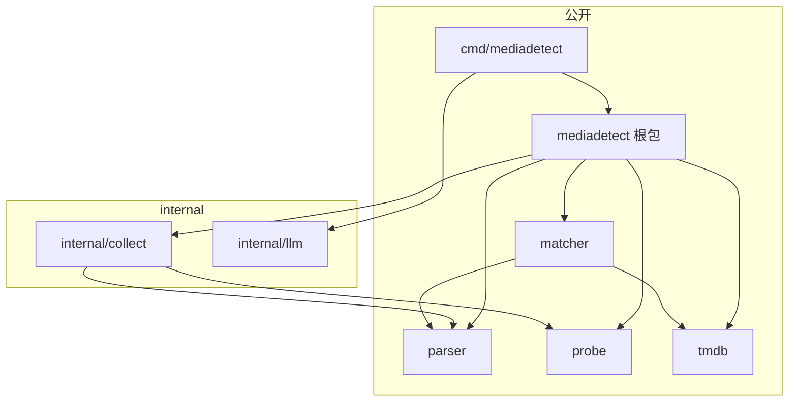

# MediaDetect Go 包边界与工程结构 技术方案

| 字段 | 内容 |
| --- | --- |
| 标题 | MediaDetect Go 包边界与工程结构 技术方案 |
| 主笔 | alang |
| 评审人 | alang（维护者兼下游调用方代表） |
| 创建日期 | 2026-11-11 |
| 目标版本 | v0.2.2 |
| 关联资源 | SPEC-001；`README.md`；`docs/specs/README.md`；Go module `github.com/dream-365/MediaDetect` |

## 1. 背景与上下文

### 1.1 系统现状

MediaDetect 是一个无状态、只读的媒体类型检测库与 CLI，当前 module path 为 `github.com/dream-365/MediaDetect`。仓库由四层组成：

* **公开根包 `mediadetect`**：提供 `Detect(ctx, path, Options)`、`Options`、`Result`、错误类型和 JSON 契约；内部承载输入检查、目录聚合、类型映射、TMDB 匹配编排和 warning 组装。
* **六个顶层子包**：`parser`、`probe`、`tmdb`、`matcher`、`llm`、`collect`。其中 `parser`、`probe`、`tmdb`、`matcher` 是下游可以直接复用的领域能力；`collect` 是被根包使用的只读遍历器；`llm` 只被 CLI 的 `--llm-fallback` 使用。
* **CLI `cmd/mediadetect`**：解析参数与 stdin，读取 `TMDB_API_KEY` / `DEEPSEEK_API_KEY`，调用根包并输出单个 JSON 对象。
* **文档与质量资产**：`docs/specs/SPEC-001-media-type-detection/`、`docs/quality/SPEC-001/`、README 和 CI。

当前包依赖无环：根包依赖 `collect`、`parser`、`probe`、`tmdb`、`matcher`；`collect` 依赖 `parser`、`probe`；`matcher` 依赖 `parser`、`tmdb`；`llm` 和 `cmd/mediadetect` 只依赖标准库与根包/对方。`go list ./...` 当前列出 8 个包，仓库中没有 `internal/` 目录。

### 1.2 核心技术痛点

本次整理不是行为缺陷修复，而是结构债务。以下问题均有仓库内可复核的证据：

1. **CLI 入口文件承担了过多职责。** `cmd/mediadetect/main.go` 为 484 行、17 个函数，同时包含 `main/run`、参数解析、stdin 读取、TTY 判断、JSON 输出、错误输出、退出码映射、verbose 输出和 help 文本。改动输出格式或退出码时，评审者必须在一个文件内跨 400 多行定位；新增 flag 会继续推高该文件。
2. **公开面与实际支持面不一致。** README 第 274 行明确把 `parser`、`probe`、`tmdb`、`matcher`、`llm`、`collect` 六个包都列为可直接使用；但 `llm` 只在 `cmd/mediadetect` 中被引用，`collect` 只在根包中被引用。下游一旦按照 README 依赖这两个包，它们就从实现细节变成事实上的公共 API，后续任何内部调整都要考虑兼容或提版本。
3. **根包公共 API 直接别名子包类型。** `result.go` 中 `MediaInfo` 是 `probe.Info` 的别名，`QueryResolver` 是 `matcher.QueryResolver` 的别名。修改 `probe.Info` 字段或 `matcher.QueryResolver` 方法会直接改变根包公开 API，而且 godoc 会把内部依赖路径暴露给调用方。公共契约没有独立落点。
4. **版本口径分散。** 发布版本应以 git tag 为唯一 SSOT，但 README 第 7 行、安装 tag 第 15 行和 CLI `defaultVersion` 各自维护版本字面量，发布前需要人工核对四处一致。SPEC-001 的目标版本 `v0.1.0`、`--version` 示例和 `tasks.md` 标题是 v0.1.x 的历史基线，不作为当前版本口径，本次不回溯改写。
5. **缺少显式的公开/内部边界。** 仓库没有 `internal/`；`collect` 和 `llm` 与真正的扩展 API 平级放在顶层，评审时无法从目录结构判断“哪些包可以改、哪些包不能破坏”。

失败链如下：

* **CLI 链路**：新增一个输出字段 → 修改 `main.go` 中的输出/错误/verbose 多个函数 → 测试仍集中在一个 330 行的 `main_test.go` 中 → 后续改动继续叠加，评审范围扩大。
* **公开面链路**：下游按 README 引入 `collect` 或 `llm` → 维护者调整遍历器签名或 LLM 客户端 → 该调整从内部重构变成破坏性变更 → 为了兼容被迫保留旧形状，结构债务固化。
* **契约链路**：根包继续别名 `probe.Info` / `matcher.QueryResolver` → `probe` 或 `matcher` 的合理演进直接穿透到根包 → 根包发布说明需要覆盖子包类型变化，版本边界模糊。

当前尚未发生外部事故；上述结论来自本次结构盘点（行数、引用关系、公开别名和版本文档），属于在 v1.0 之前主动偿还的结构债务。

### 1.3 重构/设计动机

当前版本为 `v0.1.1`，按 SPEC-001 6.5 的约定，v0.x 的 minor 版本允许破坏性 Go API 变更。现在整理的边际成本最低：

* 下游消费尚未形成规模，`collect` / `llm` 的公开依赖可以一次性收回。
* 方案不改变检测行为、JSON 契约和 module path，主要风险集中在导入路径和类型定义，可用现有测试直接回归。
* 在 v1.0 之前建立公开/内部边界，后续 `parser`、`probe`、`tmdb`、`matcher` 的演进可以在明确契约下进行。

本次整理的目标是：**把公开面收敛为根包加四个领域包，把实现细节移入 `internal/`，把公共契约从子包类型中解耦，把 CLI 按职责拆分，并让文档与版本口径一致。**

### 1.4 非目标

**不做本次整理的后果**：CLI 入口继续增长；`collect` / `llm` 继续与扩展 API 平级，下游可能按 README 形成事实依赖；根包公共契约继续被 `probe` / `matcher` 的类型变化穿透；文档版本口径继续分叉。等到 v1.0 或出现外部下游后再做，同样的调整会从 v0.x minor 变更升级为受兼容窗口约束的破坏性变更。

本次整理的正式非目标见 2.2。以下约束在本次范围内不可突破：

* **不改变检测行为**：媒体类型、匹配状态、JSON 字段、错误码、退出码和零写入语义保持 SPEC-001 的约定。
* **不改变 module path 与仓库名**：继续使用 `github.com/dream-365/MediaDetect`，不借本次整理重命名模块。
* **允许 v0.x 破坏性变更**：`collect`、`llm` 的导入路径，以及 `MediaInfo` / `QueryResolver` / `Prober` 的类型身份会变化；按 v0.2.0 minor 发布。
* **保留库复用能力**：`parser`、`probe`、`tmdb`、`matcher` 继续作为公开扩展 API，不移入 `internal/`。
* **不引入新的分类或匹配规则**：本次只调整结构、导入和文档。

## 2. 目标与非目标

### 2.1 目标

* **G1 - 架构/代码：收敛公开边界**：公开包只保留根包 `mediadetect`、`parser`、`probe`、`tmdb`、`matcher`；`collect`、`llm` 移入 `internal/`，下游不可导入。验收：排除 `/internal/` 后 `go list ./...` 恰好给出根包、`cmd/mediadetect` 和四个领域包；`parser`、`probe`、`tmdb`、`matcher` 的依赖列表中不出现 `/internal/`；外部临时模块导入 `.../internal/collect` 或 `.../internal/llm` 编译失败，临时模块必须先 `require` 本模块并用 `replace` 指向本地仓库，断言错误信息包含 `internal` 拒绝文本，避免因模块缺失而假阳性；该断言进入 CI。
* **G2 - 架构/代码：公共契约与实现解耦**：根包不再别名 `probe` 或 `matcher` 的类型；`MediaInfo`、`QueryResolver` 在根包内定义，并导出与 `probe.ErrUnavailable` 同值的 `ErrProbeUnavailable`；`result.go` 不再导入这两个子包。验收：`go doc github.com/dream-365/MediaDetect` 中两个类型显示为本地定义；`result.go` 的 import 不含 `probe`、`matcher`；`detect_test.go` 的 `proberFunc` 返回类型改为 `MediaInfo` 后，现有检测与匹配测试全部通过；新增字段转换测试断言 `MediaInfo` 与 `probe.Info` 无损互转；新增 `errors.Is` 测试断言 `ErrProbeUnavailable` 与 `probe.ErrUnavailable` 等价。
* **G3 - 可维护性：CLI 按职责拆分**：`cmd/mediadetect/main.go` 只保留 `main` 与 `run`，参数、输入、输出、help、版本与配置分别落到独立文件。验收：`main.go` ≤120 行；新增 CLI 文件各自 ≤200 行；`go test ./cmd/mediadetect` 的现有用例全部通过；CLI stdout/stderr/退出码不变。
* **G4 - 工程效率：文档与版本口径一致**：README 的项目结构、公开包列表、安装版本和目标版本一致；`docs/specs/README.md` 收录 SPEC-002；SPEC-001 的受影响条款按约定处理。验收：README 中公开包列表与 G1 的 `go list` 结果一致；README 当前版本、README 安装 tag、`defaultVersion`、目标 tag 四者一致指向 `0.2.2`，并以 git tag 作为发布 SSOT；SPEC-001 的 §2.1 G2、§3.2、§4.4.1、§4.4.1.1 带指向 SPEC-002 的替代说明；SPEC-001 中 `v0.1.0` 的目标版本、`--version` 示例和 `tasks.md` 标题作为历史基线保留，不作为当前版本验收项。
* **G5 - 可靠性：构建与行为基线不变**：不新增第三方依赖，不改变 JSON schema，不改变检测结果。验收：`gofmt -l .` 为空；`go mod tidy -diff` 无差异；`go vet ./...`、`go test ./...`、`go build ./cmd/mediadetect` 全部通过；同一输入在整理前后的 JSON 输出逐字节一致，唯一允许的差异是 `--version` 从 `0.2.1` 变为 `0.2.2`。**例外**：SPEC-004 授权的硬年份冲突封顶会改变 `|year_delta|>5` 且无 runtime 证据的 `match.status` 并新增 `match.year_conflict` warning；这是本 Spec 之外的唯一允许行为差异，不改变包边界或 JSON schema。

### 2.2 非目标

* **NG1 - 检测规则与匹配算法**：不新增媒体类型规则、不调整 matcher 评分、不改变 TMDB 查询策略（本次不做）。
* **NG2 - JSON 契约与错误码**：不增删 JSON 字段、不修改 `schema_version`、不重排退出码（本次不做）。
* **NG3 - 模块重命名**：不改 module path、仓库名或大小写；不把 `MediaDetect` 改为全小写路径（本次不做）。
* **NG4 - 引入 `pkg/` 目录**：不把公开包移动到 `pkg/` 下（本次不做；理由见 7.3）。
* **NG5 - 功能扩展**：剧集 TMDB 匹配、批量/NDJSON、持久缓存、Windows 支持均不在本次范围（Deferred to Phase 2）。
* **NG6 - 发布渠道与 CI 平台扩展**：不新增 Homebrew/Docker/包管理器发布，不增加新的 CI 平台（本次不做）。

非目标与边界的对应关系：NG1、NG2 对应 1.2 的行为契约风险（结构整理不能顺手改规则）；NG3、NG4 对应 3.4 的选型边界（module path 与顶层公开包是刻意保留的）；NG5 对应 SPEC-001 附录 A 的延后项；NG6 对应本次只做源码结构、不扩大发布面。

## 3. 架构设计与核心方案

### 3.1 总体架构

仓库当前没有 `docs/architecture/` 下的受管架构文档；SPEC-001 §3.2 是现状模块划分与职责的 SSOT，本 Spec 只描述其增量变更，不复制完整全局拓扑。

本次变更落在包布局、公开边界、根包公共契约和 CLI 文件划分四处；检测数据流、JSON 输出和外部依赖保持不变。



> 核心原则：公开包只暴露可被下游稳定依赖的能力；实现细节和 CLI 专用能力放在 `internal/`；公开契约由根包自己定义。

### 3.2 核心模块职责

| 路径 | 可见性 | 职责 | 本次变化 |
| --- | --- | --- | --- |
| `github.com/dream-365/MediaDetect` | 公开 | `Detect`、`Options`、`Result`、错误与 JSON 契约；编排本地检测和匹配 | 公共契约与实现分文件；去掉对 `probe`/`matcher` 的类型别名 |
| `.../parser` | 公开 | 文件名解析为标题、年份、角色、季集和发布线索 | 不变 |
| `.../probe` | 公开 | ffprobe / exiftool 技术元数据探测 | 不变 |
| `.../tmdb` | 公开 | TMDB 搜索、详情、缓存、限流与脱敏 | 不变 |
| `.../matcher` | 公开 | 候选评分、置信度与领先分差 | 不变 |
| `.../internal/collect` | 内部 | 只读遍历、解析、探测、分组键计算 | 从顶层 `collect` 移入 `internal/`；符号名保持 |
| `.../internal/llm` | 内部 | DeepSeek 查询扩展，仅供 CLI 使用 | 从顶层 `llm` 移入 `internal/`；符号名保持 |
| `.../cmd/mediadetect` | 可执行 | 参数、stdin、环境变量、JSON 输出和退出码 | 按职责拆分为多个文件 |
| `docs/`、`README.md`、CI | 公开文档/流程 | Spec、质量记录、使用说明和构建验证 | 同步结构、公开包列表和版本 |

### 3.3 核心数据流转

检测数据流不变：

1. CLI 解析唯一输入路径，读取环境变量并构造 `Options`。
2. 根包检查路径，调用 `internal/collect` 完成只读遍历和探测。
3. 根包用 `parser.Hints` 映射本地媒体类型，按 `GroupKey` 聚合。
4. 电影文件调用 `matcher` 和 `tmdb` 完成匹配，非电影不发电影搜索。
5. 根包组装 `Result`，CLI 序列化为单个 JSON 对象并映射退出码。

本次只有两处数据流边界变化：

* `Options.Prober` 返回根包定义的 `MediaInfo`；根包在调用 `internal/collect` 前把 `MediaInfo` 转成 `probe.Info`。外部 `Prober` 的实现不再需要导入 `probe` 来声明返回类型；若需表达“探测工具不可用”，使用根包导出的 `ErrProbeUnavailable`（与 `probe.ErrUnavailable` 是同一哨兵值），仍无需导入 `probe`。
* `Options.Resolver` 使用根包定义的 `QueryResolver`；该接口与 `matcher.QueryResolver` 的方法集一致，可直接传给 matcher，无需适配层。

### 3.4 关键选型与约束

* **保留 `parser`/`probe`/`tmdb`/`matcher` 为顶层公开包**：它们是 SPEC-001 1.2 承诺的库复用能力，也是 `mediadetect` 之外最有价值的扩展面；把它们收进 `internal/` 会改变产品能力，而不仅是整理结构。
* **只把 `collect` 和 `llm` 收进 `internal/`**：`collect` 只被根包使用，且其返回值包含 parser/probe 内部类型；`llm` 只服务 CLI 的 `--llm-fallback`。两者不具备独立版本契约的必要性。
* **根包自持公共类型**：`MediaInfo`、`QueryResolver` 和 `ErrProbeUnavailable` 在根包定义，避免公开 API 随子包类型变化而漂移；`probe.Info` 到 `MediaInfo` 的转换只发生在根包内部，`ErrProbeUnavailable` 与 `probe.ErrUnavailable` 指向同一哨兵值以保持 `errors.Is` 语义。
* **不使用 `pkg/` 目录**：顶层公开包是 Go module 的惯用形态；`pkg/` 只增加路径层级，不提供语言级可见性约束，反而让导入路径变长。详细对比见 7.3。
* **CLI 按“配置/参数/输入/输出/help”拆分**：每个文件只对应一个变更理由，保持 `package main` 不变，避免为了测试而引入不必要的子包。备选方案见第 7 章。

## 4. 详细设计

### 4.1 目标目录布局

```text
.
├── cmd/mediadetect/
│   ├── main.go          # main、run
│   ├── config.go        # config、默认值、版本注入、config.toOptions 映射
│   ├── args.go          # flag 解析与错误
│   ├── input.go         # 位置参数、stdin、TTY 判断
│   ├── output.go        # JSON、错误、verbose、退出码
│   ├── help.go          # help 文本
│   └── main_test.go     # CLI 回归测试（可后续按文件拆分）
├── internal/
│   ├── collect/         # 原顶层 collect
│   └── llm/             # 原顶层 llm
├── parser/
├── probe/
├── tmdb/
├── matcher/
├── doc.go               # 根包文档
├── options.go           # ProbeMode、MatchMode、TMDBOptions、Prober、MediaInfo、QueryResolver、Options
├── result.go            # Result、Input、Summary、FileResult、Match、Candidate、Evidence、Detection、Warning、ErrorObject
├── errors.go            # 错误码、Error、ErrProbeUnavailable
├── detect.go            # Detect 入口与输入检查
├── aggregate.go         # 目录级聚合
├── mapping.go           # 本地类型映射
├── match.go             # 匹配编排
├── policy.go            # 匹配状态决策
├── warnings.go          # warning 去重与排序
├── *_test.go            # 根包测试
└── docs/
```

### 4.2 公开 API 变更

| 符号 | 现状 | 目标 | 兼容性 |
| --- | --- | --- | --- |
| `mediadetect.MediaInfo` | `type MediaInfo = probe.Info` | 根包定义 `struct { DurationSec int; Resolution string; Codec string }` | 字段不变；`probe.Info` 到 `MediaInfo` 需显式转换 |
| `mediadetect.QueryResolver` | `type QueryResolver = matcher.QueryResolver` | 根包定义 `interface { Queries(ctx, filename, titles, year, runtimeSec) ([]string, error) }` | 方法集一致；现有实现仍可赋值 |
| `mediadetect.Prober` | `Probe(ctx, path) (MediaInfo, error)`，其中 `MediaInfo = probe.Info` | 方法名与参数不变，但返回类型改为根包定义的 `MediaInfo` | 破坏性：实现者必须返回 `mediadetect.MediaInfo`；返回 `probe.Info` 的旧实现不再满足接口 |
| `mediadetect.ErrProbeUnavailable` | 不存在；外部需导入 `probe.ErrUnavailable` | `var ErrProbeUnavailable = probe.ErrUnavailable` | 新增；`errors.Is` 语义与 `probe.ErrUnavailable` 一致，外部无需导入 `probe` |
| `mediadetect.Options` | 含 `Resolver QueryResolver`、`Prober Prober` | 字段名与语义不变，类型指向根包定义 | 字段名与语义兼容；`Prober`/`Resolver` 的类型身份变化见本表对应行 |
| `.../collect` | 顶层公开包 | `.../internal/collect` | 破坏性：下游不可导入 |
| `.../llm` | 顶层公开包 | `.../internal/llm` | 破坏性：下游不可导入 |

`MediaInfo` 的字段与 `probe.Info` 完全一致，确保根包内部转换不丢信息。`QueryResolver` 的方法签名与 `matcher.QueryResolver` 完全一致，确保根包无需为 matcher 再写适配器。`Prober` 的方法名与参数不变，但返回类型身份变化属于破坏性变更；`ErrProbeUnavailable` 与 `probe.ErrUnavailable` 同值，保证 `errors.Is` 行为不变。`ErrProbeUnavailable` 的 godoc 仍会显示 `probe.ErrUnavailable`，这是为保持错误语义而接受的权衡；外部调用方仍可直接使用根包哨兵，无需导入 `probe`。

### 4.3 数据模型与契约

本次不新增或删除 JSON 字段；`Result`、`FileResult`、`Match`、`Summary`、`Detection` 的完整字段契约沿用 SPEC-001 4.3.2–4.3.5，字段类型、必填性和序列化规则不变。本次变化只发生在 Go 侧配置与接口类型：

| 类型 | 字段/方法 | 类型 | 必填 | 校验与说明 |
| --- | --- | --- | --- | --- |
| `MediaInfo` | `DurationSec` | `int` | 否 | 探测失败或未探测时为 0；字段与 `probe.Info.DurationSec` 一致 |
| `MediaInfo` | `Resolution` | `string` | 否 | 允许为空；字段与 `probe.Info.Resolution` 一致 |
| `MediaInfo` | `Codec` | `string` | 否 | 允许为空；字段与 `probe.Info.Codec` 一致 |
| `QueryResolver` | `Queries(ctx, filename, titles, year, runtimeSec)` | 方法 | 是 | 返回额外查询词；返回 nil 或空切片表示不扩展 |
| `Options` | `Resolver` | `QueryResolver` | 否 | nil 表示不启用 LLM 查询扩展 |
| `Options` | `Prober` | `Prober` | 否 | nil 时使用 `probe.Probe`；返回 `MediaInfo` |

约束：`MediaInfo` 与 `probe.Info` 字段名、类型、顺序一致，保证根包内部转换无损；`QueryResolver` 与 `matcher.QueryResolver` 方法集一致，保证可直接传递给 matcher。

错误契约：外部 `Prober` 可用 `errors.Join(mediadetect.ErrProbeUnavailable, err)` 表示探测工具不可用；根包把该错误原样传给 `internal/collect`，因为 `ErrProbeUnavailable` 与 `probe.ErrUnavailable` 是同一哨兵值，`errors.Is(err, probe.ErrUnavailable)` 仍为真。返回其他错误时按 `probe.failed` 处理，不改变现有 warning 与 `probe_status` 语义。

### 4.4 接口与协议

公开 Go 接口与包可见性：

| 接口/包 | 签名或路径 | 可见性 | 说明 |
| --- | --- | --- | --- |
| `mediadetect.Detect` | `Detect(ctx context.Context, path string, opts Options) (Result, error)` | 公开 | 唯一检测入口；行为不变 |
| `mediadetect.Prober` | `Probe(ctx context.Context, path string) (MediaInfo, error)` | 公开 | 外部注入探测实现；nil 时用 `probe.Probe` |
| `mediadetect.QueryResolver` | `Queries(ctx context.Context, filename string, titles []string, year, runtimeSec int) ([]string, error)` | 公开 | 可选查询扩展；与 matcher 接口结构兼容 |
| `mediadetect.ErrProbeUnavailable` | 哨兵错误，与 `probe.ErrUnavailable` 同值 | 公开 | 外部 `Prober` 表达“探测工具不可用”时使用；无需导入 `probe` |
| `.../parser`、`.../probe`、`.../tmdb`、`.../matcher` | 顶层路径 | 公开 | 导出符号与签名不变 |
| `.../internal/collect`、`.../internal/llm` | `internal/` 路径 | 内部 | 模块外不可导入 |

CLI 协议不变：`mediadetect [flags] <path|->`、`mediadetect --version`、`mediadetect -h|--help`；stdout 恰好一个 JSON 对象，错误码和退出码沿用 README 与 SPEC-001 4.4.2/4.6。

### 4.5 核心流程与时序

正常路径：

1. CLI 解析 flag 与唯一输入路径，读取环境变量，构造 `Options`。
2. 根包 `Detect` 做 `lstat`、符号链接和可读性检查；失败返回 `*Error`，CLI 输出错误 JSON 和对应退出码。
3. 根包调用 `internal/collect` 完成只读遍历与探测；外部 `Prober` 的 `MediaInfo` 在此转换为 `probe.Info`。
4. 根包用 `parser.Hints` 映射类型、按 `GroupKey` 聚合；仅电影组调用 `matcher` 和 `tmdb`。
5. 根包组装 `Result`；CLI 序列化到内存后一次性写 stdout，并按 `match.status` 映射退出码。

异常路径：

* 路径不存在、输入符号链接、根不可读：根包返回结构化错误，CLI 退出 2。
* `--match=on` 且 TMDB/key 失败：本地结果仍输出，`match.status=error`，CLI 退出 4。
* `--match=auto` 且 TMDB 不可达：`match.status=unavailable`，CLI 退出 0。
* 内部包导入或依赖方向错误：编译期失败，不进入运行时。

### 4.6 异常处理与错误码

本次不新增或修改 `ERR_*` 错误码；检测错误、匹配错误和 CLI 退出码沿用 SPEC-001 4.6 与 README 的约定。结构变更引入的异常都是编译期或 CI 期失败：

| 场景 | 触发条件 | 表现 | 处理策略 |
| --- | --- | --- | --- |
| 下游导入内部包 | 模块外 `import .../internal/collect` 或 `.../internal/llm` | Go 编译失败 | 按 4.7 迁移到根包 `Detect` 或 CLI `--llm-fallback` |
| 公共领域包反向依赖 | `parser`/`probe`/`tmdb`/`matcher` 导入 `internal/` | `go list` 依赖断言失败 | 调整依赖方向；领域包只依赖标准库、第三方库和彼此 |
| 类型/错误契约遗漏 | 外部 `Prober` 返回 `probe.Info` 而非 `MediaInfo`，或未用 `ErrProbeUnavailable` 表达不可用 | 编译失败，或 `probe.unavailable` warning 丢失 | 按 4.2/4.7 迁移；根包适配层统一转换类型，并把哨兵错误原样传递；`Prober=nil` 时走 `probe.Probe` |
| 格式/静态检查失败 | 文件移动后未 `gofmt` 或 import 未整理 | `gofmt -l .`、`go vet` 非零 | 修复后重跑；CI 阻断合入 |
| 行为回归 | JSON 输出、错误码或退出码变化 | 现有测试失败 | 停止搬运，回退到上一个全绿提交 |

其他边界：

* **公开领域包**不得导入 `internal/`，保持可独立复用；根包可以导入 `internal/collect`。
* **不使用构建标签**，不保留旧路径的兼容 shim；v0.x 允许直接破坏。
* **测试文件**：`internal/collect`、`internal/llm` 的测试随包移动，保持 `package collect` / `package llm`，只更新导入路径；根包 `detect_test.go` 的 `proberFunc` 返回类型必须改为 `MediaInfo`，行为断言不变；新增 `MediaInfo` 与 `probe.Info` 字段转换测试。

Goal 与章节的对应关系：G1 由 4.1 和 4.6 的导入边界覆盖；G2 由 4.2、4.3、4.4 覆盖；G3 由 4.8 覆盖；G4 由 4.9 覆盖；G5 由 5.2、5.3 和 6.3 覆盖。

### 4.7 下游迁移

| 下游用法 | 迁移方式 |
| --- | --- |
| `import "github.com/dream-365/MediaDetect/collect"` | 改为调用根包 `mediadetect.Detect`；`collect` 不再提供公开遍历 API。注意 `Detect` 不暴露 `collect` 的 `seen` 集合和全部 `Counts` 字段；依赖这些中间值的下游需自行遍历或等待未来的公开遍历 API，不能假定无损替换 |
| `import "github.com/dream-365/MediaDetect/llm"` | 使用 CLI `--llm-fallback`；库调用方不再直接注入 LLM 客户端，仍可通过 `Options.Resolver` 注入自定义查询扩展 |
| 构造 `mediadetect.MediaInfo` | 继续使用 `mediadetect.MediaInfo{...}`；从 `probe.Info` 转换时使用显式转换 |
| 实现 `mediadetect.Prober` | 返回类型从 `probe.Info` 改为 `mediadetect.MediaInfo`；需要表达探测工具不可用时返回 `errors.Join(mediadetect.ErrProbeUnavailable, err)`，无需导入 `probe` |
| 实现 `mediadetect.QueryResolver` | 方法集不变，现有实现无需改签名 |
| 依赖 `parser`/`probe`/`tmdb`/`matcher` | 导入路径与导出符号不变；`probe.Info` 的字段契约不变，仍可用于自有代码 |

`Options.Resolver` 仍保留，因此库调用方仍然可以注入任意查询扩展；本次收回的是 `llm` 客户端包本身，不是查询扩展能力。

### 4.8 CLI 文件拆分

| 文件 | 职责 | 主要符号 | 行数预算 |
| --- | --- | --- | --- |
| `main.go` | 进程入口与一次执行的编排 | `main`、`run` | ≤120 |
| `config.go` | 运行配置、版本与 Options 映射 | `config`、`defaultConfig`、`defaultVersion`、`version`、`buildVersion`、`toOptions` | ≤120 |
| `args.go` | flag 与位置参数解析 | `cliError`、`parseArgs`、`splitFlag`、`boolValue`、`flagError` | ≤200 |
| `input.go` | 输入路径与 stdin | `resolveInput`、`readStdinPath`、`isTTY` | ≤100 |
| `output.go` | JSON、错误、verbose、退出码 | `writeError`、`writeJSON`、`exitCodeFor`、`writeVerbose`、`bestVerbose`、`pathOf` | ≤200 |
| `help.go` | 帮助文本 | `helpText` | ≤80 |

拆分只移动函数，不改变函数签名、输出顺序、错误消息和退出码。`config.toOptions()` 负责把 `config` 映射为 `mediadetect.Options`，包括读取 `TMDB_API_KEY`，以及在 `LLMFallback` 为真时用 `llm.FromEnv()` 注入 `Resolver`；`run` 只负责编排，不再逐字段拼装。`main_test.go` 继续使用 `package main`，通过 `run(args, stdin, stdout, stderr)` 做黑盒回归。

### 4.9 文档与版本同步

* **README**：更新“当前版本”为 `0.2.2`，安装示例 tag 同步为 `v0.2.2`；把“下游集成”中的公开包列表收敛为 `parser`、`probe`、`tmdb`、`matcher`，并说明 `collect`、`llm` 已移入 `internal/`；新增“项目结构”小节，展示 4.1 的目录树和公开/内部边界。
* **版本注入**：`defaultVersion` 更新为 `0.2.2`；`--version` 的构建注入机制不变。
* **Spec 索引**：`docs/specs/README.md` 增加 SPEC-002 行，状态与链接同步。
* **SPEC-001 替代范围**：以下条款写入指向 SPEC-002 的替代说明，其余行为契约继续有效。
  * §2.1 G2：包清单中的 `llm`、`collect` 改为 `internal/llm`、`internal/collect`；G2 的其他验收不变。
  * §3.2：模块布局与 `collect` 的位置改由 SPEC-002 §4.1 定义。
  * §4.4.1.1：`collect` 公开契约改由 SPEC-002 §4.7 的迁移说明替代；`collect` 不再是公开包。
  * §4.4.1：`Resolver` 类型改为根包 `QueryResolver`；`Prober` 返回根包 `MediaInfo`；删除 `type MediaInfo = probe.Info` 与“通过类型别名统一”的表述，改为“根包定义 `MediaInfo`，与 `probe.Info` 字段一致并在边界显式转换”；新增 `ErrProbeUnavailable` 的错误契约。
  * 历史注记：SPEC-001 `changelog.md` 中早期“SPEC-002 → SPEC-001”条目是历史编号，不是本 Spec；同次修订加注说明。
  * 历史版本：SPEC-001 的目标版本 `v0.1.0`、`--version` 示例和 `tasks.md` 标题保留为 v0.1.x 历史基线，不作为当前版本口径。
  * 流程：按 CLAUDE.md，先由维护者把 SPEC-001 回退为 `In Review`、更新 `updated_at`、在其 `changelog.md` 追加记录；写入上述替代说明后重算 SPEC-001 `tasks.md` 的 `spec_sha256`，再恢复为 `Approved`/`Implemented`。用户明确批准 SPEC-002 且 SPEC-001 恢复后，才修改生产代码。
* **CI 边界断言**：在 `.github/workflows/ci.yml` 增加 `boundary` 步骤，执行 6.3 的包数量、领域包 import、`result.go` import 和外部 `internal` 导入断言；断言失败即阻断合入，不能只依赖手工命令。该步骤在实现段随包移动一起加入；文档段不启用，避免当前 8 个包导致 `8 ≠ 6` 提前变红。

## 5. 非功能性需求

### 5.1 行为与确定性

* **检测结果不变**：同一输入在整理前后，`Result` 的字段值和 JSON 序列化逐字节一致；`schema_version` 保持 `"1"`。
* **唯一允许的输出版本差异**：`--version` 的 `version` 从 `0.2.1` 变为 `0.2.2`，其余字段不变。
* **零写入与只读语义不变**：现有 `TestDetectZeroWrite`、`TestCLIZeroWrite`、零 HTTP 请求和凭据脱敏测试全部通过。

### 5.2 构建与测试

* **依赖不增加**：`go.mod` / `go.sum` 不新增第三方依赖；`go mod tidy -diff` 无差异。
* **格式与静态检查**：`gofmt -l .` 为空；`go vet ./...` 通过。
* **测试与构建**：`go test ./...`、`go build ./cmd/mediadetect` 通过；CI 的现有命令全部通过。
* **包数量**：排除 `/internal/` 后共 6 个包（根包、`cmd/mediadetect` 和四个领域包），其中可被下游导入的库包为 5 个；`internal/` 下为 2 个包。
* **结构边界进入 CI**：`.github/workflows/ci.yml` 的 `boundary` 步骤必须断言上述包数量、四个领域包不导入 `/internal/`、`result.go` 不导入 `probe`/`matcher`，以及模块外导入 `internal` 失败；这些断言失败时 CI 阻断合入。

### 5.3 可维护性

* **CLI 文件预算**：`main.go` ≤120 行；`config.go` ≤120 行；`args.go` 和 `output.go` ≤200 行；`input.go` ≤100 行；`help.go` ≤80 行。验收用 `wc -l`。
* **公共契约落点**：`result.go` 不导入 `probe`/`matcher`；`options.go` 只包含公开配置与接口定义，不包含检测流程。
* **变更可定位**：新增会进入 `mediadetect.Options` 的 flag 改 `args.go`（解析）与 `config.go`（字段和 `toOptions` 映射）；新增输出格式只改 `output.go`；新增 help 文案只改 `help.go`。`run` 不逐字段拼装 `Options`。

### 5.4 安全与合规

* **凭据不变**：`TMDB_API_KEY`、`DEEPSEEK_API_KEY` 仍只从环境变量读取，不进入 JSON、stderr、错误信息或日志；现有脱敏测试通过。
* **内部包不暴露**：`internal/collect` 和 `internal/llm` 不出现在公开包的依赖列表和 README 的公开包列表中。
* **文档不泄露**：README 和 Spec 不写入真实语料路径、密钥或响应 body。

### 5.5 性能、可靠性与可观测性说明

* **性能与资源**：本次不新增运行时逻辑、依赖或后台任务，检测路径的 CPU、内存和 I/O 行为不变。验收：现有测试通过；不引入基准测试回归。
* **可靠性**：无状态、只读、零写入、零 HTTP 的既有保证不变；降级与错误语义沿用 SPEC-001。
* **可观测性**：本仓库不提供常驻服务或指标端点，可观测性体现为 CLI stderr、warning 和退出码；本次不改变这些输出，因此不新增指标。

## 6. 上线与迁移计划

### 6.1 发布与灰度

本次没有运行时服务，因此不使用流量灰度；用“分阶段提交 + 每阶段 CI 观察期”代替。每个阶段必须 CI 全绿后才能进入下一阶段，观察指标为 `go test ./...`、`go vet ./...`、`go build ./cmd/mediadetect` 和公开包清单。按 v0.x 语义发布 `v0.2.2` patch 版本，步骤分三段：

1. **文档段**：提交 SPEC-002、更新 Spec 索引；用户明确批准 SPEC-002 后，由维护者按 CLAUDE.md 回退 SPEC-001 的受影响条款（§2.1 G2、§3.2、§4.4.1、§4.4.1.1），更新 `updated_at`、追加 changelog、写入替代说明并重算 `tasks.md` 的 `spec_sha256`，然后恢复为 `Approved`/`Implemented`。此段不修改生产代码。
2. **实现段**：移动 `collect`、`llm`；拆分 CLI；解耦根包公共类型；更新 README、版本号和导入路径。实现段在用户明确批准 SPEC-002 且 SPEC-001 重新回到 `Approved`/`Implemented` 后开始。
3. **发布段**：CI 全绿后打 `v0.2.2` tag；tag 推送后按 SPEC-001 6.5 不移动、不删除。

不设灰度：这是源码级结构变更，没有运行时服务；下游通过版本号选择升级。

### 6.2 数据迁移与兼容性

* 无数据库、无索引、无持久化数据，不需要数据迁移。
* Go API 迁移按 4.7 执行；`Options`、`Result`、JSON 契约保持兼容。
* 旧版本下游可继续使用 `v0.2.1`；升级到 `v0.2.2` 是 patch 升级，包边界和公开 Go API 不变，仅同步 `--version` 与 SPEC-004 的硬年份匹配收紧。若从 `v0.1.1` 升级，仍需处理 `collect` / `llm` 导入，以及 `MediaInfo` / `QueryResolver` / `Prober` 的类型身份变化。

### 6.3 上线验证与冒烟

在仓库根目录依次执行：

```bash
gofmt -l .
go mod tidy -diff
go vet ./...
go test ./...
go build -o /tmp/mediadetect ./cmd/mediadetect
go list ./... | grep -v '/internal/'
```

补充断言：

* 排除 `/internal/` 后 `go list ./...` 恰好 6 个包；`go list ./... | grep '/internal/'` 恰好输出 `internal/collect` 和 `internal/llm` 两个包。
* `go list -f '{{.ImportPath}}: {{join .Imports " "}}' ./parser ./probe ./tmdb ./matcher | grep '/internal/'` 无输出。
* `result.go` 的 import 不含 `probe`、`matcher`：用 `if grep -Eq '"github.com/dream-365/MediaDetect/(probe|matcher)"' result.go; then echo "result.go imports probe/matcher"; exit 1; fi` 断言无匹配；grep 退出码 1 表示无匹配，不能直接当成失败。也可用等价的 Go AST 检查。
* 用同一组文件/目录 fixture 在整理前后运行 CLI，stdout 用 `cmp` 比较；除 `--version` 外必须一致。
* 在仓库外的临时 module 中验证 `internal` 不可导入：`go mod init example.com/internal-probe`；创建 `main.go`，写入 `import _ "github.com/dream-365/MediaDetect/internal/collect"` 和空的 `main`；执行 `go mod edit -replace github.com/dream-365/MediaDetect=<本地仓库绝对路径>`、`go mod edit -require github.com/dream-365/MediaDetect@v0.2.2`，再执行 `GOFLAGS=-mod=mod go build ./...`；命令必须失败，且 stderr 包含 `use of internal package ... not allowed`；对 `internal/llm` 重复一次。不要用 `go list .../internal/collect` 作为断言：直接列出内部包不会触发导入者可见性检查。
* 发布段执行 `git describe --tags --exact-match`，断言 `--version` 输出的 `version` 等于去掉前缀 `v` 的 tag；开发分支不执行此断言。

### 6.4 回滚与熔断

* **回滚触发条件**（均为可观测计数或 diff）：
  * `go test ./...` 的失败用例数 > 0，且无法用导入路径机械修复解决；
  * CLI fixture 的 stdout diff 行数 > 0（`--version` 输出除外）；
  * 排除 `/internal/` 后的包数 ≠ 6，或 `internal/` 下的包数 ≠ 2；
  * `parser`、`probe`、`tmdb`、`matcher` 的 import 列表中出现 `/internal/` 的次数 > 0；
  * `cmd/mediadetect/main.go` 行数 > 120；
  * 下游迁移矩阵之外出现额外破坏。
* **回滚步骤**：在 tag 推送前，直接回退实现段提交并恢复文档状态；不涉及数据或运行时。若 `v0.2.2` 已推送且发现阻断问题，按 SPEC-001 6.5 发布 `v0.2.3` 修复，必要时 `retract` `v0.2.2`，不移动既有 tag。
* **熔断**：实现段若在 1 个工作日内无法让 `go test ./...` 全绿，停止继续搬运，保留已通过的独立提交，回到 SPEC-002 重新拆分任务。

## 7. 替代方案与权衡

### 7.1 Status Quo：维持现状

* **思路**：不调整包布局，只在 README 补充说明。
* **优点**：零改动、零兼容风险；现有测试和下游完全不受影响。
* **成本与风险**：CLI 继续增长；`collect`/`llm` 继续与扩展 API 平级；根包继续别名子包类型；v1.0 后任何结构整理都会变成破坏性变更并需要更长的兼容窗口。
* **触发阈值**：当出现第一个外部下游依赖 `collect`/`llm`，或 `main.go` 超过 600 行，或 v1.0 发布临近时，现状成本超过一次 v0.x 整理的成本。

### 7.2 被否决方案 A：全部实现收进 `internal/`

* **思路**：只保留根包和 `cmd/mediadetect` 公开；`parser`、`probe`、`tmdb`、`matcher`、`collect`、`llm` 全部移入 `internal/`。
* **优点**：公共面最小，维护者可以自由重构所有实现。
* **淘汰原因**：SPEC-001 §1.2 明确把解析器、匹配器和探测层作为库 API 暴露；全部 internal 会删除下游复用能力，属于产品能力回退，而不是结构整理。

### 7.3 被否决方案 B：公开包收拢到 `pkg/`

* **思路**：`pkg/parser`、`pkg/probe`、`pkg/tmdb`、`pkg/matcher` 作为公开层，`internal/` 放 `collect`/`llm`。
* **优点**：目录上能一眼区分公开与内部。
* **淘汰原因**：Go 的 `internal` 已经提供语言级可见性；`pkg/` 不增加约束，只让所有导入路径变长。当前仓库规模没有必要引入这层命名约定，社区也不推荐无明确理由使用 `pkg/`。

### 7.4 被否决方案 C：保持 `collect` / `llm` 公开

* **思路**：只拆分 CLI 和根包文件，不改子包可见性。
* **优点**：兼容性最好，迁移最小。
* **淘汰原因**：`llm` 只服务 CLI，`collect` 只服务根包，二者没有独立版本契约；继续公开会让下游形成事实依赖，后续内部调整仍需兼容。公开面应与实际支持面一致。

### 7.5 被否决方案 D：把根包引擎整体移入 `internal/detect`

* **思路**：根包只保留 `Detect` facade，检测/聚合/匹配编排全部移入 `internal/detect`。
* **优点**：根包文件更少，内部实现完全不可见。
* **淘汰原因**：`internal/detect` 需要返回 `Result` 等公开类型，而公开类型在根包；Go 不允许内部包反向导入根包，否则形成循环。可行替代是类型别名泄露 internal 路径或复制 DTO，两者都增加耦合和转换成本，收益不足以抵消风险。

### 7.6 最终选型与权衡

最终选择“根包 + 四个公开领域包 + 两个 internal 包 + CLI 拆分”的方案。

| 维度 | Status Quo | 全部 internal | `pkg/` 层 | 保持 collect/llm 公开 | 引擎整体 internal | 本次选型 |
| --- | --- | --- | --- | --- | --- | --- |
| 公共面收敛 | 否 | 最强 | 强 | 否 | 强 | **强** |
| 保留库复用 | 是 | 否 | 是 | 是 | 是 | **是** |
| 兼容风险 | 无 | 高 | 中 | 低 | 高 | **中（v0.x 可控）** |
| 实现复杂度 | 低 | 中 | 中 | 低 | 高（类型循环） | **低** |
| 文档与版本一致性 | 否 | 可 | 可 | 可 | 可 | **是** |
| 契合当前阶段 | 否 | 否 | 否 | 否 | 否 | **是** |

结论：本次选型与 G1–G5 一致；它收敛公开面但保留 SPEC-001 承诺的扩展能力，且不引入类型循环或额外目录层级。
