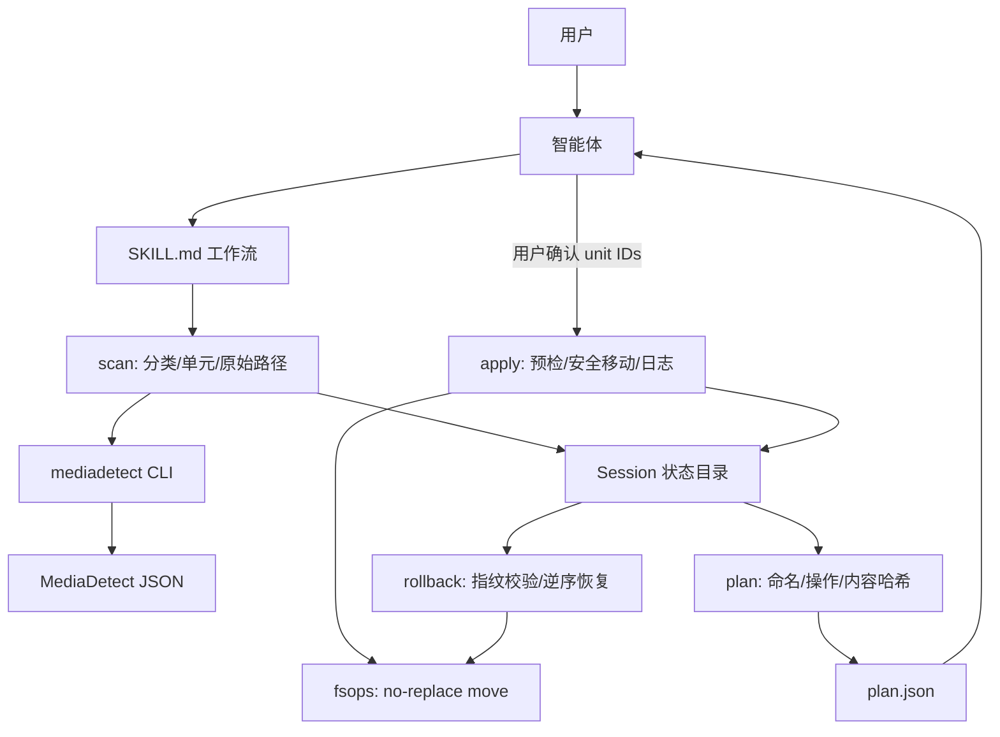

# media-title 智能体技能技术方案

| 字段 | 内容 |
| --- | --- |
| 标题 | media-title 智能体技能技术方案 |
| 主笔 | alang |
| 评审人 | alang（维护者兼技能使用者）；架构评审与对抗性评审（独立智能体） |
| 创建日期 | 2026-11-12 |
| 目标版本 | media-title v0.1.0（技能包）；MediaDetect v0.2.1（含多集解析修复） |
| 关联资源 | `scripts/mediadetect-title.sh`；MediaDetect CLI/JSON schema `"1"`；TMDB API；`skills/media-title/`；Agent Skills `SKILL.md` 规范 |

## 1. 背景与上下文

### 1.1 系统现状

MediaDetect 是一个无状态、只读的媒体类型检测库与 CLI：输入一个文件或目录，输出一个 JSON 对象，包含 `media_type`、文件级 `files[]`、TMDB 电影匹配 `match`、季集字段和 warning。它不写索引、不写缓存，也不修改输入目录。

仓库现有 `scripts/mediadetect-title.sh` 是第一个面向“整理”的包装脚本：

* 一次只接收一个路径；目录或电影文件都可以。
* 只对电影调用 TMDB 匹配，输出 `title original_title (year) {imdb_id}`。
* 目录名已含 `{...}` 时视为已整理并跳过。
* `MD_RENAME=ask` 时通过 `/dev/tty` 交互确认；`status=high` 直接执行，其余询问 Y/n。
* 只做目录重命名，或把单个电影文件移入同名目录；不处理剧集、季目录、字幕/封面/NFO，也没有计划文件和回滚。

MediaDetect 当前对剧集提供本地识别：`tv_episode`、`tv_season`、`tv_series`，`files[]` 中有 `season`、`episode`、`season_episode`，`summary.seasons` 汇总季号。但 TMDB 剧集匹配尚未实现，剧集没有远端元数据、年份和外部 ID。

本次评审还确认了四处与技能直接相关的检测边界：

1. `Show.S01E01E02.mkv` 这类多集写法当前不解析，会被判为 `movie`；与正常剧集混放时整目录为 `mixed`。
2. 单个剧集文件输入的 `media_type` 是 `tv_episode`，现有根分类没有这个分支。
3. CJK `第 N 集` 的 `season=null`；`title_candidates` 取决于文件名：带剧名前缀（如 `某剧.第2集.mkv`）通常保留剧名，裸集号（如 `第2集.mkv`）可能为空。同目录有 `S02E03` 时 `summary.seasons=[2]`，若按 `summary` 回退会把无季信息的集错误归入第二季。
4. `files[].path` 在 `internal/collect/collect.go:167` 被 NFC 归一化，不能直接作为真实文件路径使用。

### 1.2 核心技术痛点

1. **只能单条处理，无法面向媒体库。** 一个下载目录或媒体库根通常包含几十到几百个电影目录、剧集目录和散落文件。逐条调用脚本需要用户手工枚举，且不同目录的命名风格不一致，容易漏处理。
2. **电影专用，剧集无法整理。** 对剧集目录调用 TMDB 电影匹配会得到 `unmatched` 或错误结果；脚本没有“剧名/季目录”的概念，无法生成 `Show/Season 01/` 结构。
3. **自动执行缺少计划与回滚。** `status=high` 直接重命名，误匹配会立即改动文件系统；没有 dry-run 计划产物、逐项选择、变更日志或回滚。`/dev/tty` 交互也不适合由智能体代为执行的工作流。
4. **命名逻辑内嵌在 Bash + jq 中。** 标题清洗、ID 兜底、年份缺失、路径分隔符、未匹配分支都写在 jq 表达式里；新增剧集规则会继续放大脚本，测试只能靠人工。
5. **检测边界会直接变成整理错误。** 多集文件被当成电影会触发 TMDB 请求并生成错误的电影目录名；CJK 季号被 `summary.seasons` 污染会把不同季混在一起；多剧库根的顶层 `title` 只代表第一部剧。这些不是技能层“多写几个 if”能可靠兜住的，必须由 CLI 修复和技能层防御共同处理。
6. **路径与并发安全不足。** MediaDetect 返回 NFC 归一化路径；POSIX `rename` 会覆盖已存在目标；计划文件没有完整性校验；这些都会在“先计划、后执行”的窗口里造成误移动或数据覆盖。

失败链示例：

* **媒体库场景**：用户给出 `/Volumes/Media/Downloads` → 脚本一次只能处理一个子目录 → 用户手工循环 → 命名规则和确认行为在各次调用间不一致。
* **剧集场景**：用户给出 `Some.Show.S01.1080p.WEB-DL/` → 脚本按电影匹配 → 无输出或弱匹配 → 用户仍需手工建 `Season 01` 并移动文件。
* **多集场景**：`Show.S01E01E02.mkv` 被判为 movie → 技能查 TMDB → 生成 `Show E02 (年份)/` 这类错误目录。
* **误匹配场景**：`status=high` 但 TMDB 命中了同名翻拍片 → 脚本自动重命名 → 目录名被改错，且没有日志可回滚。

### 1.3 设计动机

现有脚本已经验证了“MediaDetect + 命名规则 + 文件操作”的方向，本次把它升级为可被智能体调用、可审阅、可回滚的通用技能：

* **MediaDetect 只做检测**：继续作为唯一元数据来源，不把解析、匹配规则复制进技能。
* **技能负责编排**：智能体负责理解用户意图、选择单元、解释计划；确定性脚本负责扫描、生成计划、预检、执行和回滚。
* **计划先行**：任何文件改动之前先生成完整计划，默认不执行；用户逐项确认后才动文件系统。
* **电影走 TMDB，剧集走本地识别**：v1 不为剧集引入联网匹配，保证结果可复现、无额外密钥和限流问题。
* **通用技能包**：按 Agent Skills 的 `SKILL.md` 规范组织，不绑定 Claude Code，可被复制或挂载到任意支持该规范的智能体。
* **安全边界可验证**：不覆盖、不删除非空目录、原子 no-replace 移动、按 session 隔离状态、计划内容哈希、`--expect-plan-id` 绑定确认、JSONL 指纹日志。
* **歧义一律 unplanned**：通用下载目录、多剧混放、多分部、季号未知且无上下文、歧义根模式、无法唯一映射的路径，都不猜；输出 `unplanned` 和明确原因，由用户手工处理或显式指定模式。

### 1.4 非目标

不做本次升级的后果：媒体库整理继续依赖人工逐条调用脚本；剧集目录仍然无法处理；误匹配仍可能无日志地改动文件。等库规模再扩大后再做，迁移成本和误操作风险都会更高。

本次正式非目标见 2.2。以下边界在本 Spec 内不可突破：

* **除 4.10 明确列出的多集解析修复外，不改变 MediaDetect 的检测行为与只读契约**：不新增媒体类型、不调整 matcher 评分、不改变 JSON 字段语义、不让 CLI 写文件。
* **不实现 TMDB 剧集匹配**：剧集只使用本地文件名和目录结构；不调用 TMDB TV API。
* **不删除、不覆盖、不合并用户目录**：只做 `mkdir`、`move`、`remove_empty_dir`（仅在目录为空时）；v1 禁止目录合并。
* **不自动执行**：`high` 置信度也必须经过用户确认；没有“无人值守整理”模式。
* **不做媒体库迁移**：v1 只在 `--root` 内整理，不强制拆分 `Movies/` 与 `TV/`，不移动库根之外的文件。

## 2. 目标与非目标

### 2.1 目标

* **G1 - 技能交付：通用 Agent Skill 包**：在 `skills/media-title/` 提供 `SKILL.md`、确定性辅助脚本、参考文档和计划 schema；技能可被复制或挂载到支持 Agent Skills 的智能体。验收：`SKILL.md` frontmatter 含 `name: media-title` 与可触发描述；包内无 Claude Code 专有依赖；`python3 -m py_compile` 通过；按 `SKILL.md` 的步骤可在临时目录完成一次扫描、计划、确认、执行、回滚闭环。
* **G2 - 电影整理**：对单电影文件、单电影目录、多电影目录分别生成计划；名称沿用 `scripts/mediadetect-title.sh` 的格式 `title original_title (year) {imdb_id}`，`original_title` 缺失或与 `title` 相同则省略，`imdb_id` 缺失时用 `{tmdb<id>}`，年份缺失时省略年份段。验收：测试覆盖 high/medium/low/unmatched/disabled/unavailable/multiple；只跳过形如 `{tt...}`/`{tmdb...}` 的已整理目录；多电影目录按电影拆分而不是把整个目录改成其中一部；同名字幕、NFO、封面随视频移动；多分部/多版本无法唯一归组时标记 `unplanned/unsupported_multipart`，既不猜也不拆成多个电影目录；单文件父目录只有通过“单电影目录”正面校验（4.3.1.1）时才整体重命名，否则按文件单元处理，避免把 `Downloads` 等通用容器当电影目录；已整理目录内的电影文件不重复套层。
* **G3 - 剧集整理**：使用 MediaDetect 本地识别生成 `剧名 (年份)/Season NN/` 结构；年份未知时省略年份；默认保留剧集原文件名，`--rename-episodes` 时按 `剧名 - SxxExx[ - 集标题].ext` 重命名；CJK `第 N 集`、单集文件、多剧库根、多集写法有明确降级规则。验收：覆盖 `tv_episode` 单文件、`tv_season`、`tv_series`、扁平 `Some.Show.S01...` 目录、多剧库根、已规范目录、季号缺失、CJK 与 SxxExx 混放；剧集不发起 TMDB 请求；通用下载目录散落文件、同名不同年份、多剧混放、无法确定剧名时 `unplanned`，不猜；`plan.json` 必须逐条列出 unplanned 条目及原因，不能只给计数。
* **G4 - 计划、执行与回滚安全**：扫描/计划阶段不修改媒体文件；执行前一次性预检全部选中单元；任何冲突使整个选择中止；移动使用 no-replace 原子操作；每个操作（含 `mkdir`/`remove_empty_dir`）执行前写 intent 快照、成功后写 done；按 unit 记录 `pending/applying/applied/failed/rolled_back`；`rollback` 与 `apply` 共用 session 锁，可以从日志派生已完成 unit，逆序、可重复地恢复；目录移动记录递归子树指纹，回滚时防止带走执行后新增的嵌套文件。验收：媒体树元数据指纹（排除 `.media-title`）在 `scan`/`plan` 前后不变；`apply`/`rollback` 必须带正确的 `--expect-plan-id`；目标已存在、跨设备、越界路径、符号链接、大小写/Unicode 冲突、计划哈希不符、源状态变化均被拦截；move 与日志之间的崩溃可由 intent 对账恢复；共享 mkdir 可跨 unit 表达；同一计划重复 `apply` 不重复移动；`rollback` 执行两次是幂等的。
* **G5 - 可测试、可移植、可维护**：辅助脚本只依赖 Python 3.9+ 标准库；不新增第三方 Python/Go 依赖；macOS 与 Linux 可用；路径包含空格、引号、中文、Unicode 组合字符时可正确处理；核心文件系统操作可注入/可 mock。验收：`python3 -m unittest discover -s skills/media-title/tests` 全绿；CI 在 `ubuntu-latest` 与 `macos-latest` 运行该测试；现有 Go 测试不受影响；`git diff` 中不出现新增依赖；no-replace 能力探测失败时有明确拒绝路径。
* **G6 - MediaDetect 多集解析与标题清理修复**：`parser` 识别连续多集写法 `S01E01E02`、`S01E01E02E03`，输出 `SeasonEpisode = "S01E01-E02"` / `"S01E01-E03"`，使其按 `tv_episode` 分类且不参与 TMDB 电影匹配；这里的“连续”必须是**集号数值连续**（`n, n+1, ...`，至少两段、无跳号），不是仅相邻的 `E` 段。同时修正 `mapping.go` 的 `displayTitles`/`stripEpisode`，确保 `title_candidates` 不再残留 `E02` 或 `E02E03`。验收：新增 parser/detect 测试；`Show.S01E01E02.mkv` 与 `Show.S01E01E02E03.mkv` 均为 `media_type=tv_episode`、`match.status=not_applicable`，且 `title_candidates` 均为 `["Show"]`；`S01E01-E02` 现有行为不变；非连续写法（如 `S01E01E03`、`S01E01E02E04`）仍不被误解析，由技能层对所有 `media_type` 标记 `unsupported_multi_episode`；`defaultVersion`、README、SPEC-001 已知限制、SPEC-002 版本口径与 `cmd/mediadetect/main_test.go` 的版本断言同步为 `v0.2.1`；其余 MediaDetect 测试全部通过。

### 2.2 非目标

* **NG1 - TMDB 剧集匹配**：不新增 `--match=tv`，不查询 TMDB TV，不引入 TVDB/IMDb 剧集数据（Deferred）。
* **NG2 - 联网标题猜解**：不让 LLM 或搜索引擎猜测剧名、年份、集标题；所有命名依据来自 MediaDetect 输出和可解释的文件名规则。
* **NG3 - 文件删除/覆盖/目录合并**：不删除非空目录，不覆盖同名文件，不合并目录树；`remove_empty_dir` 仅清理移动后确认空的源目录。
* **NG4 - 介质转换与下载**：不做转码、重封装、字幕下载、NFO 生成、刮削图片、去重。
* **NG5 - 媒体服务器集成**：不调用 Jellyfin/Emby/Plex API，不写它们的数据库，不触发扫描。
* **NG6 - 全局布局迁移**：v1 不做 `Movies/`、`TV/` 顶层拆分，不跨库根移动；需要时由用户显式指定不同的 `--root`。
* **NG7 - 平台扩展**：不针对 Windows 做专门测试；命名规则避免 Windows 非法字符，但不承诺 Windows 运行。
* **NG8 - MediaDetect 其他检测规则变更**：除 G6 的多集解析外，不新增媒体类型、不调整 matcher、不改变 JSON 契约；其他 CLI 变更受 4.10 约束。

非目标与风险的对应关系：NG1、NG2 对应剧集元数据不可复现的风险；NG3 对应误删/覆盖/合并风险；NG4、NG5 对应范围膨胀；NG6 对应用户库结构不可预期；NG7、NG8 对应兼容性与回归风险。

## 3. 架构设计与核心方案

### 3.1 总体架构



数据流分为三段，媒体文件写操作只发生在第三段：

1. **检测段（只读媒体文件）**：`scan` 调用 `mediadetect`，把 JSON 归一化为 `scan.json`；只在本 session 状态目录内写文件。
2. **计划段（只读媒体文件）**：`plan` 根据命名规则生成 `plan.json`，包含每个单元的操作、源状态、目标、置信度和警告。
3. **执行段（写媒体文件）**：用户确认后，`apply` 重新预检并执行选中单元，逐条写日志和完成状态；`rollback` 按日志逆序恢复。

### 3.2 核心模块职责

| 模块 | 职责 | 不负责 |
| --- | --- | --- |
| `SKILL.md` | 触发条件、工作流、如何展示计划、确认规则、何时调用脚本、失败时如何向用户解释 | 不内嵌复杂命名算法；细节放 `references/` |
| `scripts/media_title.py` | 唯一 CLI 入口；解析参数、初始化 session、分发子命令 | 不实现具体扫描/计划算法 |
| `scripts/media_title_lib/scan.py` | 根模式判定、分类、单元提取、原始路径映射 | 不命名、不写媒体文件 |
| `scripts/media_title_lib/naming.py` | 电影/剧集名称清洗、年份/ID 兜底、剧集结构 | 不读写文件 |
| `scripts/media_title_lib/plan.py` | 命名、操作生成、计划哈希、计划 schema 校验 | 不执行文件操作 |
| `scripts/media_title_lib/apply.py` | 预检、按 unit 执行、日志、完成状态、session 锁 | 不决定命名或用户是否确认 |
| `scripts/media_title_lib/rollback.py` | 日志读取、指纹校验、逆序恢复、幂等处理 | 不生成新计划 |
| `scripts/media_title_lib/fsops.py` | no-replace move、mkdir、remove_empty_dir、状态指纹、跨设备/大小写检查 | 不关心媒体语义 |
| `scripts/media_title_lib/paths.py` | 原始路径枚举、NFC 映射、路径边界/保护根、名称清洗 | 不决定目标名 |
| `scripts/media_title_lib/session.py` | session ID、状态目录布局、锁、原子写 JSON | 不执行媒体操作 |
| `references/naming.md` | 电影/剧集命名规则、边界情况、示例 | — |
| `references/mediadetect-json.md` | 使用的字段、缺失时的降级、schema 兼容、已知检测边界 | — |
| `assets/plan.schema.json` | 计划 JSON 的结构契约 | — |
| `tests/` | 单元测试与临时目录集成测试 | — |

模块拆分的目的不是增加抽象，而是让安全关键逻辑（`fsops`、`paths`、`session`）可以单独 mock 和测试；`SKILL.md` 仍然只面向一个入口命令。

### 3.3 数据流转与状态

```text
path
  -> scan: {session_id, mode, root, units[], skipped[], errors[], warnings[]}
  -> plan: {plan_id, session_id, root, options, units[{sources[], operations[], target, warnings}], summary}
  -> 用户确认（unit IDs）
  -> apply: 预检 -> 执行选中 unit -> state.json + apply.log.jsonl
  -> rollback: 读日志 -> 指纹校验 -> 逆序恢复 -> rollback.log.jsonl
```

`scan.json`、`plan.json`、`state.json`、`apply.log.jsonl`、`rollback.log.jsonl` 都位于同一个 session 目录。`plan_id` 是计划内容的哈希，用于把用户确认绑定到具体计划。

### 3.4 关键选型与约束

* **Python 3 标准库 + 小模块包**：需要可靠处理 Unicode、路径、JSON、原子操作和日志；避免 `jq` 依赖。模块拆分让 `fsops`/`paths`/`session` 可测试。
* **计划 JSON + 内容哈希**：用户可以在动文件前审阅；智能体可以按 unit 展示和选择；哈希防止确认后计划被替换。
* **按 session 隔离状态**：每次整理任务有独立目录，计划、日志、完成标记互不干扰；并发 session 不会误用彼此的 `.applied`。
* **MediaDetect 作为唯一检测源**：不复制 parser/matcher 规则；技能只消费 JSON，因此 MediaDetect 的规则演进会自动反映到技能。
* **剧集只本地识别**：不引入 TMDB TV 的密钥、限流和匹配歧义；文件名里的剧名/季集号已足够支撑目录级整理。
* **原位整理 + 禁止目录合并**：不预设用户的库布局；目录重命名的目标必须不存在，避免 POSIX rename 的合并/覆盖歧义。
* **逐项确认而非 high 自动**：用户明确选择“先出计划，逐项确认”；high 只影响展示顺序和警告，不改变执行门槛。

## 4. 详细设计

### 4.1 技能包布局

```text
skills/media-title/
├── SKILL.md                     # 技能入口：触发、工作流、确认规则
├── scripts/
│   ├── media_title.py           # CLI 入口：scan / plan / apply / rollback
│   └── media_title_lib/
│       ├── __init__.py
│       ├── scan.py
│       ├── plan.py
│       ├── apply.py
│       ├── rollback.py
│       ├── fsops.py
│       ├── paths.py
│       ├── session.py
│       └── naming.py
├── references/
│   ├── naming.md                # 命名规则与边界示例
│   └── mediadetect-json.md      # 使用的 JSON 字段、降级与已知检测边界
├── assets/
│   └── plan.schema.json         # 计划 JSON schema
└── tests/
    ├── test_scan.py
    ├── test_plan.py
    ├── test_apply.py
    ├── test_rollback.py
    ├── test_fsops.py
    ├── test_paths.py
    ├── test_session.py
    └── fixtures/                # 目录树、伪造 mediadetect JSON
```

`SKILL.md` 采用通用 Agent Skills frontmatter，不写入 Claude Code 专有配置：

```yaml
---
name: media-title
description: Organize local movie and TV directories with MediaDetect. Use when the user asks to rename, sort, or clean up downloaded movies or shows, or to apply a consistent library naming scheme.
metadata:
  version: 0.1.0
---
```

`SKILL.md` 正文控制在约 180 行以内，只保留工作流和关键判断；命名细节、JSON 字段和示例放 `references/`，按需读取。

### 4.2 输入与调用契约

辅助脚本只有一个入口：

```bash
python3 scripts/media_title.py scan   <path> [--out <scan.json>] [选项]
python3 scripts/media_title.py plan   --scan <scan.json> [--out <plan.json>] [选项]
python3 scripts/media_title.py apply  --plan <plan.json> --expect-plan-id <id> --select <ids|all> --yes [选项]
python3 scripts/media_title.py rollback --plan <plan.json> --expect-plan-id <id> [--select <ids|all>] --yes [选项]
```

通用选项：

| 选项 | 默认 | 说明 |
| --- | --- | --- |
| `--md-bin` | `mediadetect`（或 `MD_BIN`） | MediaDetect 可执行文件路径 |
| `--match auto\|on\|off` | `auto` | 电影匹配模式；剧集单元强制 `off` |
| `--probe off\|auto` | `off` | 默认只按文件名；需要时长证据时设 `auto` |
| `--mode auto\|single\|library` | `auto` | 根模式；见 4.3.1 |
| `--root <path>` | 见 4.3.1 | 所有目标路径必须位于此根下 |
| `--session <id>` | `scan` 生成 | 复用已有 session；`plan`/`apply`/`rollback` 默认从输入文件读取 |
| `--max-files` | `5000` | 透传 MediaDetect；达到上限时 `detection.truncated=true` |
| `--json` | 关闭 | 结果以 JSON 输出到 stdout；默认输出人类可读摘要 |
| `--out <path>` | — | **仅导出副本**；`scan`/`plan` 仍写 session 文件；`plan --out` 不改变“一 session 一 plan”约束 |

`plan` 选项：

| 选项 | 默认 | 说明 |
| --- | --- | --- |
| `--rename-episodes` | 关闭 | 启用 `剧名 - SxxExx[ - 标题].ext` 重命名 |
| `--keep-empty-source` | 关闭 | 不生成 `remove_empty_dir` 操作 |

`apply` 选项：

| 选项 | 默认 | 说明 |
| --- | --- | --- |
| `--expect-plan-id` | **必填** | 用户确认时看到的 `plan_id`；必须与计划文件和 `state.json` 一致，否则 `E_EXPECT_PLAN_MISMATCH` |
| `--select` | **必填** | `all` 或逗号分隔的 unit ID，例如 `u1,u3`；不接受序号 |
| `--yes` | **必填** | 明确确认执行；缺少时返回 `E_USAGE`，脚本不做交互式提问 |
| `--retry-failed` | 关闭 | 仅重试 `failed` 或对账后仍不完整的 `applying` 单元；未提供时这些单元返回 `E_UNIT_STATE_CONFLICT` |

`rollback` 选项：

| 选项 | 默认 | 说明 |
| --- | --- | --- |
| `--expect-plan-id` | **必填** | 用户确认时看到的 `plan_id`；与计划文件或 `state.json` 不一致时 `E_EXPECT_PLAN_MISMATCH` |
| `--session-dir <path>` | — | 当 `plan.json` 被替换/删除/移动时，直接指定 session 目录；必须与 `--expect-plan-id`、`state.json`、`applied-plan.json` 一致 |
| `--select` | 从 `apply.log.jsonl` 派生有日志条目的单元（`applying`/`applied`/`failed`） | `all` 或 unit ID；只回滚选中单元 |
| `--yes` | **必填** | 缺少时返回 `E_USAGE` |

输出位置与 session 布局：

```text
<root>/.media-title/sessions/<session_id>/
├── scan.json
├── plan.json               # 一个 session 最多一个 plan
├── applied-plan.json       # apply 首次执行前写入的不可变计划快照
├── state.json              # {session_token, plan_id, units: {u1: status, ...}}
├── apply.log.jsonl         # intent/done 两类记录 + from/to 指纹 + session_token
├── rollback.log.jsonl      # 回滚审计（同样含 intent/done 与 session_token）
└── apply.lock              # apply/rollback 共用的 session 排他锁
```

* `scan` 未传 `--session` 时生成 `session_id`（格式 `YYYYMMDDTHHMMSSZ-<8 hex>`）；人类输出和 JSON 都包含 `session_id` 与 `state_dir`。
* `scan` 同时生成随机 `session_token`（32 hex），写入 `scan.json`、`plan.json`、`state.json` 和每条日志；apply/rollback 校验它，防止复制或外来 session 目录驱动回滚。
* `state_dir` 是绝对路径，写入 `scan.json`、`plan.json`、`state.json`；apply/rollback 以 `state_dir` 为准并校验它等于 `<root>/.media-title/sessions/<session_id>`，避免 session 目录被移动后静默失效。
* `plan` 从 `scan.json` 读取 `session_id`，在同一个 session 目录写 `plan.json`。**一个 session 最多一个 plan**；`plan.json` 已存在时返回 `E_SESSION_HAS_PLAN`，需要重新计划请开新 session。
* `apply` 从 `plan.json` 读取 `session_id`，在同一个 session 目录写 `state.json` 和 `apply.log.jsonl`；`state.json` 记录当前 `plan_id`。
* `apply` 首次执行前把通过校验的 `plan.json` 原子复制为 `applied-plan.json`；`rollback` 在 `plan.json` 被替换或删除时只接受该快照，且 `plan_id` 必须与 `--expect-plan-id` 一致。`--out` 只导出副本，不改变 session 内的 `plan.json` 或该快照。
* `rollback` 从 `plan.json` 读取 `session_id`，写 `rollback.log.jsonl`。
* 显式传 `--session` 时必须与输入文件中的 `session_id` 一致，否则 `E_USAGE`，防止把 plan 写进另一个 session。
* session ID 只允许 `[A-Za-z0-9][A-Za-z0-9._-]{0,63}`；含 `/`、`\`、`..` 的 ID 直接 `E_USAGE`，防止日志路径穿越。
* session 之间完全隔离：不同 session 的 `state.json`、日志、锁互不影响；并发 session 操作同一目标时由 no-replace 和源状态校验兜底。
* `.media-title/` 是技能元数据，不算媒体目录；验收的“媒体树指纹”明确排除它。
* session 目录不能位于任何单元 source 之内；否则返回 `E_STATE_DIR_INSIDE_UNIT`。单单元模式下 root 取父目录/祖父目录正是为了保证这一点；用户显式把 `--root` 指到单元内部时拒绝。

启动预检：

* `scan` 启动时检查 `--md-bin` 可执行，并运行一次 `mediadetect --version`；输出必须 JSON 可解析且包含 `schema_version`。
* 只接受 `schema_version == "1"`；其他版本返回 `E_SCHEMA_UNSUPPORTED`，不生成半成品计划。
* 找不到 `mediadetect` 时给出安装命令并退出 2。

根的选择与 `--mode`：

| 模式 | 输入 | root | 单元 |
| --- | --- | --- | --- |
| `single` | 文件；父目录通过“单电影目录”正面校验（4.3.1.1） | 祖父目录 | 父目录（重命名父目录，不套层） |
| `single` | 文件；父目录是季目录且祖父是可信剧容器，show/season 名称已规范 | 祖父的父目录 | 文件 |
| `single` | 文件；父目录是季目录且祖父是可信剧容器，show/season 需要改名 | 祖父的父目录 | `unplanned/needs_directory_mode` |
| `single` | 文件；父目录是可信剧容器（show 目录），show 名称已规范 | 父目录的父目录 | 文件 |
| `single` | 文件；父目录是可信剧容器（show 目录），show 需要改名 | 父目录的父目录 | `unplanned/needs_directory_mode` |
| `single` | 其他文件 | 文件父目录 | 该文件（电影或单集） |
| `single` | 季目录（整名匹配季节标记）且父目录可信 | 祖父目录 | 该季 |
| `single` | 剧目录、电影目录（通过正面校验） | 父目录 | 该剧/该电影 |
| `library` | 目录 | 输入目录本身 | 直接子项或散落文件组 |
| `auto` | 任意 | 按 4.3.1 判定 | 按 4.3.1 判定 |

### 4.3 扫描与分组规则

#### 4.3.1 模式与根判定

`--mode auto` 的确定性规则，按顺序执行：

1. **输入是文件**：
   * 父目录通过“单电影目录”正面校验（4.3.1.1）→ `single`，unit = 父目录，root = 祖父目录；用于避免 `Movies/Inception (2010)/Inception.2010.mkv` 再套一层。
   * 父目录整名匹配季标记，且祖父目录通过“可信剧容器”校验：
     * show 与 season 目录名已是规范名（4.4.3）→ `single`，unit = 文件，root = 祖父的父目录；目标为 `<show>/<season>/`。
     * 否则 → `unplanned/needs_directory_mode`，提示用户扫描 show 目录；不得在季目录内嵌套，也不得把目标放到 root 之外。
   * 父目录整名匹配季标记但祖父目录不是可信剧容器 → `unplanned/ambiguous_season_parent`，不拿通用目录名当剧名。
   * 父目录通过“可信剧容器”校验（show 目录）：
     * show 目录名已是规范名 → `single`，unit = 文件，root = 父目录的父目录。
     * 否则 → `unplanned/needs_directory_mode`。
   * 父目录名包含扁平季标记（如 `S01`、`Season 1`、`第1季`）但不是整名季目录，且目录内还有其他剧集文件 → `unplanned/needs_directory_mode`，提示扫描父目录；不得把新 show 目录建进扁平季目录。
   * 否则 → `single`，unit = 文件，root = 父目录。
2. **输入目录整名匹配季标记**（`^Season\s*0?\d{1,2}$`、`^S0?\d{1,2}$`、`^第\s*\d{1,2}\s*季$`，大小写不敏感）且父目录通过“可信剧容器”校验 → `single`（季单元）；root = 祖父目录。父目录是通用容器名 → `unplanned/ambiguous_season_parent`。**整名匹配**，所以 `Some.Show.S01.1080p` 不属于本规则，走规则 5。
3. **输入目录的直接子项只包含同一部剧的季目录**（至少一个整名季目录；这些季目录的父目录通过“可信剧容器”校验；没有电影目录、剧目录或游离媒体文件）→ `single`（剧单元）；root = 父目录。
4. **输入目录的直接子项包含任何单元子目录**（电影目录、剧目录、或不属于同一部剧的季目录）→ `library`；root = 输入目录。若同时有散落媒体文件，记录 `warning: mixed_root`；散落文件仍作为独立单元，不丢弃。
5. **输入目录只有散落剧集文件**：
   * 按 `(归一化剧名, 年份)` 分组；所有文件必须指向唯一一组（所有 `title_candidates[0]` 归一化后相同，且非零年份集合最多一个）→ `single`（剧单元），root = 父目录。
   * 出现多个互不相同的剧名、多个不同非零年份、或同名但年份冲突 → `unplanned/ambiguous_loose_shows`，不猜。
   * 目录名只能作为佐证：归一化后必须与该唯一剧名匹配；不匹配时忽略目录名并记录 `warning: container_name_ignored`，不能反过来用目录名合并文件。
6. **输入目录只有散落电影文件**：
   * `distinct_movies <= 1` 且目录通过“单电影目录”正面校验 → `single`，unit = 目录，root = 父目录。
   * 否则 → `library`；按 `group_key` 生成 movie 单元（文件单元），root = 输入目录。即使只有一部电影，也不得因为目录是 `Downloads` 之类的通用容器而重命名整个目录。
7. **输入目录同时有散落电影和剧集文件**（没有单元子目录）→ `library`，`mode_reason=mixed_loose_files`；电影按 `group_key`、剧集按规则 5 分别生成单元。剧集部分无法唯一分组时，只把剧集部分标 `unplanned/ambiguous_loose_shows`，电影单元仍保留。
8. 仍无法判定（例如子目录既像剧又像电影、多个候选剧名冲突）→ `E_AMBIGUOUS_MODE`，要求用户显式传 `--mode single|library`。

“单元子目录”指自身可独立成为单元的直接子目录：电影目录、剧目录、季目录。判断前先读取子目录内容，不能只看名字。

#### 4.3.1.1 “单电影目录”正面校验

规则 1 和规则 6 只有在父目录/输入目录通过以下**全部**条件时，才允许把目录整体当作一个 movie 单元并重命名：

1. 目录内恰好有一个 `role=feature` 主视频组（一个主视频 + 同 stem 侧车，不含多分部/多版本）。
2. 目录内其他条目全部可以归属到该电影组：同 stem 的 `.srt/.ass/.ssa/.sub/.idx/.nfo/.jpg/.jpeg/.png/.webp`，电影级 `poster.jpg`/`fanart.jpg`/`banner.jpg`/`logo.png`/`movie.nfo`，已知系统元数据（`.DS_Store`、`Thumbs.db`、`desktop.ini`），已知电影级子目录（`Subs/`、`Subtitles/`、`字幕/`、`Extras/`、`Featurettes/`、`Trailers/`），或 MediaDetect 判为 `non_feature`/`auxiliary` 且属于该组的文件；不得有其他子目录、其他视频文件、`.part`、其他隐藏文件或其他未知条目。未识别扩展名的文件（如 `.iso`）也视为“其他条目”，阻止整体重命名。
3. 目录 basename 去掉发布标签/方括号/年份后，与单电影单元检测的 `match.best.title` 或 `match.best.original_title` 归一化后匹配（相等或包含）；或者 basename 已经是目标命名格式（标题 + 年份 + ID）。若 `--match=off` 或没有 `best`，本条件不成立，不得整体重命名。仅“目录里只有一个电影”不构成正面证据。
4. 目录 basename 不是通用容器名：`Downloads`、`Download`、`Incoming`、`Temp`、`Tmp`、`New Folder`、`Movies`、`Movie`、`Films`、`Media`、`Video`、`Videos`、`电影`、`影片`、`下载`、`临时`（大小写不敏感，允许末尾数字/空格，如 `Downloads 2`）。

任一条件不满足 → 不得把该目录当电影目录；按文件单元处理（root = 文件父目录）或 `unplanned`，并在计划中说明原因。

`--mode single` 与 `--mode library` 跳过上述推断，直接使用指定模式；若指定的模式与输入形态明显不符（例如 `single` 却检测到多部电影），返回 `E_MODE_MISMATCH`。

`scan.json` 记录 `mode`、`mode_reason`、`root`，方便智能体向用户解释“为什么这样分组”。

#### 4.3.2 根分类

1. 对输入路径调用一次 `mediadetect --match=off --probe=<off|auto> --max-depth 0 --max-files <n>`，取得本地类型和文件级结果。
2. **显式传 `--max-depth 0`**：MediaDetect 的深度超限是静默跳过，不会置 `detection.truncated`；`0` 表示不限深度，避免无提示漏文件。
3. 按 `media_type` 分支：
   * `movie` / `movie_collection` 且无 `tv_episode`：电影范围。
   * `tv_episode`：单集文件范围，按 4.3.3 生成一个剧单元。
   * `tv_season` / `tv_series` 且无 `movie`：剧集范围。
   * `mixed`：按直接子项和文件级结果拆分；不要直接把顶层 `match` 当作单元结果。
   * `non_feature` / `auxiliary` / `other`：不生成单元，记录原因。
   * `ok:false` 或退出码 2：记录错误，不生成单元。
4. `detection.truncated=true`（`--max-files` 达到上限）时，记录 `warning.code = "scan.truncated"`，**不生成执行计划**；要求用户缩小范围或提高 `--max-files`。该码与 MediaDetect `detect.go` 输出的 warning 保持一致，不再使用 `scan_truncated` 别名。

#### 4.3.3 单元提取

| 输入形态 | 单元 | 说明 |
| --- | --- | --- |
| 单个电影文件 | movie，一个 | 父目录通过单电影目录正面校验时 unit = 父目录、root = 祖父目录；否则 unit = 文件、root = 父目录；父目录含其他视频/未知条目时不得整体重命名 |
| 单电影目录 | movie，一个 | `distinct_movies <= 1` 且通过 4.3.1.1 正面校验；目录整体重命名 |
| 多电影目录 | 每个电影组一个 movie 单元 | 不以整个目录为单位命名；按 `group_key` 或文件聚合 |
| 散落电影文件（同一目录） | 每个 `group_key` 一个 movie 单元 | 同一电影组时归入同一目标目录 |
| 多分部/多版本（见 4.4.2 表） | `unplanned/unsupported_multipart` | 任一文件命中分部标记且不能证明是完整单文件；v1 不猜、不拆、不自动归组 |
| 单个剧集文件 | tv，一个 | 按 4.3.1 规则 1 选择 root；父目录是季/show 目录且名称不规范时 `unplanned/needs_directory_mode`；否则取可信容器或 `title_candidates[0]` |
| 单个剧集目录 | tv，一个 | 可能是 `tv_season` 或 `tv_series` |
| 剧集库根（含多个子目录） | 每个直接子目录一个 tv 单元 | 必须按子目录拆分；不得用顶层 `title` 代表整个库 |
| 散落剧集文件（同一目录） | 唯一 `(剧名, 年份)` 时一个 tv 单元；否则 `unplanned/ambiguous_loose_shows` | 所有 `title_candidates[0]` 归一化后必须相同；非零年份集合最多一个；通用容器名只作佐证 |
| 电影与剧集混放 | 分别按上述规则生成单元 | 顶层 `mixed` 只用于分类，不作为单元 |

单单元检测：

* 电影单元：`mediadetect --match=<auto|on|off> --probe=<off|auto> --max-depth 0 --max-files <n> -- <unit path>`；优先使用 `.match.best`，目录内多文件时使用 `files[].match.best` 并去重。
* 剧集单元：`mediadetect --match=off --probe=<off|auto> --max-depth 0 --max-files <n> -- <unit path>`；只使用本地字段，绝不发 TMDB 请求。
* 多剧库根的顶层 `title` 只代表第一部剧，**不得**用于整个库的命名；每个子目录单独调用检测。

#### 4.3.4 原始路径映射（NFC 防御）

MediaDetect 的 `files[].path` 是 NFC 归一化的相对路径，真实文件系统可能保存 NFD 或其他形式。技能必须：

1. 用 `os.scandir` 递归枚举单元目录，遵守与 MediaDetect 相同的跳过规则（隐藏项、系统目录、符号链接）。
2. 对每个真实路径计算 `NFC(relpath)`，建立 `nfc_rel -> raw_abs_path` 映射。
3. 用 MediaDetect 的 `files[].path` 做 NFC 匹配，取得对应的原始路径。
4. 匹配不到，或同一 NFC 键对应多个原始路径 → 该文件 `unplanned/E_PATH_IDENTITY`，不猜、不移动。
5. 所有文件操作使用原始路径；NFC 只用于比较和展示。
6. **全有或全无**：单元的主视频（movie）或至少一个必需剧集文件（tv）无法唯一映射，或任一必需 source 映射失败 → 整个 unit `unplanned/E_PATH_IDENTITY`，不生成任何操作；禁止出现“只移动侧车、不移动主视频”或“只移动部分剧集”的部分单元。

不要求 MediaDetect 新增 `raw_path` 字段；如果未来新增，可简化映射，但技能不能依赖它。

#### 4.3.5 已整理识别与幂等

* 电影目录名含形如 `{tt1234567}` 或 `{tmdb123}` 的 ID 标签：记录 `skipped/already_organized`，不生成操作；其他花括号内容不视为已整理。
* 电影文件已经在目标同名目录内（父目录 basename == 目标名）：跳过，避免 `Inception (2010)/Inception (2010)/...` 嵌套。
* 剧集路径已满足 `<干净剧名>/Season NN/`，或 `<干净剧名> (<年份>)/Season NN/`：记录跳过。
* 目标路径与源路径相同：用 `os.path.samefile`（两者都存在时）或规范化 `realpath` 比较，不用字符串相等。
* 第二次运行同一输入、同一 session 时，计划中 `planned` 单元数必须为 0；否则视为幂等性缺陷。

#### 4.3.6 失败与部分结果

* 单个单元检测失败不终止整次扫描；`errors[]` 记录单元路径、MediaDetect 退出码和错误消息，其他单元继续。
* `detection.truncated=true` 或达到 `--max-files` 上限时，扫描记录 `warning.code = "scan.truncated"`，不基于截断结果生成执行计划。
* 扫描阶段不写媒体文件；`scan.json` 只写 session 目录或用户显式指定的 `--out` 路径。

### 4.4 命名与目标路径规则

#### 4.4.1 通用清洗

所有进入目标名的片段经过同一套清洗：

1. Unicode NFC 归一化。
2. `/` 替换为 `-`；`:` 替换为 ` -`；控制字符替换为空格。
3. 连续空白折叠为单个空格；去掉首尾空白。
4. 去掉结尾的 `.` 和空格（避免跨平台非法名）。
5. 单个路径分量 UTF-8 字节数不超过 240；超长时优先截断标题部分，保留年份和 ID 标签。
6. 保留中文、日文、韩文、拉丁字母、数字和常见标点；不强制转拼音或英文。
7. 清洗后若为空、`.` 或 `..`，该单元 `unplanned`，不生成危险路径。

#### 4.4.2 电影名称

```text
<target> = <title>[ <original_title>][ (<year>)][ {<imdb_id>|tmdb<id>}]
```

| 字段 | 规则 |
| --- | --- |
| `title` | 必填；来自 `match.best.title`。为空则该单元 `unplanned` |
| `original_title` | 非空且与 `title` 不同才追加，避免重复 |
| `year` | `match.best.year > 0` 时追加；否则省略整个年份段 |
| ID | `imdb_id` 非空用 `{tt...}`；否则 `tmdb_id > 0` 用 `{tmdb<id>}`；否则省略整个 ID 段 |

示例：

| 输入 | 匹配结果 | 目标 |
| --- | --- | --- |
| `流浪地球2.2023.1080p.mkv` | title=流浪地球2, original=The Wandering Earth II, year=2023, imdb=tt13539646 | `流浪地球2 The Wandering Earth II (2023) {tt13539646}/` |
| `Inception.2010.mkv` | title=Inception, original=Inception, year=2010, imdb=tt1375666 | `Inception (2010) {tt1375666}/` |
| `某片.mkv` | title=某片, original=null, year=0, imdb=null, tmdb=123 | `某片 {tmdb123}/` |
| 未匹配但有 best | title=某片, year=2020, score 低于阈值 | `某片 (2020)`，`warning: weak_match`，需确认 |

电影目标路径：

* **目录输入**：只有通过 4.3.1.1 正面校验时，才整体重命名为 `<parent>/<target>`；目录内的字幕、NFO、封面不单独列出，随目录一起移动。未通过校验时按多电影/文件单元处理，不重命名通用容器。
* **文件输入，父目录通过单电影目录正面校验**（4.3.1.1）：unit = 父目录，root = 祖父目录；重命名父目录，不新建嵌套目录，也不把 `.media-title` 放进影片目录。
* **文件输入，其他情况**：`<parent>/<target>/` 作为新目录；移动主视频 + 同 stem 的附属文件（`.srt/.ass/.ssa/.sub/.idx/.nfo/.jpg/.jpeg/.png/.webp`）。
* **多分部/多版本**：至少覆盖以下 token；任一文件命中且无法证明是完整单文件时，v1 标记 `unplanned/unsupported_multipart`，不自动拆成多个电影目录，也不猜。

| 类别 | 示例 |
| --- | --- |
| CD/Disc/Disk | `CD1/CD2`、`Disc1/Disc2`、`Disk.A/Disk.B` |
| Part/Pt | `Part1/Part2`、`Part.A/Part.B`、`Pt1/Pt2` |
| 分数式 | `1of2/2of2`、`1-2` 后缀 |
| 上下/前后 | `上集/下集`、`上部/下部`、`前篇/后篇` |
| 字母后缀 | `Movie-A/Movie-B` |

计划级规则：若两个 movie 单元解析到同一 TMDB id、同一目标 basename，或同一归一化 `(title, year)`，则**全部**标 `unplanned/unsupported_multipart`，不生成任何 move；不得因为匹配结果不同而把一部电影拆成两个目录。单个文件命中分部 token 但没有配套另一半时，也标 unplanned。

* **多电影目录**：每个目标目录建在 **root 的直接下级**，不嵌在某个电影子目录内部。若 root 就是合集目录输入，目标建在合集目录内；合集目录清空后生成 `remove_empty_dir`。
* **目录已存在**：一律冲突；v1 不允许把目录重命名合并进已存在目录，也不提供 `--merge-existing`。
* **文件目标已存在**：冲突；不覆盖、不自动加后缀。
* **目标在源内部或源在目标内部**：预检拒绝，避免递归移动。
* **父目录同名**：电影文件已经在目标同名目录内时跳过（见 4.3.5）。

#### 4.4.3 剧集名称与结构

```text
<show dir>   = <show>[ (<year>)]
<season dir> = Season <NN>
<episode>    = 原文件名
             | <show> - S<NN>E<MM>[ - <episode title>].<ext>   # --rename-episodes
```

| 字段 | 规则 |
| --- | --- |
| 剧名 | 目录名通过“可信剧容器”校验且与唯一候选剧名一致时使用目录名（去掉季标记、清晰度、来源、发布组、方括号内容后，把 `.`/`_` 分隔符转为空格）；否则使用 `title_candidates[0]`，且所有文件的候选必须一致；都不可用时 `unplanned`；清洗规则同 4.4.1 |
| 年份 | 仅当目录名或文件候选中有唯一且合理的年份时使用；同一可信 show 目录内多个年份视为候选噪声则省略并 `warning: ambiguous_year`；散落剧集分组按 4.3.1 规则 5，多个不同非零年份直接 `unplanned/ambiguous_loose_shows` |
| 季号 | **逐文件**使用 `files[].season`；`summary.seasons` 只用于展示和一致性检查，**不得**用来给没有季字段的文件补季号；再次从目录名 `Season N`/`S0N`/`第 N 季` 读取；`season == 0` 映射为 `Season 00`（特别篇），不并入第一季 |
| 集号 | `files[].season_episode` 或 `season`+`episode`；CJK `第 N 集` 保留原文件名 |
| 集标题 | 仅从文件名 `SxxExx` 之后、且不含发布标签的片段提取；无法可靠提取则省略 |

可信剧容器：

* 目录名不属于通用容器名：`Downloads`、`Download`、`Incoming`、`Temp`、`Tmp`、`New Folder`、`Movies`、`Movie`、`Films`、`TV`、`TV Shows`、`Shows`、`Media`、`Video`、`Videos`、`剧集`、`电视剧`、`电影`、`影片`、`下载`、`临时`（大小写不敏感，允许末尾数字/空格，如 `Downloads 2`、`影视下载` 中的通用词按包含匹配拦截）。
* 且必须同时满足：
  1. 所有剧集文件的 `title_candidates[0]` 归一化后必须相同（只有一个值）；出现多个不同剧名 → 直接 `unplanned/ambiguous_loose_shows`，目录名不能覆盖这个结论。
  2. 目录名归一化后与该唯一剧名匹配（相等或包含），或者目录内有季子目录且这些季目录中的剧集文件也指向同一剧名。
* “目录内至少有两个剧集文件”**不再单独构成**可信证据；只有文件数而没有名称一致性时，不能用目录名当剧名。
* 目录名与候选剧名不一致时，忽略目录名并记录 `warning: container_name_ignored`；不能用目录名把多部剧合并。
* 不满足时，不能用父目录名当剧名；改用 `title_candidates`；散落文件出现多个互不相同的剧名时 `unplanned/ambiguous_loose_shows`。
* 同名不同年份：`title_candidates[0]` 相同但非零年份集合有多个不同值（如 2004/1978）→ 整个剧集组 `unplanned/ambiguous_loose_shows`，不得省略年份后合并。

季号判定：

* 4.3.1 规则 2 的季目录判定只接受**整名**季标记（`^Season\s*0?\d{1,2}$`、`^S0?\d{1,2}$`、`^第\s*\d{1,2}\s*季$`）；`Some.Show.S01.1080p` 不是季目录，仍按扁平剧目录处理。季号本身可以从目录名的 `Season N`/`S0N`/`第 N 季` 片段读取，但不得因此把整名不匹配的目录当季单元。
* 文件有 `season`：使用该季。
* 文件 `season=null` 且 `season_episode` 是 CJK `第 N 集`：进入“季号未知”分支；**即使同目录其他文件有 Season 2，也不得把它归入 Season 2**。
* 所有文件季号未知、且都在同一个剧目录内：建议 `Season 01`，标记 `warning: season_inferred`，必须用户确认。
* 多个未知季或无法判断是否同剧：单元 `unplanned`，不猜。

目标结构与操作最小化：

* 若输入是 `<show>/<season>` 形式且 show 目录只需改名：优先对 show 目录执行一条 `move`，不逐集移动；此时 unit 的 source/target 都是 show 目录，计划展示必须明确 current/target 是 show 目录，而不是季目录。
* 若输入是季目录且只有 season 需要改名：对 season 目录执行一条 `move` 到 `<show>/Season NN/`，不逐集移动。若目标季目录已存在，预检返回 `E_TARGET_EXISTS`，不合并。
* 若输入是季目录且 show 与 season 两者都需要改名：v1 返回 `unplanned/needs_directory_mode`，要求改为扫描 show 目录；避免在同一计划里对 show 和 season 做两次相互影响的目录 move。
* 若输入是扁平的季目录（如 `Some.Show.S01.1080p.WEB-DL/`）：新建 `Show (Year)/Season NN/`，把剧集逐条移入；源目录在确认为空后生成 `remove_empty_dir`。
* 若 show 目录下已有多个季目录：只重命名 show 目录，季目录和文件保持原位。
* 若输入是文件，父目录是季目录或可信 show 目录：只有 show/season 名称已规范时才把文件移入；否则整个 unit `unplanned/needs_directory_mode`，不得在季目录内新建 show 目录，也不得把目标构造到 root 外。用户应改为扫描 show 目录。
* 目标 show/season 目录已存在时，允许**逐文件移入**（这是追加季/集的正常场景）；这不是目录合并，任何最终文件目标已存在都必须报冲突。
* 共享 show 目录的多个单元必须在同一计划里做跨单元路径重叠检查，避免一个单元移动另一个单元的目标。

集文件规则：

* 默认保留原始文件名，只移动目录。
* `--rename-episodes` 时：
  * 标准 `SxxExx`：`剧名 - S01E01.ext`；有干净集标题时追加 ` - 标题`。
  * 范围 `S01E01-E02`：保留范围写法。
  * CJK `第 N 集`：保留原名，`warning: cjk_episode_no_season`。
  * 同一 `SxxExx` 多版本：优先保留原名；必须重命名时追加 ` - <resolution>` 或 ` - <source>` 区分；仍冲突则 `unplanned`。
* 同 stem 字幕随对应视频移动；`Movie.en.srt` 这类带语言后缀的侧车，只有在同一单元内该前缀唯一对应一个视频时才移动，否则留在原处并警告。
* show 级 `poster.jpg`、`fanart.jpg`、`banner.jpg`、`logo.png`、`tvshow.nfo`、`season.nfo` 随 show 目录移动；无法归属的附属文件留在原处并在结果中列为 `leftover`。
* `sample`/`trailer`/`花絮` 等 `non_feature` 文件随所在电影/剧目录移动，不放进单集目录。

#### 4.4.4 多集写法与 CJK 降级

| 写法 | CLI 修复后 | 技能行为 |
| --- | --- | --- |
| `S01E01` | `tv_episode`，`S01E01` | 正常剧集 |
| `S01E01-E02` | `tv_episode`，`S01E01-E02` | 正常范围 |
| `S01E01E02` | `tv_episode`，`S01E01-E02` | 正常范围（G6） |
| `S01E01E02E03` | `tv_episode`，`S01E01-E03` | 正常范围（G6） |
| `S01E01E03`（非连续） | 不匹配，仍是 movie | 技能层标记 `unsupported_multi_episode`，不查 TMDB、不自动命名 |
| `第 N 集` | `tv_episode`，`season=null` | 保留原文件名；季号未知分支 |

技能层在提取任何单元之前（不区分 `movie` 与 `tv_episode`），先扫描文件名中的多集模式；命中非连续多集、集号跳号或无法证明完整连续的模式时，该单元 `unplanned/unsupported_multi_episode`，绝不发起 TMDB 请求，也不进入剧集移动。

G6 还必须修正 `mapping.go` 的 `displayTitles`/`stripEpisode`：连续 `E` 段和范围都要从 `title_candidates` 中剥离，不能留下 `Show E02` 或 `Show E02E03`；2 段与 3 段都必须断言 `title_candidates == ["Show"]`。技能层额外用防御正则覆盖 `E01E03`、`E01E02E04`、`S01E01E02-E04` 等组合；即使 CLI 输出仍带污染，也不得把 `E02`/`E02E03` 当剧名。

#### 4.4.5 置信度与展示

| 匹配状态 | 计划处理 | 展示 |
| --- | --- | --- |
| `high` | 生成操作 | 正常；仍需用户确认 |
| `medium` | 生成操作 | 标记“建议核对” |
| `low` | 生成操作 | 标记“低置信度” |
| `unmatched` 且有 best | 生成操作 | 标记“弱匹配”，默认排在后面 |
| `unmatched` 无 best | 不生成操作 | `unplanned/no_match` |
| `multiple` | 不把顶层 best 当单元结果；使用 `files[].match.best` 生成多电影单元 | 标记“多电影目录” |
| `not_applicable` | 非电影（剧集/附属） | 不参与电影命名 |
| `disabled` / `unavailable` | 用本地标题/年份生成降级名称（若有） | `warning: no_tmdb`；无本地标题则 `unplanned` |
| `error` | 记录单元错误；`auto` 可降级本地命名，`on` 不猜 | `warning: tmdb_error`；默认 `unplanned` |

如果用户期望 IMDB ID 但环境没有 `TMDB_API_KEY`，扫描结果中用 `warning: tmdb_key_missing` 提示；仍可按本地标题生成计划，不把缺少密钥当作失败。

### 4.5 计划数据模型

`plan.json` 的结构由 `assets/plan.schema.json` 定义，核心字段：

```json
{
  "schema_version": "1",
  "session_id": "20261112T120000Z-a1b2c3d4",
  "session_token": "9f3c1d7e5a2b4c6d8e0f1a3b5c7d9e2f",
  "state_dir": "/Volumes/Media/Downloads/.media-title/sessions/20261112T120000Z-a1b2c3d4",
  "plan_id": "sha256:4f2c...",
  "generated_at": "2026-11-12T12:00:00Z",
  "tool_version": "0.1.0",
  "root": "/Volumes/Media/Downloads",
  "mode": "library",
  "options": {
    "match_mode": "auto",
    "probe_mode": "off",
    "rename_episodes": false
  },
  "units": [
    {
      "id": "u1",
      "kind": "movie",
      "status": "planned",
      "confidence": "high",
      "match_status": "high",
      "sources": [
        {
          "path": "/Volumes/Media/Downloads/流浪地球2.2023.1080p",
          "kind": "directory",
          "state": {"dev": 16777220, "ino": 8612345, "mtime_ns": 1762900000000000000}
        }
      ],
      "source_hash": "sha256:9a3b...",
      "target": {
        "path": "/Volumes/Media/Downloads/流浪地球2 The Wandering Earth II (2023) {tt13539646}",
        "kind": "directory"
      },
      "operations": [
        {
          "op": "move",
          "from": "/Volumes/Media/Downloads/流浪地球2.2023.1080p",
          "to": "/Volumes/Media/Downloads/流浪地球2 The Wandering Earth II (2023) {tt13539646}",
          "from_state": {"dev": 16777220, "ino": 8612345, "mtime_ns": 1762900000000000000}
        }
      ],
      "warnings": [],
      "evidence": {"tmdb_id": 842675, "imdb_id": "tt13539646", "score": 0.94, "year": 2023}
    }
  ],
  "unplanned": [
    {
      "path": "/Volumes/Media/Downloads/Movie.2020.CD1.mkv",
      "kind": "movie",
      "reason_code": "unsupported_multipart",
      "reason": "CD1/CD2 cannot be reliably grouped"
    }
  ],
  "skipped": [],
  "errors": [],
  "summary": {"units": 1, "planned": 1, "skipped": 0, "unplanned": 1, "operations": 1}
}
```

计划完整性：

* `plan_id` 是内容哈希：对去掉 `plan_id` 和 `generated_at` 的规范化 JSON（键排序、无多余空白、UTF-8）计算 SHA-256，格式 `sha256:<64 hex>`；`session_token`、`state_dir` 参与哈希。
* `apply`/`rollback` 重新计算并校验；不匹配返回 `E_PLAN_HASH_MISMATCH`。
* `apply`/`rollback` 还要求 `--expect-plan-id` 与 `plan.json`、`state.json` 中的 `plan_id` 三者一致；用户确认的是哪个计划，就只能执行哪个计划。不一致返回 `E_EXPECT_PLAN_MISMATCH`。
* `apply` 首次执行前把通过校验的计划原子写为 `<session>/applied-plan.json`；之后 `rollback` 在 `plan.json` 被替换/删除时，用 `--session-dir` 指向原 session 目录并读取该快照继续，`plan_id` 必须与 `--expect-plan-id` 一致。快照存在但哈希不符 → `E_PLAN_HASH_MISMATCH`；`--session-dir` 的 token/state_dir 不匹配（包括 session 目录被移动）→ `E_SESSION_STATE_MISSING`。
* `units[]` 只包含可执行的 `planned` 单元；`unplanned[]` 每条至少含 `path`、`kind`、`reason_code`、`reason`；`skipped[]` 每条至少含 `path`、`reason_code`、`reason`。`unplanned`/`skipped` 不分配可执行 unit ID，不能被 `--select`。
* `reason_code` 是稳定枚举，至少包括：`unsupported_multipart`、`unsupported_multi_episode`、`ambiguous_loose_shows`、`ambiguous_season_parent`、`needs_directory_mode`、`no_match`、`E_PATH_IDENTITY`、`season_unknown`、`name_empty`。
* `session_id`、`session_token`、`plan_id`、`unit.id` 都是不可信输入，使用前做字符集和存在性校验。

单元模型：

* 一个单元可以有多个 `sources[]`：散落剧集、视频 + 侧车字幕、逐文件移入 season 的剧集都属于多源。
* 每个 source 记录 `path`、`kind`、`state`（文件：`dev/ino/size/mtime_ns`；目录：`dev/ino/mtime_ns`）。
* `source_hash` 是全部 source state 的规范化哈希；`apply` 开始前校验一次，每个 `move` 前再校验对应 source。
* **source 覆盖不变量**：`unit.sources[]` 必须覆盖所有会被 `move` 的路径。如果 `move` 的是祖先目录（例如把 `Show/Season 01` 输入中的 `Show` 目录改名），source 就是该祖先目录，不再单独列其子项；如果逐文件移动，source 是每个文件。计划生成阶段必须校验“每个 `move.from` 等于某个 source，或是某个 source 的后代”，否则 `E_INTERNAL`。
* **全有或全无**：单元内任一必需 source 无法映射或状态不可验证时，整个 unit 进入 `unplanned`，不生成任何操作；不允许只移动侧车、只移动部分剧集或只移动主视频的一部分。
* **目录子树指纹**：目录 `move` 在日志中记录 `to_subtree_hash` 与 `entry_count`，覆盖移动后目标目录下所有后代的相对路径、类型、`dev/ino/size/mtime_ns`；回滚前重新计算，发现新增/删除/修改即冲突。
* **执行前重新枚举**：`apply` 对每个选中 unit 用与 `scan` 相同的原始路径规则重新枚举其 sources，以及父目录中**会归属到该 unit 的条目**（同 stem 侧车、同一 movie group 的视频/附属、同一剧集的 episode 文件），与 `sources[]` 比较；这些条目新增/删除/替换 → `E_SOURCE_STATE_MISMATCH`，整个选择零改动。无关文件不算变化。

操作类型只有三种：

| `op` | 字段 | 含义 |
| --- | --- | --- |
| `mkdir` | `path`, `pre_exists`, `pre_state` | 创建目录；已存在且是目录则成功，但记录 `created=false`；intent 必须记录执行前是否存在及其 inode |
| `move` | `from`, `to`, `from_state` | 移动文件或目录；`from` 必须存在，`to` 必须不存在；使用 no-replace；目录 move 的 done 记录 `to_subtree_hash` |
| `remove_empty_dir` | `path`, `pre_empty`, `removed_state` | 仅当目录为空时删除；用于清理移动后的空季目录；intent 记录执行前的空状态与 inode |

每个操作的 intent 先写入执行前快照，done 写入实际结果；执行器不得依赖“只有 done 才是真实状态”，崩溃恢复按 4.8 的对账表处理。

操作顺序约束：

1. 所有 `mkdir` 在 `move` 之前。
2. 目录重命名用一条 `move`，不拆成逐文件移动。
3. `remove_empty_dir` 在最后，按路径深度从深到浅。
4. 同一 `move` 的 `from` 和 `to` 不能与另一个 `move` 的源或目标重复；`mkdir` 允许跨单元重复（共享父目录），`apply` 预检去重：第一个 `mkdir` 负责创建并记 `created=true`，后续同路径操作记 `created=false`。
5. 目标路径必须唯一；大小写不敏感文件系统上还要做大小写折叠后的唯一性检查；Unicode 做 NFC 归一化后比较。
6. 跨单元路径不能重叠：一个单元的 source/target 不能是另一个已选单元 source/target 的祖先或后代；共享的 `mkdir` 目录除外。
7. 如果一个单元只选 `Season 02`，而 `Show` 父目录尚不存在，`apply` 必须依据该单元的 `mkdir` 操作创建父目录，不能因为另一个单元未选中而失败。
8. 任一单元进入 `unplanned` 时，该单元不生成任何 `mkdir`/`move`/`remove_empty_dir`；`--select all` 只覆盖 `units[]`，不包含 `unplanned`/`skipped`。

### 4.6 确认与执行流程

`SKILL.md` 规定的标准工作流：

1. **扫描**：运行 `scan`，输出 `session_id`、`mode`、单元列表、跳过/错误原因。
2. **计划**：运行 `plan`，得到 `plan.json`；媒体文件未被改动。
3. **展示**：用紧凑表格向用户展示，必须包含 `session_id`、`plan_id` 和 unit ID；表格后必须逐条列出 `unplanned[]`/`skipped[]` 的 path 与 `reason_code`，不能只给计数：
   ```text
   session: 20261112T120000Z-a1b2c3d4   plan: sha256:4f2c...
   ID   类型   当前                                     目标                                      置信度  警告
   u1   movie  流浪地球2.2023.1080p                      流浪地球2 The Wandering Earth II (2023)    high
   u2   tv     Some.Show.S01.1080p.WEB-DL               Some Show/Season 01                       medium  season_inferred
   ```
4. **确认**：明确询问“全部执行 / 选择哪些 unit / 取消”。不得把“我先看看”解释为同意。
5. **执行**：只有用户给出明确批准后，才运行 `apply --plan <path> --expect-plan-id <用户看到的 id> --select <ids|all> --yes`；`--select` 必须与用户的选择一致，`--expect-plan-id` 必须是展示给用户的那个 `plan_id`。
6. **报告**：展示已执行、跳过、冲突，以及所有未处理的 `unplanned`；给出 session 目录、日志路径和完整回滚命令 `rollback --plan <path> --expect-plan-id <id> --select <ids|all> --yes`。

硬性规则：

* 每次执行必须绑定 `plan_id`；`--expect-plan-id` 与计划/状态不一致时 `E_EXPECT_PLAN_MISMATCH`。
* 一个 session 最多一个 plan；如果重新扫描导致计划变化，必须开新 session、重新展示、重新确认。
* `unplanned`/`skipped` 单元不可被 `--select`；它们只出现在 `unplanned[]`/`skipped[]` 和报告中，不分配 unit ID。
* `high` 置信度不自动执行。
* 用户未明确批准时，不得调用 `apply`，也不得手工用 `mv`/`mkdir` 代替。
* `apply` 不接受序号，只接受 unit ID 或 `all`；展示必须带 unit ID。允许为了可读性排序（例如弱匹配靠后），但不得用序号代替 ID，避免“选 2 执行了另一个单元”。
* 缺少 `--yes` 或 `--select` 时 `apply` 返回 `E_USAGE`，不做交互式提问。
* 已应用的 unit 再次 `apply` 时跳过并报告 `already_applied`，不重复移动。
* `failed` 或对账后仍不完整的 `applying` 单元，未提供 `--retry-failed` 时返回 `E_UNIT_STATE_CONFLICT`；用户应先 `rollback` 或显式重试。
* `apply --select all` 跳过已对账为 `applied` 的单元，不因为它们的源已消失而中止整个选择；只对剩余单元预检。
* `apply` 失败后不自动回滚；先报告失败点和日志，由用户决定是否 `rollback`。

### 4.7 预检、安全移动与错误码

#### 4.7.1 预检

`apply` 在动任何文件前完成全部选中单元的预检；任一冲突使整个选择中止，并返回全部冲突列表（不是只报第一个）。

| 错误码 | 触发条件 | 处理 |
| --- | --- | --- |
| `E_USAGE` | 参数缺失/格式错误；缺少 `--yes`/`--select` | 退出 1，打印用法 |
| `E_INPUT_MISSING` | 输入路径不存在 | 退出 2 |
| `E_INPUT_SYMLINK` | 输入根是符号链接 | 退出 2 |
| `E_PROTECTED_ROOT` | 根是 `/`、`$HOME`、`/Users`、`/Volumes`、`/mnt`、`/media`、`/home` 等 | 退出 2 |
| `E_SCHEMA_UNSUPPORTED` | `schema_version` 不是 `"1"` | 退出 2 |
| `E_MODE_MISMATCH` | 显式 `--mode` 与输入形态不符 | 退出 2 |
| `E_AMBIGUOUS_MODE` | `auto` 无法判定根模式 | 退出 2，要求显式 `--mode` |
| `E_PLAN_HASH_MISMATCH` | 计划内容被改或 `plan_id` 不匹配 | 预检失败，退出 3 |
| `E_EXPECT_PLAN_MISMATCH` | `--expect-plan-id` 与 plan/state 中的 `plan_id` 不一致 | 预检失败，退出 3 |
| `E_SESSION_HAS_PLAN` | 同一 session 已有 `plan.json`，试图再生成计划 | 退出 2，要求开新 session |
| `E_SOURCE_MISSING` | 源在计划生成后消失 | 预检失败，退出 3 |
| `E_SOURCE_SYMLINK` | 源是符号链接 | 预检失败，退出 3 |
| `E_SOURCE_STATE_MISMATCH` | 源的 dev/ino/size/mtime 与计划不符，或执行前枚举发现新增/删除条目 | 预检失败，退出 3 |
| `E_TARGET_EXISTS` | 目录重命名目标已存在，或最终文件目标已存在 | 预检失败，退出 3 |
| `E_TARGET_IN_SOURCE` | 目标在源目录内部，或源在目标内部 | 预检失败，退出 3 |
| `E_OUTSIDE_ROOT` | 源/目标越出 `--root` | 预检失败，退出 3 |
| `E_DUPLICATE_TARGET` | 两个操作写同一目标，或大小写/Unicode 折叠后相同 | 预检失败，退出 3 |
| `E_CROSS_DEVICE` | 源与目标不在同一文件系统 | 预检失败，退出 3 |
| `E_NAME_TOO_LONG` | 目标分量超过 240 字节 | 预检失败，退出 3 |
| `E_PATH_IDENTITY` | MediaDetect NFC 路径无法唯一映射到原始路径 | 扫描记录 `unplanned`；预检发现时退出 3 |
| `E_NO_REPLACE_UNSUPPORTED` | 平台/文件系统不支持所需的文件或目录 no-replace 移动 | 预检失败，退出 3，零媒体改动 |
| `E_SESSION_BUSY` | 同一 session 已有 `apply` 持有锁 | 退出 3 |
| `E_UNIT_STATE_CONFLICT` | `failed` 或对账后不完整的 `applying` 单元，未带 `--retry-failed` | 退出 3，要求先 rollback 或显式重试 |
| `E_SESSION_STATE_MISSING` | state 显示已 apply 但日志/快照缺失，或 token/plan/state_dir 不属于本计划 | 退出 3，拒绝以零单元成功 |
| `E_NOTHING_TO_ROLLBACK` | 该 session 从未 apply，且没有日志 | 退出 2 |
| `E_UNKNOWN_UNIT` | `--select` 含不存在的 unit ID | 退出 1 |
| `E_STATE_DIR_INSIDE_UNIT` | session 状态目录位于单元 source 内 | 退出 3，要求换 `--root` |
| `E_APPLY_FAILED` | 执行中 `mkdir`/`move`/`remove` 失败 | 停止，退出 4 |
| `E_ROLLBACK_CONFLICT` | 回滚时目标状态已被外部修改 | 停止，退出 4 |
| `E_INTERNAL` | 未预期异常 | 退出 5 |

预检细节：

* 预检开始时先对 `applying` 单元做日志对账；已完整 done 的单元提升为 `applied` 并从本次选择排除，避免 `--select all` 因已完成单元的源消失而中止。
* 对每个选中 unit 重新枚举其 sources 以及父目录中**会归属到该 unit 的条目**（同 stem 侧车、同一 movie group 的视频/附属、同一剧集的 episode 文件），与 `sources[]` 比较；这些条目新增/删除/替换 → `E_SOURCE_STATE_MISMATCH`。无关文件不算变化，避免 `Downloads` 里有其他下载时误报。
* 对计划中每个不同的 `st_dev` 和每种操作类型（文件 move、目录 move）在实际目标父目录所在文件系统做 no-replace 探测；任一失败 → `E_NO_REPLACE_UNSUPPORTED`，零媒体改动。
* `rollback` 在执行第一条反向操作前，先校验所有选中日志条目的当前状态、逆向目标不存在、`session_token`/`plan_id` 一致；任何冲突返回全部冲突，零改动。
* 所有路径先 `realpath` 再判断包含关系；拒绝 `..` 和指向根外的符号链接。
* 大小写不敏感文件系统（macOS 默认 APFS）上，目标存在性检查使用大小写折叠比较；同时做 NFC 归一化比较，避免 Unicode 等价名冲突。
* 同一视频的同 stem 字幕若目标已存在，按冲突处理，不覆盖。
* 目录重命名目标必须不存在；v1 禁止目录合并。
* 逐文件移入已存在的 show/season 目录是允许的；该目录内任何同名文件目标都必须不存在。
* `mkdir` 的目标已存在且是目录时视为成功并记录 `created=false`；已存在但是文件时报 `E_TARGET_EXISTS`。
* 跨设备移动默认拒绝；v1 不做“复制 + 校验 + 删除”的跨设备搬运。
* 源文件 `st_nlink > 1`（硬链接）时允许移动，但记录 `warning: hardlink`，便于用户知道移动只改变了其中一个目录项。

#### 4.7.2 安全移动（no-replace）

POSIX `rename(2)` 会覆盖已存在的文件；预检后到 `rename` 之间还有 TOCTOU 窗口。因此：

* `fsops.safe_move(src, dst)` 必须使用平台级 no-replace：
  * Linux：`renameat2(AT_FDCWD, src, AT_FDCWD, dst, RENAME_NOREPLACE)`，通过 `ctypes` 调用；`ENOSYS`/`EINVAL` 时进入回退。
  * macOS：`renamex_np(src, dst, RENAME_EXCL)`，通过 `ctypes` 调用。
  * 普通文件回退：`os.link(src, dst, follow_symlinks=False)` + `os.unlink(src)`；`link` 遇到 `EEXIST` 就是冲突。
  * 目录在 no-replace 不可用时**拒绝移动**，不使用 `link` 回退。
* **能力探测**：`apply` 在预检阶段对每个计划涉及的 `st_dev` 和每种操作类型（文件、目录）在实际目标父目录所在文件系统创建临时条目，真实执行一次 no-replace 移动/`link` 探测，然后清理。目标父目录尚不存在时，使用最近的已存在祖先并校验其 `st_dev` 与目标路径的预期设备一致。任一失败返回 `E_NO_REPLACE_UNSUPPORTED`，在任何媒体文件操作之前拒绝。不得只靠平台名假设 SMB/NFS/exFAT 支持，也不能只测 session 目录。
* **intent 先写**：每个 `move` 执行前先写 `{"phase":"intent", ..., "from_state":...}` 并 `fsync`；成功后写 `{"phase":"done", ..., "to_state":...}`。崩溃恢复时按 intent 对账，不依赖“日志只有成功记录”。
* `link+unlink` 回退中，`link` 成功但 `unlink(src)` 失败时，先尝试 `unlink(dst)` 回滚到源；回滚成功则报告 `E_APPLY_FAILED` 且源保持原位。若回滚也失败，记录两个硬链接的现场；崩溃恢复遇到 `from`/`to` 同时存在且同 inode 时，按“完成移动”处理：`unlink(from)` 成功则写 `done`，失败则停止并保留现场。绝不能删除 `to` 后写 `done`。
* 移动前 `lstat(src)`，移动后 `lstat(dst)`，校验 `st_dev`/`st_ino` 与移动前一致；不一致说明源在窗口内被替换，立即停止并记录。
* `dst` 的父目录必须已存在且是目录；否则 `E_TARGET_EXISTS`/`E_INTERNAL`。
* 不跟随符号链接；`src` 是符号链接时直接拒绝。

#### 4.7.3 `mkdir` 与 `remove_empty_dir`

* `mkdir`：intent 先记录 `pre_exists` 与存在时的 `pre_state`；`os.mkdir(path)`；`EEXIST` 时用 `lstat` 确认是目录，记录 `created=false`；是文件则冲突。done 记录 `created` 和 ino；回滚只删除 `created=true` 的目录。
* `remove_empty_dir`：intent 先记录 `pre_empty=true` 与 `removed_state`；`os.rmdir(path)`；`ENOTEMPTY` 时跳过并记录 `leftover`，不递归删除；`ENOENT` 视为已完成（幂等），不是失败。执行前 `scandir` 确认没有条目（不跟随符号链接）。
* 回滚 `remove_empty_dir` 时重新 `mkdir`；目录的 inode/mtime 无法恢复，Spec 只承诺恢复结构和文件。

### 4.8 变更日志与回滚

日志默认写入 `<root>/.media-title/sessions/<session_id>/apply.log.jsonl`，每个操作两条记录（intent/done）：

```json
{"ts":"2026-11-12T12:00:01Z","phase":"intent","session_id":"20261112T120000Z-a1b2c3d4","session_token":"9f3c1d7e5a2b4c6d8e0f1a3b5c7d9e2f","plan_id":"sha256:4f2c...","state_dir":"/Volumes/Media/Downloads/.media-title/sessions/20261112T120000Z-a1b2c3d4","unit":"u1","op":"mkdir","path":"/Volumes/Media/Downloads/某某/Season 01","pre_exists":false,"pre_state":null}
{"ts":"2026-11-12T12:00:01Z","phase":"done","session_id":"20261112T120000Z-a1b2c3d4","session_token":"9f3c1d7e5a2b4c6d8e0f1a3b5c7d9e2f","plan_id":"sha256:4f2c...","state_dir":"/Volumes/Media/Downloads/.media-title/sessions/20261112T120000Z-a1b2c3d4","unit":"u1","op":"mkdir","path":"/Volumes/Media/Downloads/某某/Season 01","created":true,"ino":8612346,"result":"ok"}
{"ts":"2026-11-12T12:00:01Z","phase":"intent","session_id":"20261112T120000Z-a1b2c3d4","session_token":"9f3c1d7e5a2b4c6d8e0f1a3b5c7d9e2f","plan_id":"sha256:4f2c...","state_dir":"/Volumes/Media/Downloads/.media-title/sessions/20261112T120000Z-a1b2c3d4","unit":"u1","op":"move","from":"/Volumes/Media/Downloads/某某.S01E01.mkv","to":"/Volumes/Media/Downloads/某某/Season 01/某某.S01E01.mkv","from_state":{"dev":16777220,"ino":8612345,"size":123456789,"mtime_ns":1762900000000000000},"to_absent":true}
{"ts":"2026-11-12T12:00:01Z","phase":"done","session_id":"20261112T120000Z-a1b2c3d4","session_token":"9f3c1d7e5a2b4c6d8e0f1a3b5c7d9e2f","plan_id":"sha256:4f2c...","state_dir":"/Volumes/Media/Downloads/.media-title/sessions/20261112T120000Z-a1b2c3d4","unit":"u1","op":"move","from":"/Volumes/Media/Downloads/某某.S01E01.mkv","to":"/Volumes/Media/Downloads/某某/Season 01/某某.S01E01.mkv","from_state":{"dev":16777220,"ino":8612345,"size":123456789,"mtime_ns":1762900000000000000},"to_state":{"dev":16777220,"ino":8612345,"size":123456789,"mtime_ns":1762900000000000000},"to_subtree_hash":null,"entry_count":1,"result":"ok"}
```

规则：

* `apply` 和 `rollback` 都使用 `fcntl.flock` 对 `<session>/apply.lock` 加排他锁；同一 session 并发执行返回 `E_SESSION_BUSY`。不同 session 互不影响。
* 每个操作分两条日志：执行前 `phase=intent`，成功后 `phase=done`；两条都立即追加并 `fsync`。每条日志都带 `session_id`、`session_token`、`plan_id`、`state_dir`；apply/rollback 启动时校验这些字段，外来或复制日志直接 `E_SESSION_STATE_MISSING`。
* `move` 的 intent 记录 `from_state`、`to_absent=true`；done 记录 `to_state`，目录 move 额外记录 `to_subtree_hash`/`entry_count`。`mkdir` 的 intent 记录 `pre_exists`/`pre_state`；done 记录 `created`/`ino`。`remove_empty_dir` 的 intent 记录 `pre_empty=true`/`removed_state`；done 记录 `removed_state`/`result`。
* 崩溃恢复对账表（`apply` 与 `rollback` 共用）：
  * **move intent**
    * `from` 存在、`to` 不存在 → 未执行；删除/标记该 intent，重试或跳过。
    * `to` 存在、`from` 不存在、`to_state` 匹配 → 已执行；补写 `done`。
    * `from`/`to` 同时存在且同一 inode（`link+unlink` 中断）→ 完成移动：`unlink(from)`；成功则补写 `done`，失败则停止并保留现场。**不得删除 `to` 后写 `done`。**
    * 其他 → 冲突；停止并保留现场。
  * **mkdir intent**
    * `path` 不存在 → 未执行；重试。
    * `path` 存在且是目录，`pre_exists=false` → 已执行；补写 `done(created=true, ino)`。
    * `path` 存在且是目录，`pre_exists=true` 且 ino 匹配 → 未改变；补写 `done(created=false)`。
    * `path` 存在但不是目录，或 ino 不匹配 → 冲突。
  * **remove_empty_dir intent**
    * `path` 不存在 → 视为已执行；补写 `done`。
    * `path` 存在且为空，状态匹配 `removed_state` → 未执行；重试。
    * `path` 存在但非空或状态不匹配 → 冲突。
* `apply` 启动时先对账全部 intent；再把“state=applying 且所有操作都有 done、无失败”的 unit 提升为 `applied`；`--select all` 只预检未完成 unit。`failed` 或对账后仍不完整的 `applying` unit，未带 `--retry-failed` 时返回 `E_UNIT_STATE_CONFLICT`。
* 日志不含 TMDB key、文件内容或无关环境变量。
* `state.json` 按 unit 记录 `pending`/`applying`/`applied`/`failed`/`rolled_back`；一个计划可以分批 `apply`，已应用的 unit 不重复执行。执行前写 `applying`，完成后写 `applied`/`failed`。
* `rollback` 的默认单元集合从 `apply.log.jsonl` 派生，而不是只信 `state.json`：有 `intent`/`done` 条目的 unit 都纳入，覆盖“move 后崩溃、state 仍为 pending/applying”的场景。`state.json` 缺失但日志和 `applied-plan.json` 有效时仍可回滚；日志为空且 state 没有 apply 记录 → `E_NOTHING_TO_ROLLBACK`；state 显示已 apply 但日志缺失 → `E_SESSION_STATE_MISSING`，不得以“零单元成功”退出。
* `rollback` 在执行第一条反向操作前做整体预检：对每个未回滚的 **move** 条目，当前状态匹配 `to_state`（目录还须匹配 `to_subtree_hash`），逆向目标 `from` 不存在；已处于 `from_state` 的条目视为已回滚并跳过。`mkdir`/`remove_empty_dir` 按本节的 `created`/`ino`/`removed_state` 规则检查。路径必须在 `root` 内，`session_token`/`plan_id` 一致；任一冲突返回全部冲突，零改动。
* `rollback` 逆序读取日志，并对每个条目做指纹校验：
  * 当前 `to` 状态匹配日志 `to_state` → 反向移动；
  * 当前 `from` 状态已匹配日志 `from_state` → 视为已回滚，跳过；
  * 其他状态 → `E_ROLLBACK_CONFLICT`，停止，不强行覆盖。
  * 文件用 `dev`/`ino`/`size`/`mtime_ns` 匹配；目录除顶层 `dev`/`ino`/`mtime_ns` 外，还必须匹配递归 `to_subtree_hash`/`entry_count`；任何新增/删除/修改即冲突，避免把执行后新增的文件一起移回。
* `rollback` 本身也写 `rollback.log.jsonl` 的 intent/done，并使用同一套对账逻辑；反向 `link+unlink` 中断同样按“完成移动”处理，保证第二次 rollback 幂等。
* `mkdir` 的 `created=true`、目录为空且 `ino` 与日志一致 → 删除；`created=false` → 跳过；目录已不存在 → 视为已回滚，跳过。
* `remove_empty_dir` 的逆操作是重新创建目录（结构恢复，inode/mtime 不保证）；目录已存在 → 视为已回滚，跳过。
* `rollback` 写 `rollback.log.jsonl`，并把 `state.json` 对应 unit 改为 `rolled_back`；第二次 `rollback` 全部条目都被识别为已回滚，返回成功且不移动文件。
* 回滚本身也使用 no-replace 安全移动；回滚冲突时停止并保留现场。

### 4.9 分类与命名的防御性规则

以下规则用于兜住 MediaDetect 的已知边界，不能省略：

* **单电影目录**：必须通过 4.3.1.1 正面校验；只有“一个电影组”不够，通用容器、未识别条目、目录名不匹配都按文件单元处理。
* **多剧库根**：顶层 `title` 不能代表整个库；每个直接子目录单独检测、单独命名。
* **`tv_episode` 单文件**：父目录是季目录/可信剧容器且名称不规范时 `unplanned/needs_directory_mode`；名称规范时 root 提到 show 父目录；否则取 `title_candidates[0]`；都没有则 `unplanned`。通用下载目录名不能当剧名。
* **散落剧集**：按 `(归一化剧名, 年份)` 分组，只有唯一组时生成一个单元；多个剧名、多个非零年份或同名年份冲突 → `unplanned/ambiguous_loose_shows`，不猜；目录名只作佐证。
* **CJK 季号**：只信 `files[].season`；`summary.seasons` 不参与逐文件补季。
* **`title_candidates` 为空**：不能凭空造剧名；必须有目录上下文，否则 `unplanned`。裸 CJK 集号（如 `第2集.mkv`）常见为空；带剧名前缀时通常保留候选。
* **多集写法**：非连续、跳号或无法证明数值连续的多集写法（`S01E01E03`、`S01E01E02E04`、`S01E01E02-E04`）对所有 `media_type` 一律 `unplanned/unsupported_multi_episode`，不查 TMDB、不移动。
* **多分部/多版本**：按 4.4.2 的 token 表识别；同一 TMDB id、同一目标 basename 或同一归一化 `(title, year)` 的多个电影单元全部 `unplanned/unsupported_multipart`，不拆成多个电影目录。
* **游离季目录**：只有**整名**匹配 `Season N`/`S0N`/`第 N 季` 且父目录通过可信剧容器校验才是季单元；父目录不是可信容器（例如直接位于 `Media/`、`Downloads/` 下）→ `unplanned/ambiguous_season_parent`，不拿通用目录名当剧名。`Some.Show.S01.1080p` 不是季目录，按扁平剧目录处理。
* **unplanned 可见**：`plan.json` 的 `unplanned[]` 必须逐条列出 path/kind/reason_code；报告不得只给计数。
* **同路径判断**：用 `samefile`/`realpath`，不用字符串相等。
* **NFC 路径**：只用于匹配，不用于文件操作；映射失败 `E_PATH_IDENTITY`。
* **深度截断**：显式传 `--max-depth 0`（不限深度）；`--max-files` 截断时告警并停止计划。
* **`match.status=multiple`**：使用 `files[].match.best` 生成单元，不把顶层 `best=null` 当成未匹配。
* **`match.status=error`**：`auto` 可降级本地命名，`on` 默认 `unplanned`，不猜。
* **已整理目录**：含 `{tt...}`/`{tmdb...}` 标签的目录、父目录同名的电影文件、规范的 `Show/Season NN` 都跳过；其他花括号内容不视为已整理。

### 4.10 MediaDetect CLI 变更（多集解析）

v1 包含一条最小 CLI 修复（G6），只改 parser，不改其他检测行为：

| 写法 | 修复前 | 修复后 |
| --- | --- | --- |
| `Show.S01E01E02.mkv` | `movie`，title 含 `E02` | `tv_episode`，`season_episode="S01E01-E02"` |
| `Show.S01E01E02E03.mkv` | `movie` | `tv_episode`，`season_episode="S01E01-E03"` |
| `Show.S01E01-E02.mkv` | `tv_episode`，`S01E01-E02` | 不变 |
| `Show.S01E01E03.mkv`（非连续） | `movie` | 不变；技能层标记 `unsupported_multi_episode` |

实现约束：

* 只接受**集号数值连续**的 `E<digits>` 段：至少两段，且每一段等于前一段 + 1（`E01E02`、`E01E02E03`）；第一段与最后一段形成范围。仅相邻但跳号（`E01E03`、`E01E02E04`）不匹配，不得仅凭“多个 E 段相邻”就接受。
* 新规则放在 `parser` 的剧集识别路径，确保 `RoleHint`/`SeasonEpisode` 让 `mapping.go` 继续映射为 `tv_episode`。
* **同步修正 `mapping.go` 的 `displayTitles`/`stripEpisode`**：2 段和 3 段连续 `E` 段、以及范围（`S01E01-E02`）都要从展示标题中剥离；测试断言 `Show.S01E01E02.mkv` 与 `Show.S01E01E02E03.mkv` 的 `title_candidates` 都是 `["Show"]`，不含 `E02`/`E02E03`。
* 不修改 `schema_version`、不新增 JSON 字段、不改变其他媒体类型和匹配逻辑。
* 新增测试：parser 单测、`Detect` 集成测试、CLI 输出测试；现有 Go 测试全部通过。
* 版本按 patch 发布为 `v0.2.1`：`cmd/mediadetect/config.go` 的 `defaultVersion`、`cmd/mediadetect/main_test.go` 的版本断言、README 的版本/安装 tag/已知限制、SPEC-001 的已知限制、SPEC-002 的 G4/G5 版本口径同步修订；`--version` 断言输出 `0.2.1`（或发布构建注入的等价版本）。

其他 CLI 变更：

* 除 G6 外，v1 不要求修改 CLI。
* 如果实现阶段发现其他硬缺口，只允许只读、只增不改的扩展（新增字段/只读 flag），且不得改变现有字段语义、退出码或零写入契约。
* 任何额外 CLI 变更都视为 Spec 变更：追加 `changelog.md`、更新状态并重新获得用户批准，再改代码。

SPEC-001 影响与流程：

* SPEC-001 中所有提及 `S01E01E02` 暂不支持的已知限制（附录 B、4.5.1/§1.2 相关表述）与 README 对应条目按 G6 修订。
* 按 CLAUDE.md，修改已批准的 SPEC-001 前先把其 frontmatter 回退为 `In Review`、更新 `updated_at`、在 SPEC-001 `changelog.md` 追加记录；回退期间不改代码。
* SPEC-002 同样为 `Approved`，其 G4/G5 要求 README 当前版本、安装 tag、`defaultVersion`、目标 tag 四者一致指向 `0.2.0`。改版本前必须按同一流程回退 SPEC-002、更新 `updated_at`、追加 changelog，完成后恢复为 `Approved`；T7 的实现提交必须同时更新该版本口径，否则 `go test ./...` 与 CI 的 `--version` 断言会失败。
* 用户批准 SPEC-003 且 SPEC-001、SPEC-002 完成修订后，才实现 G6 与技能代码。

### 4.11 安全与隐私

* 子进程调用使用参数列表，不经过 shell，不使用 `shell=True`、`eval` 或字符串拼接命令。
* 文件名是数据，不是代码；包含引号、分号、`$(...)`、换行等字符时只做路径处理，不做解释。
* 向用户展示文件名时转义控制字符（尤其是换行），避免路径内容伪造计划表格或确认提示。
* 拒绝符号链接源和目标；拒绝根外路径；拒绝保护根。
* 不覆盖、不删除非空目录；`remove_empty_dir` 前再次检查目录为空。
* 默认同设备移动；跨设备拒绝，避免“复制一半后删除源”的风险。
* no-replace 移动不可用时拒绝操作，不退回普通 `rename`。
* session ID 只允许安全字符，防止日志路径穿越；`plan_id`/unit ID 做格式校验。
* TMDB key 只从环境读取并传给 `mediadetect`，不写入计划、日志或错误消息。
* 计划与日志包含本地路径，属于用户隐私；不自动上传、不发送到网络。
* 只有 `mediadetect` 会访问 TMDB；`--match=off` 时零 HTTP。

## 5. 非功能性需求

### 5.1 正确性与幂等

* **媒体树指纹**：生产验收使用元数据指纹——`--root` 下除 `.media-title/` 外的相对路径、类型、文件 `size`/`mtime_ns`/`ino`、目录 `ino` 的规范化清单；`scan`/`plan` 前后必须一致。不对全库做内容哈希，避免大媒体库扫描成本不可接受；测试夹具可以额外用内容哈希做精确断言。目录 `mtime` 不纳入指纹，因为创建 session 目录可能改变父目录 mtime。
* **session 完整性**：`scan.json`/`plan.json`/`state.json`/日志中的 `session_id`、`session_token`、`plan_id`、`state_dir` 必须一致；复制、移动或外来 session 目录不能驱动 apply/rollback。
* **目录回滚指纹**：目录 move 的 `to_subtree_hash` 覆盖所有后代；回滚前重算，新增/删除/修改即 `E_ROLLBACK_CONFLICT`，整个回滚零改动。
* 同一输入、同一选项生成的计划除 `plan_id`、`generated_at` 外保持一致。
* 对已整理目录再次 `scan`，`planned` 单元数为 0。
* 重复 `apply` 同一 unit 不重复移动；重复 `rollback` 不把回滚撤销。
* 失败的单个单元不污染其他单元的计划；`apply` 失败停止并保留已完成日志。

### 5.2 性能

* 每个单元一次 MediaDetect 调用，外加一次根分类；100 个单元约 101 次调用。
* 默认 `--probe=off`，避免对每个文件启动 ffprobe/exiftool。
* 单元顺序处理，不并发调用 TMDB，避免限流和结果不确定性；后续可按需增加 `--jobs`。
* 根分类使用 `--max-depth 0`，但通过 `--max-files` 控制规模；截断时停止计划。

### 5.3 可移植与可维护

* Python 3.9+ 标准库；不使用 `jq`、GNU coreutils 专有参数或 macOS 专有 API（no-replace 的 `ctypes` 分支除外）。
* 路径处理使用 `pathlib`/`os`，以 UTF-8 输出；兼容空格、引号、中文和 NFC/NFD 组合。
* `fsops`/`paths`/`session` 可注入；单元测试可以在 Linux 上 mock 跨设备和大小写不敏感行为，macOS 集成测试覆盖 APFS。
* 命名规则集中在 `references/naming.md`，代码中的规则与文档一致。

### 5.4 可观测性

* 默认 stderr 输出人类可读摘要：session、单元数、计划数、跳过数、unplanned 数、错误数；随后逐条列出 unplanned/skipped 的 path 与 reason_code。
* `--json` 时 stdout 只输出一个 JSON 对象，包含 `units[]`、`unplanned[]`、`skipped[]`、`errors[]` 和 `summary`，便于智能体解析。
* 每个计划有 `session_id` 和 `plan_id`；日志行带时间和单元 ID，便于定位。
* 错误消息包含路径、错误码和可操作建议，不打印堆栈给最终用户（`--debug` 可打印）。

## 6. 发布、验证与回滚

### 6.1 测试策略

单元测试（stdlib `unittest`）：

| 文件 | 覆盖 |
| --- | --- |
| `test_scan.py` | 根模式 auto/single/library 的规则顺序；单电影目录正面校验（`Downloads/Inception.2010.mkv`、父目录一电影一剧集、`.iso`/`.part`/隐藏项负例）；单/多电影目录；`tv_episode` 单文件；季目录/扁平季目录；季目录内单集文件 `needs_directory_mode`；多剧库根；散落电影+剧集 mixed；通用下载目录散落文件；同名不同年份 unplanned；多剧混放 unplanned；多分部变体 unplanned；已整理跳过；mediadetect 失败；`E_SCHEMA_UNSUPPORTED`；`scan.truncated`；多集防御（所有 media_type） |
| `test_plan.py` | 电影命名（original_title/年份/ID 缺失）、弱匹配、未匹配、多分部 unplanned、附属文件、剧集结构、可信剧容器（名称一致性优先）、散落剧集 `(title, year)` 分组、CJK 季号、季号未知、集重命名、大小写与 Unicode 冲突、计划哈希、`sources[]` 覆盖不变量、共享 mkdir、`unplanned[]` 契约与 reason_code、全有或全无、`session_token`/`state_dir`、`applied-plan.json`、目录子树指纹 |
| `test_fsops.py` | no-replace 能力探测（按 `st_dev` 和文件/目录分别探测）、目标已存在、TOCTOU mock、`link+unlink` 中断完成移动、mkdir `pre_exists`/`created` + ino、remove_empty_dir 非空/ENOENT 幂等、跨设备 mock、硬链接警告 |
| `test_paths.py` | NFC/NFD 映射、原始路径、路径越界、保护根（含 `/mnt`、`/media`、`/home`）、名称清洗、超长名、`samefile` 判断 |
| `test_session.py` | session 布局、ID 校验、一 session 一 plan、`session_token`/`state_dir` 校验、`applied-plan.json`、apply/rollback 共享锁、状态文件原子写、复制/移动 session 目录拒绝 |
| `test_apply.py` | `--expect-plan-id`、强制 `--yes`/`--select`、按 unit 分批、共享 mkdir、`applying` 状态、intent/done 日志、mkdir/remove 崩溃对账、done 后 state 前崩溃后继续剩余单元、`--retry-failed`、重复 apply 幂等、plan 后新增侧车 `E_SOURCE_STATE_MISMATCH`、部分失败 |
| `test_rollback.py` | 从日志派生 unit、intent 对账、目录递归子树指纹冲突、回滚整体预检、二次回滚幂等、rollback 自身 intent/done、plan 被替换时用 `applied-plan.json`、日志缺失 `E_SESSION_STATE_MISSING`、mkdir `created=false` 不删除、空目录重建、rollback 持锁 |

集成测试：

* 用真实 `go build` 产物和 `--match=off` 在临时目录跑完整 `scan → plan → apply → rollback`。
* 用伪造的 `mediadetect` 可执行文件（输出固定 JSON）覆盖 TMDB 匹配分支，避免测试依赖网络。
* 新增 G6 的 Go 测试：`S01E01E02`、`S01E01E02E03` 的 `season_episode` 与 `title_candidates == ["Show"]`；`S01E01-E02` 行为不变；非连续 `S01E01E03`、`S01E01E02E04` 不匹配；`cmd/mediadetect/main_test.go` 的 `--version` 断言为 `0.2.1`。
* 可选人工冒烟：设置 `TMDB_API_KEY`，对一个真实下载目录执行 `scan/plan`，人工核对前 3 个电影目标名。

验收矩阵：

| 场景 | 期望 |
| --- | --- |
| 单电影目录，TMDB high | 目标名符合脚本格式；确认后重命名；日志可回滚 |
| 多电影目录 | 每部电影一个目标目录；原目录不整体改名；`multiple` 不当作未匹配 |
| 剧集 `Show/Season 01` | 已规范时跳过；未规范时补齐目录结构 |
| 扁平 `Show.S01...` | 生成 `Show (年份)/Season 01/` 并移入 |
| 多剧库根 | 每部剧独立单元，不合并；混合根按规则拆分，不丢弃散落文件 |
| `S01E01E02` | CLI 修复后为 `tv_episode`；不查 TMDB；`title_candidates` 不含 `E02` |
| 非连续 `S01E01E03` | 技能标记 `unsupported_multi_episode`，不查 TMDB |
| 多分部 `Movie.CD1/CD2` | `unplanned/unsupported_multipart`，不拆目录、不猜 |
| 通用下载目录散落剧集 | 只有唯一 `(剧名, 年份)` 时生成单元；多剧名/多不同年份/无剧名 → `unplanned` |
| CJK `第 N 集` + S02 | CJK 不进入 Season 02；保留原名或显式确认 Season 01 |
| 目标已存在 | 预检失败，零文件改动 |
| TOCTOU 目标出现 | no-replace 返回冲突，不覆盖 |
| SMB/exFAT 不支持 no-replace | 能力探测失败，媒体文件零改动 |
| 扫描/计划阶段 | 媒体树元数据指纹不变（排除 `.media-title`） |
| 第二次 apply 同一 unit | 跳过，不重复移动 |
| 回滚两次 | 第一次恢复，第二次成功且不移动 |
| move 后崩溃、state 仍 applying | rollback 从 intent/done 日志派生并处理 |
| 只选 `Season 02`、`Show` 不存在 | 共享 mkdir 创建父目录，不因未选 Season 01 失败 |
| 计划文件被改 | `E_PLAN_HASH_MISMATCH` |
| 确认后计划被替换 | `--expect-plan-id` 不匹配，`E_EXPECT_PLAN_MISMATCH` |
| apply 与 rollback 并发 | 同一 session 锁，`E_SESSION_BUSY` |
| 两个 session 并发 | 状态隔离；同一目标由 no-replace/源状态拦截 |
| `Downloads/Inception.2010.mkv` + `.iso`/`.part` | 不重命名 `Downloads`；unit=文件，目标为 `Inception (2010) {…}/` |
| 同目录散落一部电影 + 一集剧集 | `library`/`mixed_loose_files`，分别生成 movie/tv 单元，不报 `E_AMBIGUOUS_MODE` |
| `Show/Season 1/Show.S01E01.mkv` 名称不规范 | `unplanned/needs_directory_mode`，不越界、不在季目录内嵌套 |
| 扁平 `Some.Show.S01.1080p/` | 不按季目录规则 2；生成 `Some Show/Season 01/` 并逐集移入 |
| 同名不同年份 `Show.2004.S01E01` + `Show.1978.S01E01` | `unplanned/ambiguous_loose_shows`，不合并 |
| 多分部变体 `Part.A/Part.B`、`1of2`、`上/下集` | 全部 `unplanned/unsupported_multipart`，不拆目录 |
| unplanned/skipped 展示 | `plan.json` 含逐条 `unplanned[]`；报告中 path + reason_code 可见 |
| mkdir 成功、done 前崩溃 | 重启对账补 `done(created=true)`；回滚删除该目录 |
| link 成功、unlink 前崩溃 | 重启 `unlink(from)` 完成移动并补 `done`，不出现假成功 |
| move done 后、state 前崩溃 | 第二次 `apply --select all` 提升为 applied，继续执行剩余 unit |
| plan 被替换/删除后 rollback | 使用 `applied-plan.json`，`plan_id` 匹配才继续 |
| session 目录被移动/复制 | `session_token`/`state_dir` 不匹配，`E_SESSION_STATE_MISSING` |
| 回滚前目标目录新增嵌套文件 | 递归子树指纹不符，`E_ROLLBACK_CONFLICT`，零改动 |
| 目标挂载点不支持目录 no-replace | 预检阶段 `E_NO_REPLACE_UNSUPPORTED`，零媒体改动 |
| plan 后新增同 stem 侧车 | `E_SOURCE_STATE_MISMATCH`，零改动 |
| `S01E01E02E03` | `title_candidates == ["Show"]`，不残留 `E02E03` |

### 6.2 CI 与发布

* `.github/workflows/ci.yml` 新增 `skills` job，在 Ubuntu 与 macOS 上运行：
  ```bash
  go build -o "$RUNNER_TEMP/mediadetect" ./cmd/mediadetect
  go test ./...
  "$RUNNER_TEMP/mediadetect" --version | grep -q '"version":"0.2.1"'
  MD_BIN="$RUNNER_TEMP/mediadetect" python3 -m py_compile skills/media-title/scripts/media_title.py
  MD_BIN="$RUNNER_TEMP/mediadetect" python3 -m unittest discover -s skills/media-title/tests -v
  ```
* 集成测试通过 `MD_BIN` 使用刚构建的二进制；单元测试中的 TMDB 分支用伪造的 `mediadetect`，不访问网络。
* G6 版本变更必须同步 SPEC-002 G4/G5 与 `cmd/mediadetect/main_test.go`；CI 的 `go test ./...` 和 `--version` grep 同时作为门禁，避免只改 `defaultVersion` 而测试仍断言 `0.2.0`。
* 现有 Go `boundary` 步骤不受影响：`skills/` 下没有 Go 包，`go list ./...` 计数不变。
* 技能版本 `0.1.0` 写在 `SKILL.md` 的 `metadata.version`；MediaDetect 因 G6 发布 `v0.2.1`。
* 发布物就是 `skills/media-title/` 目录；安装方式是复制或挂载到目标智能体的 skills 目录，不在仓库内写 Claude Code 专属安装器。

### 6.3 回滚

* 单次整理失败：使用 session 的 `apply.log.jsonl` 执行 `rollback --plan <path> --expect-plan-id <id> --select <ids|all> --yes`；先整体指纹预检，再逆序恢复。
* 技能本身有问题：删除技能目录即可，不残留服务或索引；`.media-title/sessions/` 中的计划/日志可由用户自行保留或清理。
* 若发现 MediaDetect 输出契约变化导致计划错误：停止执行，升级技能或回退 MediaDetect 版本；已执行部分按日志回滚。
* 若 G6 的 parser 修复引入回归：回退 MediaDetect 到 `v0.2.0`，技能的多集防御仍会把多集文件标记为 `unsupported_multi_episode`，不会误查 TMDB。

## 7. 替代方案与权衡

### 7.1 Status Quo：继续使用 `mediadetect-title.sh`

优点是零新增代码；缺点是单条、电影专用、无计划/回滚、依赖 jq、自动执行 high。它无法覆盖用户要求的“电影电视剧 + 本节目录整理”。放弃。

### 7.2 被否决方案 A：把整理能力加进 MediaDetect CLI

MediaDetect 的核心契约是只读检测；加入 `mv`/`mkdir` 会破坏零写入承诺、扩大 CLI 职责、让库用户承担文件系统风险。整理属于编排层，不属于检测层。放弃。

### 7.3 被否决方案 B：纯 LLM 技能，不写确定性脚本

让智能体直接理解 JSON 并执行移动，灵活但不可测试、不可复现，路径安全和冲突检查依赖模型即兴发挥，误操作风险高。保留智能体做“理解与确认”，把“计算与执行”交给脚本。

### 7.4 被否决方案 C：直接集成 FileBot/Radarr/Sonarr

这些工具成熟，但引入外部运行时、数据库、API 和许可证约束，且与“本地优先、MediaDetect 为唯一检测源”的目标不符。未来可作为导出格式的参考。

### 7.5 被否决方案 D：剧集也走 TMDB 匹配

需要新增 TMDB TV 客户端、匹配评分、季集映射和限流处理，超出 v1 范围；剧集目录整理并不要求集标题，本地识别已足够。Deferred 到后续 Spec。

### 7.6 被否决方案 E：目录合并

允许把源目录合并进已存在目标目录会引入 POSIX rename 的嵌套/覆盖歧义，回滚也无法可靠还原目录边界。v1 禁止目录合并，只允许逐文件移入已存在的 show/season 目录。

### 7.7 最终选型

通用 Agent Skill 包 + 小而可测试的 Python 模块 + MediaDetect JSON + 内容哈希计划 + 按 session 隔离状态 + no-replace 移动 + 指纹日志/回滚。它复用现有检测能力，把新增复杂度限制在编排层，并满足“先出计划、逐项确认”的安全要求。

## 附录 A：命名规则速查

| 情况 | 目标 |
| --- | --- |
| 电影，title=Inception，original 相同，year=2010，imdb=tt1375666 | `Inception (2010) {tt1375666}` |
| 电影，title 与 original 不同 | `标题 原名 (年份) {id}` |
| 电影，无 imdb，有 tmdb | `标题 (年份) {tmdb<id>}` |
| 电影，无年份 | `标题 {id}` |
| 电影，未匹配无 best | 不生成操作，列入 `unplanned/no_match` |
| 剧集，已有 `Show/Season 01` | 跳过 |
| 剧集，扁平 `Show.S01...` | `<Show> (<年份>)/Season 01/` |
| 剧集，季号未知 | `<Show>/Season 01/` + `season_inferred`，需确认 |
| 剧集，CJK `第N集` | 保留原文件名；必要时 `Season 01` 需确认 |
| 同 stem 字幕 | 随视频移动，不改名 |
| 多集 `S01E01E02` | CLI 修复后为 `tv_episode`，保留范围写法 |
| 非连续 `S01E01E03` | `unplanned/unsupported_multi_episode` |
| 多分部 `Movie.CD1/CD2`、`Part.A/Part.B`、`1of2`、`上/下集` | `unplanned/unsupported_multipart` |
| 通用下载目录散落剧集 | 唯一 `(剧名, 年份)` 才处理；多剧名/多不同年份/无剧名 → `unplanned/ambiguous_loose_shows` |
| `Downloads/Inception.2010.mkv` + `.iso` | 不重命名 `Downloads`；unit=文件 |
| `Show/Season 1/Show.S01E01.mkv` 名称不规范 | `unplanned/needs_directory_mode`，提示扫描 show 目录 |
| 同名不同年份 `Show.2004` + `Show.1978` | `unplanned/ambiguous_loose_shows` |

## 附录 B：已知限制

* **剧集无远端元数据**：年份、剧名规范化、集标题仅来自目录/文件名；拼写错误不会被纠正。
* **CJK 集号无季号**：`第 N 集` 不含季信息，只能推断为 `Season 01` 或保持未整理。
* **非连续多集**：`S01E01E03` 不被 CLI 修复覆盖，技能标记 `unsupported_multi_episode`，不自动命名。
* **动漫绝对集号**：`[Group] Show - 12 [1080p].mkv` 可能被当作电影或无季集；v1 不专门处理。
* **多版本/多分部**：v1 不自动归组；`CD1/CD2`、`Disc1/Disc2`、`Part.A/Part.B`、`Pt1/Pt2`、`1of2`、`上/下集` 等标记 `unplanned/unsupported_multipart`，由用户手工处理。
* **通用下载目录**：散落文件只有唯一 `(剧名, 年份)` 时才处理；多剧混放、同名不同年份或无法确定剧名时 `unplanned`。
* **单集文件在已有 show 树内**：若 show/season 目录名不规范，v1 返回 `unplanned/needs_directory_mode`，要求扫描 show 目录；不在季目录内嵌套，也不把目标放到 root 外。
* **一 session 一 plan**：重新计划必须开新 session；旧 session 的 state/日志保留用于回滚。
* **no-replace 支持**：SMB/NFS/exFAT 等文件系统可能不支持 no-replace；按 `st_dev` 和文件/目录分别探测，任一失败时拒绝执行，不退回普通 `rename`。
* **崩溃恢复**：move/mkdir/remove_empty_dir 都有 intent 快照与对账；`done` 后 `state` 前崩溃可由下一次 apply 提升并继续。目录 inode/mtime 只能尽力恢复，`remove_empty_dir` 重建不保证原元数据。
* **plan/session 完整性**：plan 被替换或删除时使用 `applied-plan.json`；session 目录被复制或移动时 `session_token`/`state_dir` 不匹配，拒绝 rollback。
* **unplanned 可见性**：`plan.json` 与报告逐条列出 unplanned/skipped 及原因；这是有意的“少整理但不猜”。
* **大小写不敏感文件系统**：预检按大小写折叠和 NFC 比较，但外部工具随后改名仍可能造成冲突。
* **跨设备**：默认拒绝，避免复制中断导致源文件丢失；需要用户先自行迁移到同一设备。
* **附属文件归属**：无法通过同 stem 或唯一前缀判断的字幕/图片留在原处，列为 `leftover`，不猜测。
* **NFC 路径**：MediaDetect 返回 NFC，技能必须映射回原始路径；同一 NFC 键对应多个原始路径时拒绝处理。
* **深度**：根分类使用 `--max-depth 0`，但 `--max-files` 截断时停止计划；不支持“静默截断后继续”。
* **目录元数据**：回滚恢复结构和文件，但不保证目录 inode/mtime 与原值一致。
* **CLI 契约变化**：只支持 `schema_version "1"`；升级需同步技能。

## 附录 C：评审问题与修订映射

| 评审项 | 问题 | 修订位置 |
| --- | --- | --- |
| A1 | `plan` 写盘与只读验收冲突 | 4.2 session 布局、5.1 媒体树指纹排除 `.media-title` |
| A2 / R10 | 根模式二义、多剧库根合并 | 4.3.1 `--mode`、4.3.3 多剧库根拆分 |
| A3 / R7 | 单元只支持单 source | 4.5 `sources[]` + `source_hash` |
| A4 / R2 | 计划未绑定确认、序号错位 | 4.5 `plan_id` 内容哈希、4.6 只接受 unit ID |
| A5 | CLI 修改边界矛盾 | 2.1 G6、4.10 只允许多集解析修复 |
| A6 | 状态枚举缺失 | 4.4.5 补 `multiple`/`not_applicable`/`error` |
| A7 / R11 | 已整理文件重复套层 | 4.3.5 父目录同名跳过 |
| A8 | 深度截断无告警 | 4.3.2 使用 `--max-depth 0`、截断即停止 |
| A9 | 跨设备/大小写测试不可行 | 3.2 模块拆分、5.3 可注入、6.1 mock |
| R1 | 非原子覆盖移动 | 4.7.2 no-replace `safe_move` |
| R3 | 确认门槛与分批冲突 | 4.2 `--yes`/`--select` 必填、4.8 按 unit 状态 |
| R4 / R5 | 回滚不可验证/不幂等 | 4.8 指纹日志、二次回滚语义、`mkdir created` |
| R6 | 目录合并语义矛盾 | 2.2 NG3、4.4.2、4.7.1 禁止目录合并 |
| R8 | `S01E01E02` 误判为电影 | 2.1 G6、4.4.4、4.10 |
| R9 | CJK 季号污染 | 4.4.3 只信逐文件 `season` |
| R12 | NFC 路径不可直接使用 | 4.3.4 原始路径映射、4.3.6 `E_PATH_IDENTITY` |

### 第二轮复审修订

| 评审项 | 问题 | 修订位置 |
| --- | --- | --- |
| A2-1 | 单文件父目录已整理仍套层 | 4.3.1 规则 1、4.4.2 文件输入 |
| A2-2 / R10-2 | 根规则顺序导致丢子目录/误判单剧 | 4.3.1 重排规则 3/4、单元子目录定义 |
| A2-3 / R7-1 | 季目录单元移动 show 祖先未入 sources | 4.5 source 覆盖不变量 |
| A2-4 | 多电影目标目录措辞矛盾 | 4.4.2 多电影目录条目 |
| A3-1 | session 复用导致 rollback 跨 plan | 4.2 一 session 一 plan、4.8 日志派生 unit |
| A4-1 | 全库内容哈希指纹成本 | 5.1 元数据指纹 |
| A5-1 / R8-1 | `displayTitles` 残留 `E02` | 2.1 G6、4.4.4、4.10 |
| A6-1 / R10-1 | 通用下载目录被当剧名 | 4.3.3、4.4.3 可信剧容器、4.9 |
| A7-1 | move 成功到日志落盘崩溃窗口 | 4.7.2 intent 先写、4.8 intent/done 对账 |
| A8-1 | `scan_truncated` 与 `scan.truncated` 不一致 | 4.3.2 统一为 `scan.truncated` |
| A8-2 | G6 未包含 v0.2.1 版本 bump | 2.1 G6、4.10、6.2 |
| R1-1 | no-replace 能力未探测、link 中断 | 4.7.2 能力探测、intent、link 清理 |
| R2-1 | 用户确认的 plan 与执行 plan 未绑定 | 4.2/4.5/4.6 `--expect-plan-id` |
| R3-1 | 崩溃后 pending unit 不被 rollback | 4.8 从日志派生、`applying` 状态 |
| R3-2 | 共享 mkdir 无法跨 unit 表达 | 4.5 操作约束 4/7、共享 mkdir |
| R4-1 | rollback 未持锁 | 4.8 apply/rollback 共用 `apply.lock` |
| R4-2 | 目录回滚带走新增文件 | 4.8 目录 `mtime_ns` 冲突检查 |
| R6-1 | CD1/CD2 被拆成多个电影单元 | 4.3.3/4.4.2/4.9 `unsupported_multipart` |

### 第三轮复审修订

| 评审项 | 问题 | 修订位置 |
| --- | --- | --- |
| A3-1 / R11-1 | 通用下载目录被当单电影目录整体改名 | 4.3.1.1 正面校验、4.3.1 规则 1/6、4.3.3、4.4.2、4.9 |
| A3-2 / A3-7 / A3-8 / R11-4 | 混合散落根、季目录/扁平季目录与单集文件 root 错误 | 4.3.1 规则 1-8、4.3.3、4.4.3、4.9、6.1 |
| R11-2 / R11-3 | 通用容器名/同名不同年份导致多剧合并 | 4.3.1 规则 5、4.4.3 可信剧容器、4.9 |
| A3-3 / A3-4 / A3-13 / R11-5 / R11-6 / R11-7 | mkdir/remove/link+unlink 对账缺失、done 后 state 前崩溃卡死 | 4.7.2、4.7.3、4.8 对账表、4.6 `--retry-failed` |
| R11-8 | plan/session 被替换/删除/复制，rollback 静默 no-op | 4.2 `applied-plan.json`/`session_token`/`state_dir`、4.5、4.8、4.7.1 |
| A3-11 / R11-9 | 能力探测未覆盖目录 move/目标挂载点 | 4.7.1、4.7.2 按 dev/类型探测 |
| R11-12 | 目录回滚只比 top mtime，带走新增嵌套文件 | 4.5 目录子树指纹、4.8 整体预检 |
| A3-5 / R11-10 / R11-13 | G6 非数值连续、3 段 title 残留、SPEC-002/main_test 版本链 | 2.1 G6、4.4.4、4.10、4.10 影响流程、6.2 |
| R11-11 | 多分部变体未定义，可能拆电影 | 4.3.3、4.4.2 token 表、4.9 |
| A3-6 | unplanned 只有计数，无条目契约 | 4.5 `unplanned[]`、4.6、5.4、4.9 |
| A3-10 / A3-12 / A3-14 / A3-15 / R11-14 / R11-15 | `--out`、rollback 示例、schema 测试、CJK 断言、全有或全无、plan 后新增侧车 | 4.2、4.3.4、4.5、4.6、4.7.1、6.1、1.1 |
