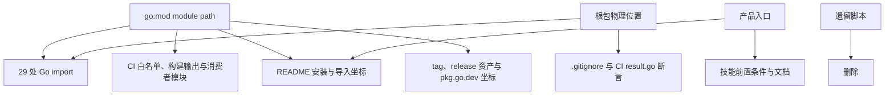
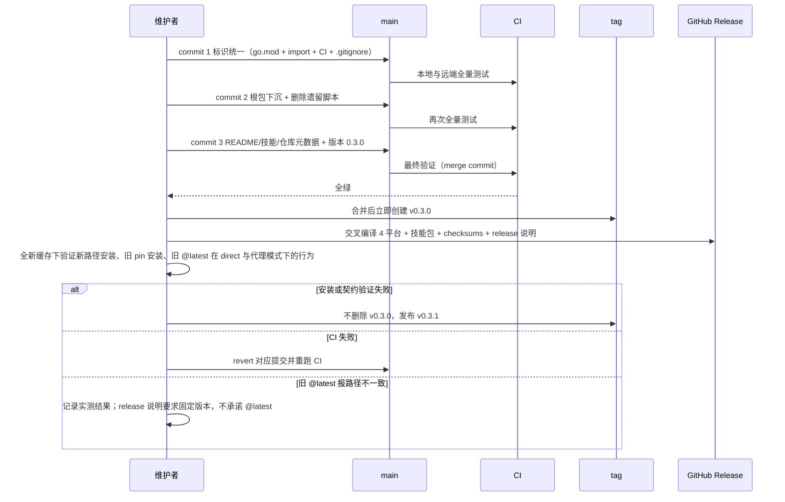

# MediaTitle 仓库更名与模块路径迁移技术方案

| 字段 | 内容 |
| --- | --- |
| 标题 | MediaTitle 仓库更名与模块路径迁移技术方案 |
| 主笔 | alang |
| 评审人 | alang；独立质量评审；独立架构评审（否决后修订） |
| 创建日期 | 2026-11-14 |
| 目标版本 | v0.3.0（media-title 技能保持 0.1.1） |
| 关联资源 | `go.mod`；`.gitignore`；`.github/workflows/ci.yml`；`README.md`；`skills/media-title/`；`scripts/mediadetect-title.sh` |

## 1. 背景与上下文

### 1.1 系统现状

本仓库是一个 Go module，`go.mod` 声明 `module github.com/dream-365/MediaDetect`，当前版本 v0.2.2。它对外提供根包 `mediadetect` 与 `parser`、`probe`、`tmdb`、`matcher` 四个领域包，内部包含 `internal/collect`、`internal/llm` 与 `cmd/mediadetect` CLI；同时托管 `skills/media-title` 智能体技能（技能版本 0.1.1）。核心链路是：技能扫描脚本以子进程调用 `mediadetect` CLI，CLI 完成只读探测、文件名解析与 TMDB 匹配，再把 JSON 结果交回技能生成计划。

发布侧现状：没有 release workflow，发布靠手工执行。v0.2.2 的 GitHub Release 包含 4 个平台二进制（darwin/linux × amd64/arm64）、`media-title-skill_v0.2.2.tar.gz` 与 `checksums.txt`，release 说明中的安装命令仍指向旧路径。仓库描述仍是「MediaDetect: stateless read-only media type detection library and CLI」，README 一级标题仍是 `# MediaDetect`。

2026-11-14，GitHub 仓库已从 `dream-365/MediaDetect` 重命名为 `dream-365/MediaTitle`，本地 `origin` 已指向新地址，旧名重定向可用；但 module path、29 处 Go import、README、CI 断言与脚本提示仍是旧名。仓库内共 28 个文件、71 行包含旧路径；5 个已发布 tag（v0.1.0–v0.2.2）的 `go.mod` 全部声明旧 module path；新路径在 pkg.go.dev 为 404，旧路径为 200。

根目录平铺 15 个 Go 文件（10 个实现 + 5 个测试）。`scripts/mediadetect-title.sh` 已被 SPEC-003 取代，在历史 Spec 之外没有活跃代码或测试引用；它首次添加于 `8fac466`，最近一次修改是 `c6cd6fa`。

### 1.2 核心技术痛点

**失败链一：新名字无法作为安装坐标。** 读者通过 `MediaTitle` 找到仓库 → README 首屏给出的第一条命令是 `go install github.com/dream-365/MediaDetect/cmd/mediadetect@...` → 读者若按仓库名替换路径，Go 因 `go.mod` 声明路径与请求路径不一致而拒绝 → 安装失败，或误判项目不可用。

**失败链二：旧 `@latest` 的行为不可控，取决于解析模式。** Go 代理对同仓库 tag 的归属并不一致：`GOPROXY=direct` 会选中最高 tag v0.3.0 → 拉取 `.mod` 后声明的是新路径 → 报 `module declares its path as ... but was required as ...`；部分标准代理（实测 goproxy.cn）仍把旧路径 `@latest` 解析到 v0.2.2。因此不能承诺旧 `@latest` 可用，文档必须要求固定版本。

**失败链三：现有 CI 与忽略规则会静默破坏迁移。** `.gitignore:2` 的 `/mediadetect` 同时匹配将要新建的 `mediadetect/` 目录，批量 `git add` 会漏掉整个包；`.github/workflows/ci.yml:32` 的 `go build ./cmd/mediadetect` 默认把二进制写到当前目录的 `mediadetect`，与同名目录冲突后直接失败。修订前的方案没有把这两项纳入检查。

**失败链四：产品入口与交付物错位。** 仓库首页、release 说明与安装示例都以 CLI 为第一入口，而实际产品入口是 `media-title` 技能；技能自身没有前置条件说明，`media_title.py` 默认在 `PATH` 中查找 `mediadetect`，缺失时才报错。

**证据。** 维护者判断：「工具应该被分装在里面，不应该直接暴露，MediaTitle 更像是一个产品功能，而不只是一个工具。」仓库事实：28 个文件 / 71 行旧名引用；`README.md:15` 首屏即 CLI 安装命令；`git check-ignore --no-index` 命中 `mediadetect/doc.go`；scratch 复制后执行 `go build ./cmd/mediadetect` 返回 `build output "mediadetect" already exists and is a directory`；发布后实测：旧 `@latest` 在 `GOPROXY=direct` 下解析到 v0.3.0 并报路径不一致，在 goproxy.cn 下仍解析到 v0.2.2。诚实记录：目前没有真实事故，也没有外部项目 `require` 旧路径。

### 1.3 重构/设计动机

触发点是产品身份变化，而不是技术债清理：项目从「一个 CLI 工具」变成「由技能交付的产品功能」，名称、安装坐标和第一入口都需要对齐。现在做的原因是迁移成本处于最低点——没有外部下游，旧 pin 版本不受影响，GitHub 重定向仍然有效；每推迟一个版本，需要同步的引用就多一批。

本次同时完成三件事：统一仓库与 module 标识、把根包从仓库根目录下沉、把产品入口收敛到技能。三项拆成独立提交；回滚按 3→2→1 逆序执行，commit 1 不能单独回退，因为它会与后续提交的 import 冲突。

### 1.4 非目标

不做的后果：新名字永远无法通过 `go install` / `require` 解析；README 与仓库名的错位长期存在；根目录继续平铺实现文件，产品入口继续指向 CLI；引用面随功能增长，迁移成本只升不降。

本次范围内不可突破的约束：

* **不改变行为**：媒体类型、匹配状态、JSON 字段、错误码、退出码与零写入语义保持 SPEC-001 / SPEC-004 的约定。
* **保留公开包边界**：`parser`、`probe`、`tmdb`、`matcher` 继续作为公开扩展 API，不移入 `internal/`（SPEC-002）。
* **保留 CLI 可安装能力**：本次只收敛文档入口，不把 `cmd/mediadetect` 移入 `internal/`。
* **修正迁移陷阱**：`.gitignore` 与 CI 构建输出必须在同一次迁移中修正，不能留给「以后」。
* **历史记录不改写**：`docs/specs/**` 与 `docs/quality/**` 中的旧路径作为当时事实保留。
* **SPEC-002 的边界**：SPEC-002 曾把「不改变 module path 与仓库名」列为那次整理的非目标，该结论只约束那次整理。本 Spec 显式取代它在标识层面的结论，但不修改 SPEC-002 的历史文本。
* **tag 不可撤销**：新 tag 只在校验全绿后创建；错误版本用后续补丁版本修正，不删除、不移动已有 tag。

## 2. 目标与非目标

### 2.1 目标

本次共 5 个 Goal，按架构/代码级与可靠性/运维级分类；本次不改变运行时路径，因此没有性能类目标。

- **G1 - 标识统一（架构/代码级）**：`go.mod`、全部 Go import、CI、README 与脚本提示统一使用 `github.com/dream-365/MediaTitle`。验收：`grep -rn "dream-365/MediaDetect" --exclude-dir=.git --exclude-dir=docs .` 返回 0 行；`go list ./...` 的 8 个包全部以新路径开头；`go build ./...`、`go vet ./...`、`go test ./...` 全部通过。
- **G2 - 目录收敛（架构/代码级）**：15 个根级 Go 文件移入 `mediadetect/`，仓库根不再有 `.go` 文件；删除无活跃引用的 `scripts/mediadetect-title.sh`。验收：`find . -maxdepth 1 -name '*.go'` 为空；`git check-ignore -q --no-index mediadetect/doc.go` 返回非 0；`go build -o "$(mktemp -d)/mediadetect" ./cmd/mediadetect` 成功；`go list ./...` 仍为 6 个公开包 + 2 个 internal 包；技能测试与 CI 全绿。
- **G3 - 产品入口收敛（工程效率级）**：README 首屏把 `media-title` 技能作为产品入口，CLI 与 Go 库标为「实现细节 / 扩展 API」；技能补充前置条件；仓库描述与 README 一级标题对齐 MediaTitle。验收：人工检查 README 首屏与目录结构；技能文档包含安装前置条件；`scripts/mediadetect-title.sh` 的引用只存在于历史 Spec。
- **G4 - 新路径可安装、旧 pin 版本可用、发布资产完整（可靠性/运维级）**：在迁移后的提交上发布 v0.3.0，并产出与 v0.2.2 同类的 release 资产。验收：`go install github.com/dream-365/MediaTitle/cmd/mediadetect@v0.3.0` 在全新 `GOMODCACHE` 下成功；`go install github.com/dream-365/MediaDetect/cmd/mediadetect@v0.2.2` 仍成功；旧路径 `@latest` 在 direct 与代理模式下的实测结果均被记录，且文档要求固定版本；4 个平台二进制、技能压缩包与 `checksums.txt` 齐备。
- **G5 - 契约不变（可靠性/运维级）**：JSON Schema 版本仍为 `"1"`，检测与匹配行为、错误码、退出码不变；技能版本保持 0.1.1。验收：既有 Go 测试与 `python3 -m unittest discover -s skills/media-title/tests` 全部通过；`--version` 的 `schema_version` 仍为 `"1"`。

### 2.2 非目标

- **NG1 - 行为与契约调整**：不修改检测规则、匹配阈值、JSON 字段、错误码或退出码（本次不做）。
- **NG2 - CLI 身份重命名**：不重命名二进制 `mediadetect`、`--version` 中的 `display_name` 与环境变量前缀 `MD_`（本次不做）。
- **NG3 - 公开包收缩**：不把 `parser`、`probe`、`tmdb`、`matcher` 移入 `internal/`（本次不做）。
- **NG4 - 历史文档改写**：不修改既有 Spec 与质量报告中的旧路径（本次不做）。
- **NG5 - 技能布局与版本调整**：不改变 `skills/media-title/` 的目录结构，不升级技能版本 0.1.1（本次不做）。
- **NG6 - 仓库迁移**：不新建仓库、不更换 GitHub owner（本次不做）。
- **NG7 - 旧路径维护窗口**：是否为旧 module path 保留维护版本，留待观察首个外部下游后再定（Deferred to Phase 2）。
- **NG8 - 旧路径 `@latest` 兼容**：不在同一仓库内同时维持新旧路径的 `@latest`（本次不做）；该能力无法通过 Go module 机制实现。

## 3. 架构设计与核心方案

### 3.1 总体架构

仓库目前没有 `docs/architecture/`。全局结构与包边界由 `depends_on` 中的 SPEC-002 第 3 章承载；本 Spec 只变更命名、物理布局、文档入口与发布流程，不重新定义包职责与运行时数据流。

本次变更的传播链路：

> 核心原则：模块标识只有一个来源（`go.mod`），其余位置都是它的投影；产品入口只有一个（技能），CLI 是实现细节。

### 3.2 核心模块职责

* **`mediadetect/`（新增目录）**：原根包，承载 `Detect`、`Options`、`Result`、错误与 JSON 契约；行为不变，只改变物理位置与导入路径（改造）。
* **`cmd/mediadetect`**：CLI 入口，继续可安装；文档地位从「产品入口」降为实现细节（不变 + 文档收敛）。
* **`parser` / `probe` / `tmdb` / `matcher`**：公开领域包，职责不变（不变）。
* **`internal/collect` / `internal/llm`**：内部实现，不变（不变）。
* **`skills/media-title`**：产品入口，目录与技能发现约定不变；补充前置条件并随全局命名更新引用（小改）。
* **`.gitignore` / CI**：忽略规则与构建输出必须与目录迁移同步修正（改造）。
* **发布资产**：4 个平台二进制、技能压缩包、`checksums.txt` 与 release 说明随 v0.3.0 重建（改造）。
* **`scripts/`**：删除已被技能取代的遗留脚本，目录随之消失（移除）。

### 3.3 核心数据流转

开发者或下游引入模块时，解析链为：仓库 URL → `go.mod` 声明的 module path → 目标版本的 tag → 包导入路径。本次迁移要求这四段在同一次发布中对齐，因此 tag 必须落在 `go.mod` 已改名的提交上，并且在合并后立即创建。

产品使用链保持不变：`skills/media-title` → `media_title.py` → 子进程调用 `mediadetect`（`MD_BIN` 可覆盖）→ JSON 结果回到技能。迁移只改变文档如何描述它，以及二进制从哪里安装。

发布链：main 全绿 → 合并 → 立即打 v0.3.0 → 交叉编译 4 个平台、打包技能、生成 checksums → 创建 GitHub Release → 24 小时观察。

### 3.4 关键选型与约束

* **单 module，不引入子 module**：技能是 Python，Go 侧没有独立发布单元；嵌套 module 只会增加 replace 与版本协调成本。
* **根包下沉，而非保留平铺**：仓库根只保留模块元数据与产品目录；包名仍为 `mediadetect`，符号不变。新目录与二进制同名，必须同时修正 `.gitignore` 与 CI 的 `-o` 输出。
* **文档入口收敛，而非把 CLI 内部化**：把 CLI 移入 `internal/` 会破坏 `go install` 与技能安装路径，超出本次范围。因此统一称 CLI 为「实现细节」，避免与 Go 的 `internal/` 语义混淆。
* **合并后立即打 tag**：tag 是发布闸门，不是发布后的观察结果；若等待 24 小时再打，README 会在这段时间里宣传一个不存在的版本。
* **旧 `@latest` 不作兼容承诺**：同一仓库的 tag 在不同解析模式下可能归属到不同路径，无法让新旧 `@latest` 同时可靠；发布说明要求固定版本，旧 pin 版本不受影响。
* **各方案的详细对比与取舍见第 7 章。**

## 4. 详细设计

### 4.1 标识映射

| 项目 | 迁移前 | 迁移后 |
| --- | --- | --- |
| Module path | `github.com/dream-365/MediaDetect` | `github.com/dream-365/MediaTitle` |
| Go 代理转义 | `!media!detect` | `!media!title`（大小写敏感） |
| 根包导入路径 | `github.com/dream-365/MediaDetect` | `github.com/dream-365/MediaTitle/mediadetect` |
| 领域包导入路径 | `.../MediaDetect/{parser,probe,tmdb,matcher}` | `.../MediaTitle/{parser,probe,tmdb,matcher}` |
| CLI 安装坐标 | `.../MediaDetect/cmd/mediadetect@v0.2.2` | `.../MediaTitle/cmd/mediadetect@v0.3.0` |
| 仓库 URL | `github.com/dream-365/MediaDetect` | `github.com/dream-365/MediaTitle` |
| Release 标题 | `MediaDetect + media-title v0.2.2` | `MediaTitle + media-title v0.3.0` |
| Release 资产 | 4 平台二进制 + 技能包 + checksums | 同名模式，版本改为 v0.3.0 |
| 仓库描述 | MediaDetect: stateless read-only ... | MediaTitle: skill-first media library organizer |
| README 一级标题 | `# MediaDetect` | `# MediaTitle` |
| 二进制名 | `mediadetect` | `mediadetect`（不变） |
| JSON `display_name` | `MediaDetect` | `MediaDetect`（不变） |
| CLI/模块版本 | `0.2.2` | `0.3.0` |
| 技能版本 | `0.1.1` | `0.1.1`（不变） |

### 4.2 目录契约

迁移后的仓库根：`go.mod`、`go.sum`、`README.md`、`LICENSE`、`CLAUDE.md`、`mediadetect/`、`matcher/`、`parser/`、`probe/`、`tmdb/`、`internal/`、`cmd/`、`skills/`、`docs/`、`.github/`。

约束：

* 仓库根不得出现 `*.go` 文件；`mediadetect/` 包含原包的全部 15 个文件（10 实现 + 5 测试）。
* `mediadetect/` 内保持原包名与文件划分，不借移动拆分或合并符号。
* `.gitignore` 必须保留「忽略根目录 `mediadetect` 二进制」的语义，同时放行 `mediadetect/` 目录。采用先忽略 `/mediadetect`、再用 `!/mediadetect/` 放行目录的顺序，并加一条 CI 断言防止回归。
* CI 的 `go build` 必须使用 `-o <临时路径或 bin/>`，不能依赖默认输出名。
* `scripts/` 目录在删除遗留脚本后不再存在；后续脚本放入其所属产品目录（技能相关放入 `skills/media-title/scripts/`）。
* `skills/media-title/` 的 `SKILL.md`、`scripts/`、`assets/`、`references/`、`tests/` 位置不变。

### 4.3 CI 断言调整

| 位置 | 现状 | 迁移后 |
| --- | --- | --- |
| `go build`（`ci.yml:32`） | `go build ./cmd/mediadetect`，输出到当前目录 | `go build -o "$RUNNER_TEMP/mediadetect" ./cmd/mediadetect` |
| 忽略规则 | `.gitignore` 的 `/mediadetect` 同时命中新目录 | 增加 `!/mediadetect/`，并断言 `git check-ignore -q --no-index mediadetect/doc.go` 为非 0 |
| 私有依赖白名单 | 排除 `github.com/dream-365/MediaDetect` | 排除 `github.com/dream-365/MediaTitle` |
| 公开/内部包计数 | 6 公开 + 2 internal | 数值不变，包路径随 `go list` 更新 |
| `result.go` 边界断言 | 检查根目录 `result.go` 的 import | 检查 `mediadetect/result.go`，排除新路径的 `probe` / `matcher` |
| 临时消费者模块 | `replace` / `require` 旧路径 | 改用新路径；`require` 使用不触发网络解析的占位版本 |
| 版本断言 | 期望 `0.2.2` | 期望 `0.3.0` |

### 4.4 产品入口与文档口径

* **README 首屏**：先说明 MediaTitle 是「由 `media-title` 技能交付的媒体库整理产品」，给出技能入口；CLI 与 Go 库移到后文，标注为实现细节与扩展 API。
* **安装命令**：技能入口写清 `mediadetect` 二进制的安装方式（新路径 + v0.3.0）；源码构建命令中的 clone 目录改为 `MediaTitle`。
* **路径大小写**：明确 module path 大小写敏感，代理转义为 `!media!title`；所有示例使用精确路径。
* **技能前置条件**：`SKILL.md` 增加 Prerequisites 段，说明需要 `mediadetect` 在 `PATH` 中或通过 `--md-bin` / `MD_BIN` 指定；说明兼容的 JSON Schema 版本为 `"1"`。
* **术语**：CLI 统一称为「实现细节（implementation detail）」，不使用「内部工具」，避免与 Go `internal/` 混淆。
* **仓库元数据**：更新 GitHub 仓库描述与 README 一级标题，与产品定位一致。
* **历史文档**：`docs/specs/**`、`docs/quality/**` 不改写。

### 4.5 核心流程与时序

### 4.6 异常与边界

| 场景 | 处理 |
| --- | --- |
| 批量移动后 `git status` 看不到新目录 | `.gitignore` 未修正；先改忽略规则，再执行移动，并用 `git check-ignore --no-index` 断言 |
| `go build ./cmd/mediadetect` 报输出已存在 | 使用 `-o` 指定输出；CI 与本地文档同步 |
| 改路径后 CI 报私有依赖 | 白名单与临时消费者模块的路径必须同批更新；以 `go list -deps` 输出为准逐条核对 |
| 新 tag 创建后发现安装失败 | 不删除、不移动 v0.3.0；修复后发布 v0.3.1，并在 changelog 记录 |
| tag 推送失败 | 不创建 Release、不对外宣布；修复后重推同一 tag。若短期无法修复，revert commit 3，使 README 回到 v0.2.2 的安装坐标 |
| 旧路径 `@latest` 报 path mismatch | `direct` 模式下的已知行为；代理模式可能仍解析到旧 pin。两种结果都记录，文档要求固定版本 |
| 需要恢复旧 `@latest` | 只能在旧路径发布高于 v0.3.0 的版本（如 v0.3.1），代价是新路径同时不可用；二者不能并存 |
| pkg.go.dev 尚未索引新路径 | 不作为阻塞条件；在 changelog 记录索引状态，索引后复查 |
| 技能测试因二进制缺失失败 | 属于本地环境问题；CI 通过 `MD_BIN` 注入，不修改测试语义 |

### 4.7 下游迁移说明

* 所有导入路径前缀变更：根包变为 `.../MediaTitle/mediadetect`，领域包变为 `.../MediaTitle/{parser,probe,tmdb,matcher}`。
* 不提供旧路径别名、转发 shim 或第二个 module；Go 没有等价的模块别名机制，跨仓库 shim 只会引入新的维护面。
* 旧 pin 版本（`@v0.2.2` 及更早）继续可用，因为那些 tag 的 `go.mod` 不可变。
* 旧路径 `@latest` 不作兼容承诺：`direct` 模式下会失败，部分代理仍解析到旧 pin；需要旧版本时固定 `@v0.2.2`。
* 二进制名、JSON 契约与环境变量前缀不变，v0.2.2 的技能仍可与新版 `mediadetect` 通信（Schema `"1"`）。

## 5. 非功能性需求

### 5.1 一致性与可验证性

* **引用一致性**：除 `docs/` 外，旧路径出现次数必须为 0；该断言可由 CI 或发布前脚本执行。
* **忽略规则**：`git check-ignore -q --no-index mediadetect/doc.go` 必须返回非 0，确保目录不会被忽略规则吞掉。
* **包数量稳定**：公开包 6 个、internal 包 2 个，与迁移前相同；根级 Go 文件数为 0。
* **性能不适用说明**：本次只改变源码位置、module path 与发布坐标，不触及探测、解析、匹配或网络路径，因此不设定延迟、吞吐或资源指标（不适用）。

### 5.2 兼容性

* **旧 pin 版本可安装**：已发布 tag 的 `go.mod` 不可变，v0.2.2 及更早版本在迁移后仍可安装；可用性依赖代理缓存或 GitHub 旧名重定向。
* **旧 `@latest` 不作兼容承诺**：tag 创建后实测，`GOPROXY=direct` 解析到 v0.3.0 并报路径不一致，goproxy.cn 仍解析到 v0.2.2；文档不得宣传旧 `@latest`，必须要求固定版本。
* **路径大小写**：module path 大小写敏感；代理转义为 `!media!title`，文档示例必须精确匹配。
* **契约稳定**：JSON Schema 版本、错误码、退出码与检测结果不变。

### 5.3 可观测性

* **发布记录**：`changelog.md` 记录 v0.3.0 的提交 SHA、CI run、tag SHA、验证命令与结果、pkg.go.dev 索引状态、旧 `@latest` 的实测错误。
* **tag 溯源**：tag 必须指向 `main` 上的提交，且该提交的 CI 已通过；记录 `git rev-parse v0.3.0^{commit}` 与 `git merge-base --is-ancestor` 的结果。
* **CI 覆盖**：macOS 与 Linux 两个矩阵全部通过，Go 测试与技能测试都不得跳过。

### 5.4 安全与依赖

* **无新增依赖**：迁移不引入新 module 依赖，`go mod tidy -diff` 为空。
* **无密钥变更**：不涉及 TMDB 密钥、GitHub secret 或权限调整。

### 5.5 发布完整性

* **资产齐全**：4 个平台二进制、技能压缩包与 `checksums.txt` 与 v0.2.2 保持一致；checksums 可由 `sha256sum -c` 校验。
* **说明一致**：release 说明包含新安装坐标、旧 `@latest` 不作兼容承诺并要求固定版本的提示，以及 JSON Schema `"1"` 的兼容说明。

## 6. 上线与迁移计划

### 6.1 发布与灰度

单 PR，三个独立提交，按顺序合并；使用 merge commit，不使用 squash，否则逆序回滚的前提失效。

合并前：

* 每个提交都在本地跑 `go build ./...`、`go vet ./...`、`go test ./...` 与技能测试。
* 远端 CI 必须在每个提交上通过；由于 Actions 按 push 运行，三个提交逐个推送，或确保最终合并前每个提交都有一次绿色运行。

合并后：

1. **立即创建 v0.3.0**，指向 `main` 的合并提交；推送后确认远端 tag 存在。tag 是发布闸门，不再等待 24 小时。
2. 交叉编译 4 个平台二进制，打包 `media-title-skill_v0.3.0.tar.gz`，生成 `checksums.txt`。
3. 创建 GitHub Release，说明中写明新路径与旧 `@latest` 的限制；在远端 tag 确认前不创建 Release、不对外宣布。
4. **tag 后 24 小时观察**：全新缓存安装、旧 pin 安装、旧 `@latest`、pkg.go.dev 索引、技能测试。

本仓库是源码 + release 资产发布，没有流量可灰度；两段式观察（合并前全绿 + tag 后 24 小时）就是本项目的灰度节奏。若仓库治理要求更严，需在实施前开启 `main` 保护规则并勾选必需检查；当前 `gh api .../rulesets` 为空，所有合并方式均可用。

### 6.2 数据迁移与兼容性

* **无数据迁移**：仓库无持久化数据，迁移只涉及源码、文档与发布坐标。
* **旧 tag 保持只读**：不修改、不删除、不重打 v0.1.0–v0.2.2。
* **单路径发布**：v0.3.0 起只使用新 module path，不为同一版本维护双路径。
* **旧 `@latest`**：行为取决于解析模式，不作兼容承诺；需要旧版本时固定 `@v0.2.2`。
* **旧路径窗口**：暂不承诺维护分支（NG7）；若出现外部下游，再评估补发旧路径维护版本。

### 6.3 上线验证与冒烟

发布前：

* `go build ./...`、`go vet ./...`、`go test ./...` 全部通过。
* `grep` 断言旧路径在非 `docs/` 范围为 0。
* `find . -maxdepth 1 -name '*.go'` 为空；`git check-ignore -q --no-index mediadetect/doc.go` 为非 0。
* `go build -o <临时路径> ./cmd/mediadetect` 成功。
* `python3 -m unittest discover -s skills/media-title/tests` 通过。
* 本地运行 `--version`，确认 `schema_version` 为 `"1"`、`version` 为 `0.3.0`。

发布后（tag 创建后 24 小时内）：

* 使用全新缓存：`GOBIN=$(mktemp -d) GOMODCACHE=$(mktemp -d) GOPROXY=https://proxy.golang.org go install github.com/dream-365/MediaTitle/cmd/mediadetect@v0.3.0` 成功；执行 `"$GOBIN/mediadetect" --version`，断言 `"version":"0.3.0"` 与 `"schema_version":"1"`。再用 `GOPROXY=direct` 重复一次。
* 旧 pin：`GOMODCACHE=$(mktemp -d) ... go install github.com/dream-365/MediaDetect/cmd/mediadetect@v0.2.2` 成功。
* 旧 `@latest`：记录解析到的版本与错误原文；预期为 v0.3.0 + 路径不一致。
* 新 `@latest`：记录是否已能解析到 v0.3.0，代理滞后不视为失败。
* 资产校验：下载 release 资产并执行 `sha256sum -c checksums.txt`。
* 检查 pkg.go.dev 新路径索引状态。

### 6.4 回滚与熔断

**触发条件（任一满足即回滚）：**

* 合并后 macOS 或 Linux CI 任一矩阵失败且 30 分钟内无法修复。
* v0.3.0 在新缓存下安装失败，或 `go list -m` 返回路径不一致（旧 `@latest` 在 `direct` 模式下的失败属已知行为，不算回归）。
* 技能测试套件失败，或 `--version` / JSON 契约发生变化。
* 发现公开包数量、公开 API 或行为与迁移前不一致。
* Release 资产上传失败或 checksums 校验失败：重新上传同一 tag 的资产即可；仅当二进制本身不可用时才进入 v0.3.1 流程。

**回滚步骤：**

1. 按 3→2→1 逆序回退对应提交（优先 `git revert`，保留历史）；commit 2 与 3 可单独回退，commit 1 必须连同后续提交一起回退。
2. 若已创建 v0.3.0 但验证失败：不删除、不移动 tag，修复后发布 v0.3.1，并把 README 与 release 说明中的安装坐标同步到实际发布的版本。
3. 若必须放弃新 module path：在一个 `go.mod` 仍声明旧路径的提交或分支上发布高于 v0.3.0 的版本（如 v0.3.1），恢复旧路径 `@latest`；这会让新路径 `@latest` 不可用。二者不能同时兼容，必须在 release 说明中写明当前生效的一侧。
4. 旧 pin 安装依赖代理缓存或 GitHub 重定向；`GOPROXY=direct` 下若重定向失效则不可用。回滚不承诺恢复旧 `@latest` 与旧路径同时可用。
5. 回滚后复查 GitHub 旧名重定向与 pkg.go.dev 旧路径索引，确认旧 pin 安装坐标仍可用。

## 7. 替代方案与权衡

### 7.1 Status Quo：只保留 GitHub 重命名

* **思路**：remote 已切换，旧 URL 由 GitHub 重定向，module path 与文档不动。
* **优点**：零代码改动，旧版本全部可用。
* **淘汰原因**：新名字永远不可作为安装坐标；每新增一个引用就加深错位。阈值是「第一次对外分享新仓库名」或「第一个新 tag」，两者都已临近。

### 7.2 只改文档与入口，保留旧 module path

* **思路**：README 与技能文档改用 MediaTitle 叙述，`go.mod` 不动。
* **优点**：不触碰编译与 CI，风险最低。
* **淘汰原因**：读者仍要在仓库名与安装路径之间换算；`go install .../MediaTitle/...` 依旧失败。属于把错位写进文档，而不是消除错位。

### 7.3 新建仓库替代重命名

* **思路**：新建 `MediaTitle` 仓库，复制代码并重新开始。
* **优点**：历史干净。
* **淘汰原因**：丢失 issue、tag、release 资产与提交历史；本次问题不来自历史污染，收益为零。

### 7.4 保留根包平铺，仅做更名

* **思路**：只改 module path 与文档，不移动根目录 15 个 Go 文件。
* **优点**：改动面小，公开导入路径只变前缀。
* **淘汰原因**：仓库元数据与实现文件继续混杂，且本次已确定要整理目录；合并做只多一次机械 import 更新，分两次做则要扫两遍。

### 7.5 把 CLI 与公开包收进 `internal/`

* **思路**：让工具完全不可见，只暴露技能。
* **优点**：产品边界最纯粹。
* **淘汰原因**：破坏 `go install`、技能安装路径与 SPEC-002 的公开 API 承诺；需要新的交付通道，超出本次范围（NG3）。

### 7.6 旧路径转发 shim

* **思路**：保留一个旧路径的薄 module，内部 import 新路径并转发符号。
* **优点**：旧导入路径理论上可继续使用。
* **淘汰原因**：Go 没有模块别名；需要第二个 module 或仓库，且每个导出符号都要手工转发。旧 `@latest` 的问题仍由同仓库 tag 归属决定，shim 无法修复。

### 7.7 权衡矩阵

| 维度 | 7.1 Status Quo | 7.2 只改文档 | 7.3 新仓库 | 7.4 只更名 | 7.5 内部化 | 7.6 shim | 本次方案 |
| --- | --- | --- | --- | --- | --- | --- | --- |
| 新名字可安装 | 否 | 否 | 是 | 是 | 是 | 是 | **是** |
| 改动成本 | 无 | 低 | 高 | 中 | 高 | 高 | 中 |
| 下游影响 | 无 | 无 | 高 | 中 | 高 | 中 | 中（无外部下游） |
| 回滚难度 | 无 | 低 | 高 | 低 | 中 | 高 | 低（三个独立提交） |
| 目录与产品定位 | 未解决 | 部分 | 部分 | 未解决 | 过度 | 未解决 | **是** |
| 旧 `@latest` 可并存 | 是 | 是 | 是 | 否 | 否 | 否 | 部分（取决于代理） |

## 附录 A：未决问题

* **Q1**：旧 module path 是否需要保留一个维护窗口（例如在 v0.3.x 期间补发旧路径构建）？当前依 NG7 推迟，等出现首个外部下游再评估。
* **Q2**：产品显示名与二进制名最终是否也改为 MediaTitle / `mediatitle`？本次依 NG2 保持不变；若改，需要单独的破坏性变更 Spec。
* **Q3**：旧路径 `@latest` 已实测：`GOPROXY=direct` 解析到 v0.3.0 并报路径不一致，goproxy.cn 仍解析到 v0.2.2；实测结果已记入 `changelog.md`。是否需要额外维护旧路径的固定版本入口，留待首个外部下游出现后再评估。
